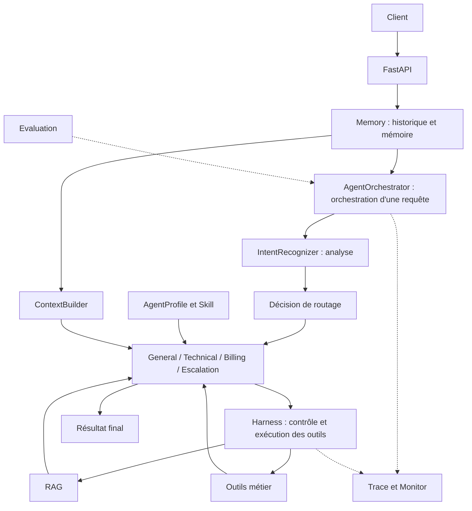
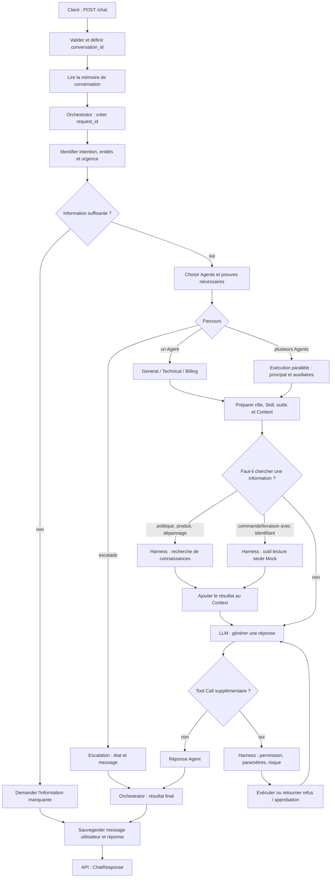

# Arclume — Conception du projet et chaîne complète

## 0. Plan du document

1. Ce qu'est Arclume : problème de support, capacités, limites et composants.
2. Le parcours général d'une requête : de `/chat` à la réponse, avec RAG, Memory, Tools et Trace.
3. Conception couche par couche : HTTP, Memory, intention, routage, Agents, Skill, Context, RAG, Harness, réponse, Monitor et Evaluation.
4. Exemples de demandes qui suivent des branches différentes.
5. Données et états : emplacement et cycle de vie.
6. Comment essayer le projet.
7. Résumé, preuves actuelles et prochaines étapes.

Les annexes indexent les fichiers/fonctions, les API/configurations/commandes et les termes.

## 1. Qu'est-ce qu'Arclume ?

### 1.1 Le problème traité

Arclume est un backend multi-Agent pour le support client. Une demande peut être un salut, une recherche de commande, une question de remboursement, une panne de connexion ou plusieurs problèmes à la fois. Le système doit comprendre la demande, choisir le responsable, décider quelles informations sont nécessaires, vérifier si une action est autorisée, puis produire une réponse compréhensible.

Exemples :

- « Hello » peut recevoir une réponse directe.
- « How long does a refund take? » demande une politique dans la base de connaissances.
- « I get a 401 error when logging in » demande un parcours technique.
- « I cannot log in and I was charged twice » peut demander Technical et Billing.
- « I want a human » doit suivre le parcours d'escalade.

L'idée centrale est donc une chaîne observable : **comprendre la demande, répartir les responsabilités, obtenir les informations, exécuter les outils et générer la réponse**.

### 1.2 Capacités actuelles

| Capacité | Rôle dans le projet |
| --- | --- |
| HTTP API | Reçoit, valide et retourne un résultat uniforme. |
| Reconnaissance d'intention | Identifie le type de problème, les entités, l'urgence et la confiance. |
| Routage Agent | Choisit Agent principal, Agent auxiliaire ou escalade. |
| Mémoire de conversation | Fournit historique, résumé et informations utilisateur. |
| RAG | Recherche des éléments utiles dans la base de connaissances. |
| Skill | Ajoute des règles métier maintenues par des humains pour un scénario. |
| Tool Call | Lit ou traite une information structurée et renvoie le résultat à l'Agent. |
| Harness | Vérifie permission et risque, exécute et enregistre le résultat. |
| Trace / Monitor | Enregistre le parcours ; observe succès, latence et erreurs. |
| Evaluation | Vérifie séparément intention, routage, retrieval et réponses. |

| Agent | Responsabilité principale |
| --- | --- |
| General Agent | Questions générales, commande, livraison, information manquante et certains fallbacks. |
| Technical Agent | Connexion, codes erreur, configuration et dépannage. |
| Billing Agent | Remboursement, facture et paiement. |
| Escalation Agent | Enregistre le besoin humain et produit un message de transfert. |

General, Technical et Billing partagent un même moteur d'exécution ; leurs différences viennent du profil, des règles métier et du périmètre d'outils. Escalation suit un chemin déterministe : il sauvegarde un état et produit un message structuré sans appeler le modèle.

### 1.3 Limites actuelles

Arclume est un prototype exécutable et extensible. Il cible les conversations et documents de connaissances en anglais. Il ne prétend pas que le découpage et le retrieval couvrent le chinois ou d'autres langues.

Les outils commande/livraison utilisent des données de démonstration. L'escalade enregistre un état et un message ; elle n'envoie pas la demande à un vrai centre de support.

Le Harness peut décider `allow`, `deny` ou `require_approval`. Mais `/chat` expose seulement la recherche de connaissances et des outils de démonstration en lecture seule. Il n'expose pas de remboursement réel, changement d'adresse ou annulation de commande, c'est-à-dire des actions qui modifient un dossier métier.

Ainsi, « nécessite une approbation » est pour l'instant une décision de politique, pas un workflow humain complet. Il reste à sauvegarder les tâches en attente, fournir une interface ou API d'approbation, reprendre l'action après accord et conserver un audit durable.

L'intention, le retrieval et l'évaluation existent, mais la taille et l'origine des données limitent les conclusions. Les résultats servent surtout à vérifier la chaîne, détecter les régressions et localiser les problèmes ; ils ne prédisent pas directement la qualité avec de vrais clients.

### 1.4 Répartition des composants

| Couche | Composants | Question traitée |
| --- | --- | --- |
| Interface | FastAPI, modèles de requête/réponse | Que reçoit-on et quel format retourne-t-on ? |
| Compréhension / orchestration | IntentRecognizer, AgentOrchestrator | Que veut l'utilisateur et qui traite ? |
| Exécution Agent | Agents, AgentProfile, ContextBuilder | Quelles règles et quelles informations guident cette réponse ? |
| Information / capacités | Memory, Skill, RAG, outils métier | Où trouver historique, règles, connaissances et résultat métier ? |
| Frontière d'exécution | Harness | Cet appel d'outil est-il autorisé, et quel résultat donne-t-il ? |
| Observation / validation | Trace, Monitor, Evaluation | Que s'est-il passé, le système fonctionne-t-il, quelle est sa qualité ? |



## 2. Parcours général d'une requête

Cette partie donne une vue d'ensemble. Une requête ne traverse pas forcément tous les modules : un salut peut aller directement au modèle, une question de connaissance peut utiliser RAG, une demande complexe peut appeler plusieurs Agents, et une demande humaine peut revenir plus tôt.

### 2.1 Vue globale

`/chat` est l'interface HTTP principale. Un client envoie `POST /chat` avec le message, un identifiant utilisateur et un identifiant de conversation. Le système lit le contenu déjà présent dans cette conversation, comprend le problème et choisit l'Agent responsable.

L'Agent prépare l'historique, son rôle et les règles métier. Si des connaissances ou un outil sont nécessaires, il récupère leur résultat. Pour plusieurs domaines, plusieurs Agents traitent chacun leur partie puis une réponse unique est produite. Enfin, le système sauvegarde le tour et la Trace, puis retourne le résultat.



La boucle d'outils a une limite de tours. Un échec Agent peut aussi déclencher un fallback ou un retour d'erreur.

### 2.2 Chaîne d'exécution principale

```text
requête utilisateur
→ POST /chat
→ valider et définir/générer conversation_id
→ lire Memory de la conversation
    - Redis : messages récents, résumé, AgentState
    - ChromaDB : résumés historiques pertinents, profil utilisateur
→ AgentOrchestrator crée request_id
→ IntentRecognizer analyse le message et le contexte récent
    - mots-clés et similarité n-gram avec des questions modèles
    - révision LLM possible si les preuves locales sont insuffisantes ou contradictoires
    - intention fine, scores de domaine, entités, urgence et besoin d'information
    - sous-tâches distinctes pour une demande composée
→ vérifier si l'information est suffisante
    - non : demander par exemple un numéro de commande ou le produit concerné,
      sauvegarder ce tour et retourner ChatResponse ; le prochain /chat reprend le même conversation_id
    - oui : produire RoutingDecision
→ choisir General, Technical, Billing, Escalation, ou un principal avec un ou plusieurs auxiliaires
→ préparer AgentProfile, Skills dynamiques, mémoire, profil, AgentState, entités, outils et Context initial
→ si le plan le demande, précharger knowledge_search ou un outil métier lecture seule via Harness et ajouter le résultat au Context
→ appeler le LLM
→ texte final, ou Tool Call supplémentaire contrôlé par Harness puis retour au LLM
→ obtenir une ou plusieurs réponses Agent, les fusionner si nécessaire
→ sauvegarder message utilisateur, réponse finale, mémoire de travail, état et mises à jour de profil
→ enregistrer intention, routage, retrieval, outils, Agents et mémoire dans Trace
→ retourner ChatResponse
```

Monitor ne produit pas une réponse utilisateur : il agrège en arrière-plan succès, latence, échecs et alertes des Agents et outils.

### 2.3 Chaîne RAG quand une connaissance est nécessaire

```text
demande de recherche de connaissances
→ réécriture de requête
    - mode recommandé : le LLM génère plusieurs requêtes sous différents angles
      tout en conservant produit, code erreur, numéro de commande et date
    - mode sans LLM : requête originale, version sans ponctuation et version de mots-clés triés ;
      ces variantes ne comprennent pas les synonymes et servent seulement à tester la chaîne sans coût LLM
→ Dense et BM25 en parallèle pour chaque requête
→ fusion RRF et déduplication entre requêtes
→ reranking : LLM optionnel ou classement local à faible coût
→ retourner les chunks Top-K
→ l'Agent répond avec ces éléments
```

### 2.4 Informations fournies par Memory

```text
Redis
  ├── messages récents
  ├── résumé de conversation
  └── état de traitement AgentState

ChromaDB
  ├── profil utilisateur réutilisable
  ├── mémoire épisodique : résumés historiques retrouvables
  └── base RAG : chunks de documents métier
```

La base RAG utilise aussi ChromaDB, mais elle contient des documents métier et non l'historique propre à l'utilisateur.

### 2.5 Appels d'outils via Harness

```text
Agent propose ToolCall
→ Harness vérifie existence, activation et permission de l'Agent
→ décide allow, deny ou require_approval
→ si allow, exécute l'outil
→ retourne ToolResult à l'Agent
→ l'Agent continue la réponse
```

`tools/` contient les capacités concrètes. `harness/` gère les contrôles, limites d'exécution et enregistrements. `/chat` expose seulement des outils bas risque ; l'outil de ticket à risque n'est pas dans son périmètre. Une politique d'approbation existe mais pas encore le workflow complet d'approbation humaine et de reprise.

### 2.6 Trace, Monitor et Evaluation

Chaque requête reçoit un `request_id`. La Trace peut enregistrer : intention/routage, début Agent, Skill/RAG/Tool utilisés, fin Agent, fusion et fin de requête. Les événements dépendent du parcours : demander une information manquante ou escalader ne produit pas la boucle modèle/outils normale.

Monitor agrège périodiquement les données d'exécution. Evaluation est une évaluation de qualité séparée : elle ne fait pas partie de chaque requête `/chat`.

## 3. Conception et implémentation couche par couche

Les sections suivantes détaillent comment intention et routage se partagent le travail, d'où vient la connaissance, pourquoi les outils ont une frontière de permission, et comment réponses et observations sont produites. Elles décrivent le comportement réellement supporté par le code ; les objectifs non connectés sont marqués comme tels.

### 3.1 Entrée HTTP et contrat de données

Arclume utilise FastAPI. L'implémentation principale est dans `api/main.py` et les structures HTTP sont dans `schemas/api.py`.

Au démarrage, `lifespan()` crée le client modèle, Memory, la base de connaissances, les Tools, le Harness, les Agents, l'Orchestrator, le Monitor et l'Evaluator. Ces objets sont stockés dans `app.state` et réutilisés par les requêtes. Ils sont libérés à l'arrêt. Si la mémoire longue ou la base de connaissances sont indisponibles, une partie du service peut se dégrader ; Redis reste nécessaire pour une vraie conversation. `/health` montre l'état des composants.

`POST /chat` est l'entrée métier principale. Le client fournit le message, `user_id` et `conversation_id`. Si `conversation_id` manque, l'API le crée. FastAPI valide d'abord le contenu avec `ChatRequest`.

```text
recevoir ChatRequest
→ définir conversation_id
→ lire Memory
→ appeler AgentOrchestrator.run()
→ recevoir le résultat interne
→ retourner ChatResponse
```

La couche HTTP ne reconnaît pas l'intention et ne choisit pas l'Agent. Elle transmet message et contexte à l'Orchestrator, puis convertit son résultat en réponse uniforme. `ChatResponse` contient le texte final, mais aussi l'intention, Agent principal/auxiliaires, raison de routage, état d'escalade et appels d'outils. Ces champs aident l'interface et le diagnostic.

Les autres endpoints concernent base de connaissances, Skills, Trace, Monitor et Evaluation. Leurs paramètres et formats sont décrits dans le guide de code.

### 3.2 Memory et état d'une requête

Arclume sépare mémoire de travail, mémoire longue et état de traitement. Elles n'ont pas le même cycle de vie.

| Type | Contenu | Rôle |
| --- | --- | --- |
| Mémoire de travail | Messages récents et résumé de la conversation | Comprendre ce qui vient d'être dit. |
| Mémoire longue | Résumés historiques et profil utilisateur | Retrouver plus tard une expérience ou préférence liée. |
| État de traitement | `AgentState` | Savoir où en est le dossier, qui le traite et si RAG ou une escalade est nécessaire. |

`AgentState` n'est pas l'état interne d'un seul Agent. C'est l'état global du dossier client actuel. Il garde intention, entités comme numéro de commande ou code erreur, Agents principal/auxiliaires, besoin de retrieval et besoin humain. Le système n'a donc pas besoin de deviner à chaque tour, à partir du texte libre, où en est le dossier. Si un message précédent disait « I want a human », AgentState peut indiquer directement si le dossier est déjà escaladé.

Le code actuel utilise surtout `active`, `escalated`, intention, entités et routage. Les champs `waiting_for_input`, `waiting_for_approval` et `resolved` sont réservés, mais les workflows complets de reprise après information utilisateur, approbation humaine ou résolution ne sont pas encore implémentés.

```text
Redis
  ├── messages récents
  ├── résumé courant
  └── AgentState : état du dossier client

ChromaDB
  ├── episodic memory : résumés historiques retrouvables par sens
  └── user profile : préférences et entités importantes
```

Redis conserve les données rapides et souvent mises à jour de la conversation ; la mémoire de travail et `AgentState` ont un TTL par défaut de 24 heures. ChromaDB conserve les données que l'on peut retrouver plus tard par sens.

| Contenu | Fichier |
| --- | --- |
| Messages récents, résumé et compression | `memory/conversation_memory.py` |
| Résumés historiques et profil utilisateur | `memory/long_term_memory.py` |
| Lecture/sauvegarde de l'état | `memory/state_store.py` |
| Champs de `AgentState` | `schemas/state.py` |

À la réception de `/chat`, `ConversationMemory` construit `memory_context` avec `user_id`, `conversation_id` et la question actuelle. Il contient les messages récents, le résumé, des résumés historiques pertinents, le profil et l'état courant. L'Agent lit ou crée ensuite `AgentState` avec `StateStore`.

```text
question actuelle + user_id + conversation_id
→ lire conversation récente et résumé
→ retrouver les résumés historiques pertinents
→ lire le profil utilisateur
→ lire AgentState
→ construire memory_context puis Context du tour
```

`ContextBuilder` ajoute les entités extraites, par exemple numéro de commande, suivi, montant, code erreur et date, ainsi que Skill, résultats RAG et résultats d'outils.

À la fin, l'Orchestrator sauvegarde une seule réponse finale, celle réellement vue par l'utilisateur. Une réponse fusionnée de plusieurs Agents, un fallback ou une demande d'information manquante sont donc enregistrés dans Redis comme texte final, et non comme brouillon d'un seul Agent. L'état du dossier est également mis à jour. Si la mémoire longue est disponible, le profil utilisateur est mis à jour ; un résumé historique n'est écrit qu'au moment d'une compression de conversation.

#### Comment le profil utilisateur est créé et stocké

Le profil est dans une collection ChromaDB séparée, `user_profile`. Elle est distincte de la base RAG et de la collection `episodic`. Chaque `user_id` stable correspond à un document ; son ID est un hash de `user_id`, afin de ne pas exposer directement l'identifiant brut comme ID ChromaDB. Le contenu est un JSON similaire à :

```json
{
  "user_id": "user-001",
  "entities": {"order_id": ["ORDER-123"], "error_code": ["401"]},
  "preferences": {"preferred_contact": "email"},
  "updated_at": "..."
}
```

Ce n'est pas la conversation entière enregistrée comme « profil ». Par défaut, le profil vient surtout des entités structurées extraites par `IntentRecognizer` : numéro de commande, suivi, montant, code erreur ou date.

```text
message utilisateur
→ IntentRecognizer extrait les entities
→ Orchestrator produit la réponse finale
→ ConversationMemory.update_profile(user_id, entities=analysis.entities)
→ LongTermMemory lit le profil existant
→ fusionne entities / preferences existantes et nouvelles
→ upsert dans la collection ChromaDB user_profile
```

Si `ARCLUME_MEMORY_LLM_ENABLED=true` est activé et que le LLM Memory est configuré, `ConversationMemory` peut aussi demander au modèle d'extraire seulement les `preferences` explicites et `entities` stables, au format JSON. Cette extraction est désactivée par défaut. En cas d'échec d'extraction ou de ChromaDB, le chat continue et ignore seulement cette mise à jour de profil.

Au tour suivant, `ConversationMemory.get_context()` lit directement le JSON par le même `user_id` et le met dans `user_profile` du Context. Ce n'est pas une recherche sémantique de profil : seuls les résumés `episodic` sont retrouvés par vecteurs avec la query actuelle ; le profil est une dernière version fusionnée, lue exactement par identifiant utilisateur.

Cette implémentation est légère : elle ne sépare pas encore clairement les entités temporaires d'un dossier et les préférences durables, et elle n'a ni confirmation utilisateur, ni suppression, ni résolution de conflit, ni expiration. Elle montre comment un profil structuré peut s'accumuler, mais ne doit pas être présenté comme une gouvernance mature des profils ou de la vie privée.

Quand trop de messages récents existent, `ConversationMemory` compresse les plus anciens :

```text
anciens messages
→ produire un résumé
→ conserver le résumé dans Redis
→ écrire dans ChromaDB episodic memory si disponible
→ ne garder que les derniers messages bruts dans Redis
```

Cela contrôle la longueur du Context tout en permettant de retrouver plus tard un historique pertinent. La base RAG utilise aussi ChromaDB, mais elle contient des chunks de documents métier, pas des résumés ou profils d'utilisateur. Son stockage et son retrieval sont expliqués en section 3.6.

### 3.3 Reconnaissance d'intention

La reconnaissance d'intention ne répond pas seulement à « quel Agent ? ». Elle décide aussi de quel type de preuve la réponse a besoin. L'implémentation est dans `core/intent_recognizer.py`. L'Orchestrator lui transmet le message anglais actuel et l'historique récent.

```text
message actuel + jusqu'à trois tours récents
→ normaliser texte et casse
→ trouver mots-clés et expressions métier, garder la preuve trouvée
→ comparer le message aux questions modèles avec n-grams de caractères 1/2/3
→ privilégier un sujet métier clair à how / what / please
→ décider si la preuve locale est suffisante
→ si ambigu et ARCLUME_INTENT_LLM_ENABLED=true : demander une révision LLM
→ extraire order_id, tracking_id, amount, error_code, date
→ estimer urgence et scores General / Technical / Billing
→ détecter les domaines indépendants et créer les subtasks
→ choisir information_need : none, knowledge, live_data, mixed ou action
→ retourner IntentResult
```

Le message actuel est l'objet principal de l'analyse locale. L'historique récent sert surtout à la révision LLM optionnelle. Un sujet unique clair utilise le résultat local. Plusieurs problèmes réellement indépendants restent plusieurs domaines, sans appeler automatiquement le LLM. Un sujet faible, des résultats proches ou des preuves contradictoires deviennent une ambiguïté.

#### Ce que donnent mots-clés et templates

Un `Pattern` est une table maintenue de mots et expressions métier. Par exemple `refund` ou `money back` indiquent un remboursement ; `charged twice` ou `payment failed`, le paiement ; `cannot log in` ou `401`, la connexion ; `my order`, `tracking` ou `delivery`, commande/livraison. `return` seul est une preuve plus faible, car son sens est ambigu.

`policy`, `how long`, `how to` et `introduce` ne sont pas des sujets métier Pattern. Ils servent à estimer le besoin d'information : politique, procédure, produit ou dépannage, et donc le besoin éventuel de RAG.

Les mots-clés sont rapides et explicables. Le système garde le mot exact dans `topic_evidence` pour la Trace et le diagnostic. Le score local additionne simplement les occurrences et reste inférieur à 1. Ce n'est pas une probabilité statistiquement calibrée. Les frontières de mot évitent par exemple que `hi` dans `shipping` soit lu comme un salut. Cette méthode reste sensible à l'écriture : `cannot signin` peut manquer `cannot sign in`.

Les templates complètent ce point. Chaque intention fine a des phrases typiques : `refund request`, `I want to request a refund`, `cannot log in` ou `I cannot sign in`. Le système coupe message et template en fragments continus de 1, 2 et 3 caractères, construit des vecteurs locaux, puis calcule leur similarité cosinus. Chaque intention garde son meilleur template et compare le premier au second.

Ainsi `I cannot sign in` et `I cannot signin` partagent beaucoup de petits fragments malgré l'espace manquant. `refund`, `refunding` et `refunded` partagent aussi des fragments. Ce n'est pas l'Embedding sémantique de ChromaDB : c'est une similarité de forme, rapide et sans API, mais elle ne comprend pas forcément que `I need my money back` est proche de `I want a refund`. Un vrai Embedding pourra être comparé plus tard sur des erreurs réelles ; il ne faut pas supposer qu'il est meilleur sans évaluation.

Les mots `what`, `how`, `?` et `please` indiquent seulement une question. Ils ne doivent pas masquer un thème précis. `What is your refund policy?` devient donc `refund`, pas `query`. Les templates servent surtout de candidat lorsqu'il n'existe pas de mot métier fiable. Les seuils actuels — score template au moins 0,75 et avance d'au moins 0,15 sur le deuxième — sont des seuils pratiques à évaluer davantage.

#### Quand une décision est ambiguë

Plusieurs mots-clés ne demandent pas automatiquement un LLM. Le système distingue plusieurs problèmes indépendants de mots présents par hasard. Dans `I cannot log in and I was charged twice`, les deux expressions appartiennent à Technical et Billing et sont deux segments reliés par `and`. Le système peut produire deux sous-tâches sans coût LLM.

Les ambiguïtés sont plutôt : seulement `return`, `account`, `payment`, `401` ou `500` ; aucun sujet métier fiable avec une demande d'aide ou les pronoms `it`, `that`, `this` dépendants du contexte ; ou Technical et Billing présents sans phrases indépendantes claires.

Avec `ARCLUME_INTENT_LLM_ENABLED=true`, seulement ces cas appellent le Chat LLM. Il voit le message, l'historique récent et les intentions autorisées, puis retourne intention, confiance et raison. Son résultat est fusionné avec les règles et templates. En cas d'échec, de format invalide ou de switch fermé, le système garde le résultat local. Le LLM ne décide pas l'autorisation d'un outil et n'approuve pas une opération à risque. Les poids de fusion sont des valeurs initiales d'ingénierie, non calibrées.

#### Comment `IntentResult` décide la suite

`IntentResult` est le résultat structuré transmis à l'Orchestrator. Il faut distinguer :

```text
intent : problème précis actuel
intent_group : grande famille métier de ce problème
Agent responsable : rôle finalement choisi pour le traiter
```

Une intention fine permet de distinguer remboursement, facture et double débit, même s'ils appartiennent à Billing. Elle aide ensuite à décider entre politique, état de paiement ou simple prochaine étape.

| Agent principal | `intent_group` | `intent` fin |
| --- | --- | --- |
| General | `greeting` | `greeting` |
| General | `feedback` | `feedback` |
| General | `complaint` | `complaint` |
| General | `query` | `query`, `order_status`, `logistics` |
| General | `request` | `request` |
| General | `other` | `other` |
| Technical | `technical` | `technical`, `technical_login`, `technical_crash` |
| Billing | `billing` | `billing`, `refund`, `invoice`, `payment_issue` |
| Billing | `account` | `account`, `account_security` |
| Escalation | `escalation` | `escalation`, `human_handoff` |

`account_security` appartient à `account`, mais Billing le traite actuellement car il n'existe pas encore d'Account Agent séparé.

| Champ | Sens et usage |
| --- | --- |
| `confidence` | Fiabilité heuristique de l'intention principale. Si le résultat est `other`, que le message contient un vrai contenu et que le score est faible, l'Orchestrator demande une information plus précise. Ce n'est pas une probabilité calibrée. |
| `matched_intents` | Autres intentions trouvées localement ; utile pour problème composé ou mot-clé erroné. |
| `topic_evidence` | Mots/expressions réellement trouvés ; utilisés dans Trace et diagnostic. |
| `domain_scores` | Force de preuve General, Technical et Billing ; aide à choisir principal et auxiliaire. |
| `entities` | Numéro de commande/suivi, montant, code erreur, date ; futurs paramètres d'outils lecture seule. |
| `urgency` | `low`, `medium`, `high`, `critical` ; `critical` peut escalader directement, `high` demande plus de prudence. |
| `ambiguity_reasons` | Pourquoi le local n'est pas fiable ; condition de la révision LLM optionnelle. |
| `supporting_domains` | Domaines avec un sous-problème réellement indépendant ; pas seulement un score élevé. |
| `subtasks` | Travail par domaine : la requête entière pour un sujet unique, ou les morceaux séparés pour une demande composée. |
| `information_need` | `none`, `knowledge`, `live_data`, `mixed`, `action` ; indique où trouver l'information nécessaire. |
| `should_use_rag` | Vrai seulement pour `knowledge` ou `mixed`. |
| `planned_tool_name` | Outil lecture seule prévu si l'intention et les paramètres sont présents, par exemple `order_query`. |

#### Comment les `subtasks` séparent une demande composée

Un `IntentSubtask` contient le domaine, le sous-message anglais, l'intention fine, les entités extraites, le besoin d'information, l'usage RAG et l'outil lecture seule éventuellement préchargé.

```text
I cannot log in and I was charged twice

Technical
→ query: I cannot log in
→ intent: technical_login
→ information_need: knowledge
→ should_use_rag: true

Billing
→ query: I was charged twice
→ intent: payment_issue
→ information_need: live_data
→ should_use_rag: false
```

Technical ne répond qu'à la connexion et Billing qu'au double débit. Plusieurs Agents parallèles ne répètent donc pas toute la phrase. Une requête à un seul domaine crée aussi un `subtask`, mais garde son texte complet.

#### Comment `information_need` choisit la source

`information_need` répond à « de quelle information a-t-on besoin avant de répondre ? », non à « quel Agent traite ? ».

```text
politique de remboursement, règles, dépannage
→ knowledge → knowledge_search

état actuel de commande ou livraison
→ live_data → outil lecture seule seulement si un identifiant existe

connaissance technique + donnée actuelle
→ mixed → retrieval et outil métier

salut, feedback, escalade humaine
→ none → pas de source externe

remboursement, changement d'adresse, annulation demandés
→ action → reconnaître l'action, sans exécuter automatiquement une écriture à risque
```

`What is your refund policy?` et `Has my refund arrived?` peuvent tous deux aller à Billing, mais le premier demande une politique et le second une donnée actuelle. Choisir le bon Agent ne signifie donc pas automatiquement utiliser RAG. `should_use_rag` vient seulement de `knowledge` ou `mixed`.

Les outils commande/livraison sont Mock et paiement/remboursement ne sont pas reliés à un backend réel. Même si `live_data` est correct, un résultat de démonstration ne doit jamais être présenté comme l'état réel du client. La section 3.4 utilise ensuite `domain_scores`, `supporting_domains` et `subtasks` pour choisir les Agents et leur donner exactement leur partie du message.

### 3.4 Routage et coopération des Agents

Après l'analyse d'intention, `AgentOrchestrator` décide qui traite la demande, si un autre Agent aide, et comment dégrader en cas d'erreur. Le code est dans `agents/agent_orchestrator.py`; les Agents sont dans `general_agent.py`, `technical_agent.py`, `billing_agent.py` et `escalation_agent.py`.

```text
IntentResult
→ enregistrer Trace intent_recognized
→ si l'information est insuffisante : demander un complément et terminer ce tour
→ sinon _make_decision() produit RoutingDecision
→ escalade directe, un Agent, ou principal + auxiliaires en parallèle
→ composer les résultats, gérer fallback/échec et signal d'escalade
→ construire OrchestratorResult et sauvegarder le résultat final
```

Une demande est considérée trop imprécise lorsque `intent == other`, que le message contient plus de deux caractères et que `confidence < 0.5`. Cela évite de traiter un `?` isolé comme une vraie demande. Le système ne sélectionne alors pas un Agent métier : il demande une information concrète, marque `primary_agent` comme `general`, sauvegarde le message et la réponse, puis attend le prochain `/chat` avec le même `conversation_id`.

Pour une demande suffisamment claire, `_make_decision()` applique les règles suivantes :

1. `human_handoff`, `escalation` ou urgence `critical` vont directement à Escalation. Cet Agent marque `escalated` et `needs_human`, puis retourne un message déterministe ; il ne lance pas la boucle modèle/outils des Agents métier.
2. `technical`, `technical_login`, `technical_crash` vont à Technical. `refund`, `invoice`, `payment_issue`, `billing`, `account` et `account_security` vont à Billing. Les autres demandes choisissent le domaine ayant le meilleur `domain_scores`.
3. Un domaine non principal devient auxiliaire seulement si son score est au moins `0.45`, au moins 55 % du score principal, et s'il est confirmé comme problème indépendant dans `supporting_domains`.

Cette dernière règle évite de faire participer Billing parce que le mot ambigu `return` est apparu. Une demande de remboursement seule va à Billing ; connexion + double débit peut aller à Technical + Billing. Une demande produit + connexion + double débit produit aujourd'hui de façon fiable Technical + Billing : General peut avoir une sous-tâche produit, mais il n'est pas encore automatiquement ajouté comme auxiliaire. C'est une limite connue du routage.

`RoutingDecision` contient `primary_agent`, `supporting_agents`, `reason`, `confidence` et `use_rag`. Un plan de lecture seule tel que `planned_tool_name` reste dans `IntentResult` et est utilisé ensuite, principalement par General ; RoutingDecision ne le recrée pas.

#### 3.4.1 Informations utilisées par le routage

| Information | Rôle dans le routage |
| --- | --- |
| `intent` | Mappe une intention claire vers un Agent. |
| `confidence` | Décide si l'analyse est assez fiable. |
| `urgency` | Décide une intervention humaine. |
| `domain_scores` | Indique les domaines métier présents. |
| `matched_intents` | Garde plusieurs intentions dans un message. |
| `supporting_domains` | Limite les domaines auxiliaires aux preuves indépendantes. |
| `subtasks` | Lie sous-message, domaine et besoin de preuve. |
| `information_need` | Distingue connaissance, donnée actuelle, action et absence de preuve externe. |
| `should_use_rag`, `planned_tool_name` | Prépare retrieval et, pour General avec identifiant, une lecture seule. |

Le routage utilise donc le résultat structuré existant, sans relancer une seconde classification par mots-clés. Les scores de domaine proviennent néanmoins des Pattern de l'étape précédente : la sélection auxiliaire n'est pas une compréhension sémantique indépendante des mots-clés.

#### 3.4.2 Information manquante et escalade directe

```text
intention imprécise
→ demander l'information nécessaire
→ ne pas exécuter d'Agent métier

demande humaine ou urgence critique
→ Escalation Agent
→ enregistrer l'escalade
→ retourner le message de transfert
```

Escalation est déterministe, sans boucle modèle/outils des Agents métier.

#### 3.4.3 Agent principal et Agent auxiliaire

| Champ de `RoutingDecision` | Rôle |
| --- | --- |
| `primary_agent` | Agent responsable principal. |
| `supporting_agents` | Agents qui ajoutent une réponse pour un domaine indépendant. |
| `reason` | Intention, scores de domaine et résultat du choix. |
| `confidence` | Confiance du routage. |
| `use_rag` | Indique qu'un Agent doit essayer de chercher des connaissances. |

Les intentions claires suivent la table fixe : connexion/code erreur/crash → Technical ; remboursement/facture/paiement → Billing ; demande générale/commande/livraison → General. Sinon, le score de domaine maximal devient Agent principal.

Après ce choix, les autres domaines sont vérifiés avec les seuils et avec les segments indépendants de `subtasks`. Le découpage utilise aujourd'hui virgule, point-virgule, ainsi que `and`, `also`, `plus` et `but`, puis les preuves de chaque segment. Cette méthode locale n'est pas un parseur sémantique général : noms de produit contenant un connecteur, phrase sans connecteur, négation ou segment indivisible à deux domaines peuvent être mal compris. Les cas ambigus peuvent être révisés par LLM ; il faudra une évaluation annotée de demandes composées.

Chaque sous-tâche recalcule son besoin d'information. Un Agent qui a besoin de RAG n'oblige donc pas tous les autres Agents à faire une recherche.

#### 3.4.4 Exécution à un ou plusieurs Agents

Sans auxiliaire :

```text
RoutingDecision → Primary Agent → AgentResponse
```

Avec auxiliaires, l'Orchestrator lance le principal et les auxiliaires en parallèle. Chaque Agent partage l'historique et le contexte de routage au niveau requête, mais reçoit seulement son sous-message. Sa sélection de Skill, sa query RAG et son besoin d'information utilisent cette sous-tâche. Le plan de lecture seule commande/livraison reste principalement disponible à General.

Par exemple :

```text
shipping time + introduce the mini desk lamp + refund process

General : shipping time + mini desk lamp
Billing : refund process
```

Les deux Agents cherchent et répondent uniquement à leur partie. Cela traite la cause des répétitions : ils ne reçoivent plus toute la demande composée. Dédupliquer seulement le texte final ne peut pas détecter deux réponses de formulation différente mais de même sens.

L'Agent principal sauvegarde `AgentState`. Les auxiliaires lisent le même contexte mais ne réécrivent pas l'état. L'Orchestrator écrit les messages de conversation une seule fois, après la réponse finale. Chaque `AgentResponse` contient texte, succès, durée, outils utilisés et éventuel signal d'escalade.

#### 3.4.5 Fusion des résultats multi-Agent

`ResponseComposer` dans `agents/response_composer.py` utilise du code déterministe, sans appel LLM : la réponse de l'Agent principal vient en premier ; les réponses auxiliaires réussies et différentes sont ajoutées comme information complémentaire.

Ce choix évite un appel modèle, une latence et un coût supplémentaires, et garde le principal en tête. Le composeur n'essaie pas de résoudre un conflit sémantique entre deux réponses. La protection principale contre les répétitions vient du découpage avant exécution ; une résolution de conflits plus avancée reste une amélioration future.

#### 3.4.6 Fallback et escalade après exécution

Si un Technical ou Billing unique échoue, l'Orchestrator essaie General comme fallback. Si General échoue aussi, il retourne un message d'échec uniforme. En cas d'erreur de configuration ou d'appel modèle, il essaie d'abord le fallback General ; l'API ne reçoit une erreur HTTP que si la cause finale reste une erreur de modèle.

En parallèle, un ou plusieurs succès suffisent pour composer une réponse. Si tous les Agents échouent, le système retourne le même message d'échec uniforme.

L'escalade peut aussi apparaître pendant l'exécution : outil métier en échec, besoin d'une permission backend ou décision humaine nécessaire. L'Orchestrator rassemble état, raison et source. `critical`, escalade directe ou signal Agent donnent `escalated = true`; une urgence `high` est actuellement aussi marquée après le traitement normal.

La Tool Policy peut retourner « approbation humaine requise », mais aucun outil d'écriture à risque n'est visible des Agents `/chat`. Il ne faut donc pas présenter ceci comme une branche d'approbation complète déjà active dans le chat.

Le routage accomplit finalement trois choses : choisir le responsable principal, décider une coopération inter-domaines, et décider s'il faut demander un complément, utiliser un fallback ou marquer une intervention humaine.

### 3.5 AgentProfile, Skill et Context

Après le choix d'un Agent, le système doit encore savoir ce que cet Agent fait, quelles règles métier il applique pendant ce tour, quelles informations le modèle voit et quels outils il peut utiliser.

```text
AgentProfile → responsabilités stables et frontières de capacité
Skill → règle métier ajoutée pour le scénario actuel
Context → informations temporaires de la requête actuelle
```

#### 3.5.1 `AgentProfile` : contrat du rôle

`AgentProfile` définit à la fois la façon de répondre et les actions autorisées. `agents/agent_profile.py` définit les champs possibles. Chaque valeur concrète est dans `profile = AgentProfile(...)` de `general_agent.py`, `technical_agent.py`, `billing_agent.py` ou `escalation_agent.py`. `CustomerServiceAgent` garde ce profil dans `self.profile` et l'utilise pendant l'appel modèle.

| Champ | Signification dans le code | Utilisation actuelle |
| --- | --- | --- |
| `role` | Nom lisible du rôle | Ajouté au Context modèle et aux informations de monitoring. |
| `mission` | Mission principale | Explique ce que le rôle doit résoudre. |
| `workflow` | Étapes recommandées | Prompt du modèle, pas un diagramme Python exécuté automatiquement. |
| `input_contract` | Informations normalement nécessaires | Indique au modèle de demander numéro de commande, code erreur ou heure si nécessaire ; aucun contrôle Python n'oblige encore tous les champs. |
| `output_contract` | Éléments attendus dans la réponse | Par exemple causes possibles et étapes de dépannage ; ce n'est pas un validateur automatique. |
| `handoff_conditions` | Cas à remettre à un humain | Règle de prompt ; l'escalade directe vient surtout de l'intention et de l'urgence dans l'Orchestrator. |
| `tool_scope` | Noms des outils autorisés | Vraie frontière : seuls ces Tool Schemas sont montrés au modèle et Harness les vérifie. |
| `model` | Modèle spécifique optionnel | Vide pour les Agents actuels ; ils utilisent le Chat model global. |
| `temperature` | Variabilité de sortie | Envoyée au LLM : Billing 0.0, Technical 0.1, General 0.3. |
| `max_tokens` | Longueur maximale d'une réponse | Envoyée directement au LLM. |

Pendant l'exécution, rôle, mission, workflow, contrats d'entrée/sortie et conditions de handoff deviennent des instructions modèle. `tool_scope` limite outils et permissions Harness ; `temperature` et `max_tokens` sont des paramètres réels du modèle.

#### 3.5.2 `Skill` : règle métier pour le scénario courant

Un Skill est un SOP métier écrit à la main en Markdown. Il explique ce qu'il faut vérifier, demander, ne pas promettre et comment présenter la prochaine étape. Le Skill remboursement, par exemple, distingue éligibilité, délai et statut ; il demande un numéro de commande lorsqu'une vérification est nécessaire ; sans résultat métier, il ne promet pas qu'un remboursement est terminé. Le Skill ne consulte aucune commande et ne modifie aucun remboursement.

Un Agent peut couvrir plusieurs scénarios. Les règles ne sont donc pas toutes figées dans son Prompt de base. Elles sont chargées seulement quand elles servent, depuis :

```text
skills/refund/SKILL.md
skills/logistics/SKILL.md
skills/technical/SKILL.md
skills/escalation/SKILL.md
```

Chaque fichier a des métadonnées (`name`, `agents`, `keywords`, `enabled`) qui décident s'il est utilisable, puis le texte : `Purpose`, `Workflow / Procedure`, `Safety rules`, `Response style`.

« Dynamique » signifie qu'un Skill n'est pas attaché définitivement à un Agent au démarrage. À chaque tour, le choix dépend de l'Agent sélectionné et de l'intention fine de sa sous-tâche.

```text
IntentRecognizer → intent + IntentSubtask
Orchestrator → nom du Skill candidat selon Agent + intent
CustomerServiceAgent → SkillLoader vérifie enabled et agents autorisés
→ charger SKILL.md, couper à la limite de taille, ajouter skill_instructions au Context
→ le modèle suit ces règles, demande une information ou propose un Tool Call
→ tout Tool Call reste contrôlé par Harness
```

Pour `I was charged twice. How do I request a refund?`, Billing reçoit l'intention `refund`; `refund` devient candidat. Si ce Skill est activé et autorise Billing, il entre dans le Context. L'expression `I need my money back` reçoit aussi ce SOP si l'intention en amont est déjà `refund`, même si ces mots ne sont pas dans les `keywords` du Skill. Un salut normal ne charge pas le Skill remboursement.

| Agent + intention fine | Skill candidat | Injection finale |
| --- | --- | --- |
| Technical + `technical`, `technical_login`, `technical_crash` | `technical` | Si activé et autorisé pour Technical. |
| Billing + `refund`, `payment_issue` | `refund` | Si activé et autorisé pour Billing. |
| General + `order_status`, `logistics` | `logistics` | Si activé et autorisé pour General. |
| Billing + `invoice` ou `billing` large | aucun | Aucun mauvais SOP remboursement ; seul le Profile Billing est utilisé. |
| Escalation | `escalation` candidat | Escalation est aujourd'hui déterministe et ne passe pas par cette injection modèle ; le fichier prépare une future extension. |

Les `keywords` de Skill ne renversent donc plus la décision d'intention déjà prise dans `/chat`. Ils servent encore à la découverte lorsqu'un Agent est appelé seul sans candidat Orchestrator, et pourront être complétés par une similarité Embedding.

#### Frontière entre Skill et Tool

```text
Skill
→ « demander le numéro de commande ; ne pas promettre un remboursement non vérifié »
→ instruction modèle, sans opération externe

Tool / Harness
→ recherche de politique ou consultation de commande avec numéro disponible
→ permission, paramètres et risque vérifiés avant toute exécution
```

`information_need`, les entités et le Tool Call modèle décident surtout de l'usage de données. Un Skill peut demander un numéro de commande, mais ne peut pas contourner Harness pour appeler `order_query`, ni effectuer une écriture telle qu'un remboursement ou un changement d'adresse.

Un Skill fait au plus 3 200 caractères et l'ensemble des Skills au plus 5 000 caractères. En cas d'échec de chargement, l'Agent garde son AgentProfile de base ; une règle optionnelle ne fait pas échouer la requête entière.

#### 3.5.3 `Context` : matériaux d'un appel modèle

`Context` est l'ensemble temporaire d'informations d'un appel modèle. Il est reconstruit à chaque requête et n'est pas sauvegardé comme mémoire indépendante. Sa structure est dans `schemas/context.py`, sa construction dans `core/context_builder.py`, et son appel dans `agents/customer_service_agent.py`.

| Information | Champ `Context` | Source et contenu |
| --- | --- | --- |
| Message actuel | `user_message` | Message réellement traité : original en mono-Agent, ou `IntentSubtask.query` en multi-Agent. |
| Conversation récente | `conversation_history` | `recent_messages` Redis, avec `role` et `content`. |
| Résumé courant | `memory_summary` | Résumé Redis des messages plus anciens. |
| Historique retrouvé | `episodic_memories` | Résumés de conversation pertinents retrouvés dans ChromaDB. |
| Profil utilisateur | `user_profile` | Préférences et entités structurées de ChromaDB. |
| État du dossier | `state` | `AgentState` lu dans Redis. |
| Instructions de base | `system_instructions` | `system_prompt` de base de l'Agent ; AgentProfile est rendu séparément après. |
| SOP du scénario | `skill_instructions` | Corps des SKILL.md sélectionnés, vide sans Skill. |
| Chunks de connaissance | `knowledge_results` | Résultat RAG préchargé via `knowledge_search`. |
| Analyse structurée | `metadata` | Intention, confiance, urgence, entités, Agents, raison, RAG, besoin d'information, `request_id`, etc. |
| Résultats d'outils | `tool_results` | Liste prévue de `ToolResult`; vide au Context initial, puis ajoutée comme messages Tool pendant la boucle. |

`ContextBuilder` organise ces données mais ne lit pas Redis, ne cherche pas ChromaDB, n'exécute pas RAG et n'appelle pas le modèle.

#### 3.5.4 Du Context aux messages LLM

Le modèle ne reçoit pas un JSON Context complet. Il reçoit différents messages : règles, état, analyse, Skills, mémoire, connaissances, historique et enfin la question actuelle.

| Matériau | Ce que le modèle voit |
| --- | --- |
| `system_instructions` | Règles générales, par exemple « répondre clairement, ne pas inventer de politique ». |
| `AgentProfile` | Rôle, mission, workflow, contrats et outils autorisés. |
| `state` | Message system JSON `[Current case state]`, distinct du texte de conversation. |
| `metadata` | Message system JSON `[Request analysis]` avec intention, entités et besoin d'information. |
| `skill_instructions` | Message system `[Active instructions]` seulement avec un Skill actif. |
| `memory_summary`, `episodic_memories`, `user_profile` | Messages system avec résumé, historique pertinent et profil ; le profil n'est pas un fait temps réel de commande/paiement. |
| `knowledge_results` | Message system `[Relevant knowledge]` avec chunks et sources. |
| `conversation_history` | Derniers messages bruts user/assistant. |
| `tool_results` | Après un Tool Call, message de rôle `tool` avec le résultat réel. |
| `user_message` | Dernier message de rôle user, ajouté après les matériaux précédents. |

Une requête normale ressemble donc à :

```text
system_prompt = instructions de base + AgentProfile
messages system = AgentState → analyse → Skill → mémoire/profil → connaissances
messages conversation = historique récent
dernier message user = sous-question réellement traitée
```

Les Tool Schemas ne sont pas ces messages : ils sont un paramètre séparé du modèle. Si le modèle propose un Tool Call, Harness l'exécute ou le refuse et le `ToolResult` est ajouté au tour modèle suivant.

Quand l'analyse demande des connaissances, l'Agent tente d'abord `knowledge_search` via Harness et place les chunks ou l'échec dans le Context initial. La boucle Tool Call peut toujours appeler d'autres outils autorisés, mais le Tool connaissance déjà préchargé n'est pas réexposé dans le même tour. AgentProfile, Skill et Context séparent ainsi rôle stable, règle métier dynamique et information ponctuelle.

### 3.6 RAG : des documents au retrieval en requête

Le RAG actuel vise les connaissances de support en anglais. Il permet l'entrée fiable du retrieval dans une chaîne multi-Agent : chunking de documents, retrieval hybride Dense + BM25, fusion RRF, déduplication entre queries, et réécriture/reranking LLM optionnels.

La base, les cas d'évaluation et les documents métier restent ceux d'une démonstration. Le projet ne présente donc pas les résultats comme une qualité de retrieval de production. Avec des documents réels, il faudra ajouter métadonnées métier, version de document, filtre de permission, stratégies retrieval/reranking plus fines, et évaluation par jeux annotés et Checker.

L'intention répond « cette demande peut-elle nécessiter une connaissance ? ». La base répond « quels documents sont pertinents ? ». Le résultat de recherche ne change pas l'intention ni l'Agent choisi. Tous les domaines sont aujourd'hui dans la collection ChromaDB `knowledge_base`, sans collection Technical/Billing séparée ni catégorie métier obligatoire par chunk.

```text
demande knowledge_search
→ réécriture de query
    - mode recommandé : LLM, plusieurs angles, conserver produit/code erreur/identifiant/date
    - mode de test sans LLM : query originale, sans ponctuation, mots triés ; pas de vraie compréhension sémantique
→ Dense + BM25 en parallèle pour chaque query
→ fusion RRF et déduplication entre queries
→ reranking : LLM optionnel ou classement local
→ chunks Top-K
→ Agent répond à partir des chunks
```

#### 3.6.1 Entrée des documents et chunking

Au premier démarrage avec une base vide, le système importe `data/demo_docs`. Des documents peuvent aussi être ajoutés par endpoint ou upload en `.md`, `.txt` ou `.json`. Le texte est nettoyé et JSON devient texte cherchable. Images, vidéo, OCR, versions et filtre d'autorisation par client ne sont pas encore dans cette chaîne.

Le chunking est conçu pour les documents de support anglais : il détecte titres Markdown et paragraphes séparés par des lignes vides, garde autant que possible un paragraphe complet dans la même section et fusionne les petits paragraphes. Seulement si un paragraphe est trop long, il coupe d'abord à une fin de phrase anglaise, puis à une frontière de mot.

Un chunk fait au plus 500 caractères par défaut (`CHROMA_CHUNK_SIZE`). Il garde le chemin de titre, tronqué si nécessaire. Deux chunks voisins de la même section partagent jusqu'à 50 caractères (`CHROMA_CHUNK_OVERLAP`), coupés de préférence à une frontière de mot. Deux sections différentes ne se chevauchent pas. `knowledge/knowledge_base.py` stocke titre, source, numéro/total de segment et un ID stable. Réimporter le même chunk le met à jour, mais modifier une source ne supprime pas automatiquement les anciens chunks. Un index existant ne se reconstruit pas automatiquement après modification du chunking : une procédure de nettoyage et réindexation est nécessaire avant une comparaison sérieuse.

#### 3.6.2 Embedding, Dense et BM25

```text
chunk document
├── ChromaDB : document + Dense vector retrieval
└── BM25 en mémoire du processus : index mots-clés des mêmes chunks
```

Le projet n'a pas de service Embedding séparé et ne fixe pas d'`embedding_function` personnalisée. Avec `chromadb==0.5.23`, la fonction par défaut utilise `all-MiniLM-L6-v2`; ChromaDB vectorise à l'écriture et lors de `query_texts`. Ce n'est pas un modèle métier choisi après benchmark. Un changement explicite doit fixer la version et recalculer les vecteurs existants. Le n-gram de `_template_match()` pour les intentions est une autre représentation, sans rapport avec cet Embedding.

Dense aide lorsque les mots de l'utilisateur diffèrent du document. BM25 aide pour code erreur, numéro de commande et nom produit exacts. BM25 est reconstruit depuis les chunks ChromaDB et reste en mémoire : il faut le recharger après redémarrage et le rafraîchir après import. Le corpus cible est anglais ; un fallback de tokenisation ne prouve pas une qualité multilingue. Les fichiers principaux sont `knowledge/knowledge_base.py` et `knowledge/bm25_index.py`.

#### 3.6.3 Quand RAG est appelé

`IntentRecognizer` choisit `information_need`: politique/procédure/dépannage → `knowledge`; état commande/livraison → `live_data`; demande mixte → `mixed`. `should_use_rag` vient de ce besoin, pas d'une liste fixe d'intentions.

Quand `use_rag=true`, l'Agent précharge `knowledge_search` via Harness avant le premier appel modèle. Les résultats entrent dans le Context et le Tool préchargé n'est pas reproposé au modèle dans le même tour. Le modèle peut encore demander d'autres outils autorisés. Si la base est vide ou indisponible, le modèle reçoit l'absence de preuve vérifiée et ne doit pas inventer une politique.

```text
besoin knowledge
→ Agent / Harness tente knowledge_search
→ résultat : chunks dans Context puis modèle
→ vide ou erreur : absence explicite de preuve puis modèle
```

Prévoir RAG, exécuter le Tool, et obtenir un chunk utile sont donc trois faits différents. Il faut regarder séparément `tools_used`, Tool Trace et résultats de recherche.

#### 3.6.4 Réécriture, retrieval hybride et RRF

`ToolManager` garde toujours la question originale et produit quelques variantes. Avec `ARCLUME_RAG_LLM_ENABLED=true`, le Chat LLM crée au plus trois queries sous différents angles et conserve entités clés. Par exemple, `how long does a refund take` peut donner questions sur éligibilité, délai de revue et délai de paiement.

Sans ce switch, le système renvoie seulement l'original, une version sans ponctuation et des mots triés. Ce ne sont pas des reformulations sémantiques. Elles servent à limiter les Tokens, permettre la chaîne sans clé modèle et tester Dense/BM25/RRF ; elles ne prouvent aucune qualité de query rewrite. Si le LLM échoue, renvoie un JSON invalide ou aucune variante valable, le système reprend l'original et ces variantes locales afin que la recherche ne s'arrête pas.

Chaque variante lance Dense et BM25 en parallèle. Dans chaque variante, RRF fusionne les classements ; les candidats de toutes les variantes sont ensuite dédupliqués par `chunk_id`.

```text
query originale + variantes
→ Dense ChromaDB et BM25 en parallèle
→ RRF par variante
→ déduplication entre variantes
```

Dense distance et score BM25 ont des échelles différentes. RRF utilise seulement le rang : un chunk bien classé dans plusieurs branches gagne plus. La forme est `1 / (k + rang)` avec `k=60` par défaut. Si une branche échoue, l'autre est conservée autant que possible et le résultat est marqué dégradé. `knowledge/hybrid_retriever.py` gère le hybride/RRF ; `tools/tool_manager.py` gère réécriture et déduplication.

#### 3.6.5 Reranking

Le retrieval cherche largement ; la réponse finale a besoin de peu de chunks qui répondent vraiment. Après fusion/déduplication, le système rerank puis envoie Top-K à l'Agent afin de limiter bruit et longueur de Context.

Par défaut, le classement local combine score RRF et chevauchement lexical entre query originale et chunk, sans Token supplémentaire. Avec `ARCLUME_RAG_LLM_ENABLED=true`, le système peut envoyer question originale et chunks numérotés au Chat model configuré dans `LLM_MODEL`, recevoir des scores de pertinence et les trier. En cas d'échec, il revient au classement local. Le modèle configuré actuellement est `gemini-3.5-flash-lite`; il suit la configuration et n'est pas un reranker spécialisé. Query rewrite et reranking LLM partagent ce switch et sont désactivés par défaut.

Il n'y a pas de Cross-Encoder ni de BGE Reranker déployé. RRF fusionne des récupérations ; classement local et Chat LLM rerank les candidats après fusion. Si l'évaluation montre que le bon chunk est récupéré mais rate souvent Top-K, un Cross-Encoder anglais pourra être comparé avec métriques retrieval, qualité réponse, latence et coût.

Top-K n'est pas optimisé expérimentalement : le préchargement `/chat` demande trois résultats par défaut, tandis que la recherche indépendante accepte `top_k`. Il faudra comparer Top-1/3/5, avec et sans reranking LLM, sur les mêmes questions anglaises annotées, puis vérifier récupération, rang et soutien réel de la réponse. Le petit jeu actuel ne prouve pas que le reranking LLM est meilleur que le classement local.

#### 3.6.6 Résultats, preuves et échecs

Un résultat contient contenu de chunk, source et information de rang. Dans `/chat`, les chunks sont préchargés puis placés dans Context ; d'autres Tool Calls arrivent ensuite comme messages Tool. La base ne génère jamais elle-même la réponse : l'Agent la formule.

Les politiques doivent venir de documents métier valides. Les Prompts demandent d'utiliser les preuves fournies et d'éviter de prétendre qu'une commande, un remboursement ou une opération backend est terminé sans ToolResult. Mais il n'existe pas encore de citation obligatoire ni de vérification phrase par phrase de fidélité aux sources. Une connaissance vide, obsolète ou contradictoire demande toujours une revue humaine.

Un échec de variante ou de branche conserve les autres résultats si possible. Un échec LLM revient au local. Un échec retrieval total retourne un résultat vide et dégradé ; l'Agent ne doit pas inventer de fait métier. Les cas RAG actuels sont peu nombreux et basés sur la démo : ils vérifient la chaîne et aident à localiser les erreurs, sans prouver le comportement d'une grande base ou du trafic réel.

### 3.7 Tools et Harness : capacité et frontière d'exécution

Un Tool réalise une capacité concrète ; Harness est la couche de contrôle obligatoire pour chaque Tool Call. Agent ou modèle peuvent demander un Tool, mais ne peuvent pas exécuter une fonction Python arbitraire.

#### 3.7.1 Tools présents et gestion par Harness

| Usage | Tool | Limite actuelle |
| --- | --- | --- |
| Connaissance métier | `knowledge_search` | Recherche politique, produit et dépannage ; ne génère pas la réponse finale. |
| Support général | `suggest_required_fields`, `inspect_request_context` | Aident à voir information manquante ou contexte structuré non sensible. |
| Support technique | `lookup_error_code`, `build_diagnostic_plan` | Expliquent codes fréquents et étapes de diagnostic à faible risque. |
| Facturation | `check_billing_fields`, `compare_amounts` | Vérifient champs et montants fournis ; aucun accès paiement réel. |
| Commande/livraison | `order_query`, `logistics_query` | Seulement données Mock, jamais des dossiers réels. |
| Préparation handoff | `create_handoff_summary` | Produit un résumé, pas un ticket réel. |
| Action à risque démo | `ticket_create` | Demande approbation ; pas de système ticket réel ni visibilité Agent actuelle. |

Harness reçoit un `ToolCall` structuré : `call_id`, `tool_name`, `arguments`, `requested_by`, plus AgentState, Context et `allowed_tools`. Chaque Tool enregistré a un `ToolDefinition` : nom, schéma de paramètres, fonction Python, niveau de risque, timeout, retries, Agents autorisés, activation, cache/fallback/reranking optionnels. Harness compare la requête avec ces règles : le modèle ne décide pas seul s'il peut exécuter.

| Partie Harness | Entrée | Action | Fichier |
| --- | --- | --- | --- |
| `ToolPolicy` | Outil, activation, `allowed_tools`, Agents autorisés, Agent actif, risque | `allow`, `deny` ou `require_approval`; sans exécution ni LLM | `harness/policy.py` |
| `ToolExecutor` | ToolCall autorisé, schéma, timeout, retries | Valide paramètres, appelle la fonction, gère timeout/retry, normalise `ToolResult` | `harness/executor.py` |
| `HarnessRuntime` | ToolCall, état, Context, périmètre | Relie Policy, Executor et Trace ; stoppe avant fonction sur refus/approbation | `harness/runtime.py` |
| `TraceRecorder` | IDs, Agent, Tool, résultat, durée, erreur | Sauvegarde événements structurés pour Trace, Monitor et diagnostic | `harness/trace.py` |

La Policy est déterministe : outil absent ou désactivé → refus ; hors `tool_scope` / `allowed_tools` → refus ; hors liste d'Agents du Tool → refus ; après ces vérifications, Tool à haut risque → approbation requise ; sinon Tool bas risque → autorisé. `active_agent` confirme le rôle réellement en charge ; sans état, `requested_by` est utilisé.

Un Tool Call peut venir du plan avant le modèle ou du modèle pendant sa réponse. Si l'intention a déjà défini une preuve nécessaire, l'Agent précharge via Harness `knowledge_search` ou une lecture seule commande/livraison avec identifiant, place le résultat dans Context, puis appelle le modèle. Sinon, le modèle retourne un Tool Call pour un Tool restant dans son périmètre. Les Tools préchargés sont retirés des schémas de ce tour pour éviter les doublons ; avec `use_rag=false`, `knowledge_search` n'est pas montré. Dans tous les cas, un Tool Schema permet seulement de demander : il ne contourne pas Harness.

#### 3.7.2 Exécution d'un Tool Call

```text
Agent précharge selon plan, ou modèle propose ToolCall(nom + paramètres)
→ Harness enregistre la demande
→ ToolPolicy compare ToolCall, AgentState/allowed_tools et ToolDefinition
→ deny : retourner la raison
→ require_approval : retourner résultat en attente, sans fonction
→ allow : ToolExecutor valide et exécute
    - timeout, retry, cache, circuit breaker et fallback selon Tool
→ ToolResult uniforme + Trace
→ Agent renvoie le résultat au modèle pour continuer
```

Chaque Agent limite le nombre de tours de Tool Call afin qu'un modèle ne demande pas indéfiniment des outils. Pour les interfaces compatibles Gemini 3 OpenAI, `core/llm_utils.py` conserve et `customer_service_agent.py` renvoie les champs requis tels que `extra_content.google.thought_signature`. Ce n'est ni un paramètre métier ni une donnée à sauvegarder en Memory ; c'est un détail de compatibilité protocolaire. Les modèles sans ce champ ne sont pas affectés.

`knowledge_search` est bas risque : une panne de base donne un résultat vide avec information de dégradation. `order_query` et `logistics_query` retournent une démo et ne prouvent jamais une connexion à un système réel.

#### 3.7.3 Opérations à risque : état actuel

Pour un Tool à haut risque, Policy retourne « approbation humaine requise » et n'exécute rien. `ticket_create` est enregistré pour la démonstration, mais il n'est connecté à aucun système de ticket réel et n'appartient à aucun `tool_scope` d'Agent. Une requête `/chat` normale ne peut donc ni l'exécuter ni demander ce workflow complet. La décision peut être testée par un appel Harness isolé.

Un Agent peut afficher une invitation à l'escalade, et la Policy peut bloquer une opération, mais cela ne signifie ni « ticket créé » ni « remboursement exécuté ».

Un vrai workflow devra sauvegarder opération et paramètres comme enregistrement récupérable, montrer la demande à une personne autorisée, vérifier son accord, reprendre avec le même operation ID, et gérer expiration, double approbation et audit. Ce n'est pas une capacité actuelle de `/chat`.

Les Tools ne sont pas exposés comme serveur MCP et aucun Tool MCP externe n'est intégré. Les capacités sont enregistrées dans le processus Arclume et appelées par Harness, ce qui simplifie définition, permission, Trace et test à cette taille. Plus tard, MCP pourra être étudié pour services métier indépendants, Tools tiers ou découverte commune. MCP règle un protocole d'intégration ; il ne remplace jamais permission, risque, timeout, audit ou approbation de Harness.

### 3.8 De l'entrée modèle à la réponse finale

Après routage, choix de Skill, lecture de Memory et préparation des preuves, cette section répond à trois questions : que voit le modèle, que produit chaque Agent, et comment le client reçoit-il le résultat final ? La construction détaillée de chaque champ Context est en 3.5.

#### 3.8.1 Ce qu'un Agent reçoit et produit

L'entrée d'un Agent métier est `respond()` dans `agents/customer_service_agent.py`. Il demande à `core/context_builder.py` de transformer les matériaux du tour en messages modèle, puis appelle le Chat model compatible OpenAI via `LLMClient`. La question actuelle est toujours ajoutée à la fin ; le reste contraint et complète la réponse.

```text
System prompt
→ règles générales
→ AgentProfile : rôle, mission, outils autorisés
→ Skill actif éventuel
→ pour une demande composée : limite « traiter seulement cette sous-tâche »
→ limites sur preuves absentes, données Mock et actions interdites

messages history / system / tool
→ AgentState, intention, entités, urgence, routage
→ résumé, mémoire historique, profil utilisateur
→ chunks de connaissance déjà trouvés
→ ToolResult déjà obtenu dans le tour
→ conversation récente

dernier message user
→ mono-Agent : message original
→ multi-Agent : seule la sous-question anglaise de cet Agent
```

Pour `I cannot log in and I was charged twice.`, Technical reçoit le sous-problème connexion et Billing le sous-problème double débit. Ils ont leurs propres règles, Skill, connaissances et Tools ; deux modèles ne répondent donc pas deux fois à toute la phrase.

Le modèle peut retourner du texte directement, ou demander un Tool encore autorisé dans la Tool Call Loop. Le résultat outil devient ensuite un message `tool` pour le modèle. À la fin, un Agent métier retourne `AgentResponse` :

| Champ | Sens |
| --- | --- |
| `agent_type` | Domaine ayant produit le résultat, par exemple `technical` ou `billing`. |
| `content` | Texte final de cet Agent. |
| `success`, `error`, `latency_ms` | Succès, cause d'échec et durée. |
| `escalated`, `escalation_reason`, `escalation_source` | Besoin humain détecté pendant l'exécution, raison et origine. |
| `tools_used`, `tool_traces` | Tools réellement utilisés et leurs traces. |

Escalation est l'exception : il produit un message déterministe d'escalade, sans boucle modèle/outils métier ni création d'un ticket réel.

#### 3.8.2 Fusion d'un ou plusieurs résultats Agent

Avec un seul Agent, `AgentResponse.content` est déjà le texte final. Pour une demande composée, `AgentOrchestrator` attend en parallèle principal et auxiliaires. Chaque Agent a déjà traité son propre `IntentSubtask`. Puis `ResponseComposer.compose()` dans `agents/response_composer.py` réalise une concaténation déterministe, sans nouvel appel LLM.

```text
réponse Agent principal
→ en premier

réponse auxiliaire réussie et non vide
→ si exactement identique au principal : ignorer
→ sinon ajouter : Additional information:
→ chaîne finale
```

La forme est donc :

```text
[réponse complète de l'Agent principal]

Additional information:

[réponse complète du premier auxiliaire]
```

Ce n'est pas un résumé LLM. Le composeur ne réécrit pas le ton, ne résout pas les conflits factuels et ne déduplique que deux chaînes exactement identiques. Il évite coût et latence supplémentaires, mais une répétition de sens ou une transition maladroite reste possible. La meilleure protection actuelle est la séparation des sous-tâches avant exécution. Un Answer Composer contrôlé pourra être comparé plus tard sur des évaluations suffisantes.

Si un Agent spécifique échoue, l'Orchestrator essaie General en fallback. En multi-Agent, au moins un succès suffit à composer les résultats réussis ; tous les échecs donnent un message unique d'échec. Une erreur modèle peut encore devenir une erreur API si aucun fallback ne réussit.

#### 3.8.3 Sauvegarde et retour de la réponse finale

Après réponse mono-Agent, fusion, fallback ou demande d'information manquante, l'Orchestrator possède un seul texte externe final. Il écrit une fois le message utilisateur et cette réponse Assistant dans Redis, met à jour l'`AgentState`, puis essaie de mettre à jour le profil si la mémoire longue est disponible. Au prochain tour avec le même `conversation_id`, le système lit donc la réponse réellement vue, pas le brouillon du principal. Les deux écritures Redis ne sont pas une transaction inter-messages : un échec intermédiaire reste une limite à améliorer.

```text
un ou plusieurs AgentResponse
→ Orchestrator : texte final
→ écrire user message + assistant message final
→ rassembler routage, escalade et Tools dans OrchestratorResult
→ api/main.py : ChatResponse
```

| Usage | Champs `ChatResponse` |
| --- | --- |
| Continuer le dialogue | `message`, `conversation_id`, `model` |
| Lire les décisions | `intent`, `intent_group`, `primary_agent`, `supporting_agents`, `routing_reason`, `routing_confidence`, `escalated` |
| Diagnostiquer | `request_id`, `tools_used`, `tool_traces` |

`use_rag=true` ne prouve pas que `knowledge_search` a été exécuté ni qu'un chunk utile a été trouvé. Planifier le retrieval, appeler le Tool et obtenir une preuve sont trois faits distincts. Le code principal est `run()` et `_persist_final_turn()` dans `agent_orchestrator.py`, puis `chat()` dans `api/main.py`.

### 3.9 Trace, Monitor et Evaluation

Ils produisent tous des données, mais ne répondent pas à la même question.

| Nom | Objet | Moment | Question |
| --- | --- | --- | --- |
| Trace | Une requête `/chat` précise | Pendant son exécution | Quelles étapes ont vraiment eu lieu, où a eu lieu l'échec ? |
| Monitor | Statistiques accumulées Agents/Tools | Collecte périodique en arrière-plan | Quel Agent ou Tool devient lent ou échoue davantage ? |
| Evaluation | Cas de test avec résultat attendu | Commande ou API déclenchée séparément | Quelle est la qualité du versionnement actuel sur des cas fixes ? |

#### 3.9.1 Trace : reconstruire une requête

`harness/trace.py` contient Trace. Orchestrator, Agent ou Harness écrivent un `TraceEvent` pour les étapes importantes. `request_id`, non un simple log texte, relie tous les événements d'une même requête.

| Champ `TraceEvent` | Sens |
| --- | --- |
| `event_id`, `event_type`, `timestamp` | Identifiant, type et heure de l'événement. |
| `request_id`, `conversation_id` | Requête et conversation liées. |
| `agent_name` | Agent concerné, sinon vide. |
| `call_id`, `tool_name` | Appel Tool concerné, sinon vide. |
| `data` | Détails selon le type : intention, raison de routage, durée, nombre de résultats ou erreur. |

Les types actuels couvrent début/fin/échec de requête, intention, routage, Skill, fin RAG, début/fin Agent, fusion, Memory, réception/Policy/exécution/fin Runtime des Tools. Cela permet de distinguer « Billing non sélectionné », « Billing sélectionné mais retrieval absent », « retrieval en erreur » et « modèle faux malgré les preuves ».

`TraceRecorder` est aujourd'hui une liste en mémoire du processus, limitée par défaut à 10 000 événements. Les plus anciens sont supprimés au-delà de la limite et un redémarrage efface tout. C'est un outil de démonstration et diagnostic, pas un audit durable. `GET /traces/{request_id}` montre la chaîne ; `GET /trace/tool/{request_id}` filtre les événements Tool.

#### 3.9.2 Monitor et Prometheus

`monitor/performance_monitor.py` implémente Monitor. Toutes les 10 secondes par défaut, `PerformanceMonitor` lit les statistiques mémoire de `AgentOrchestrator.get_stats()` et `ToolManager.get_stats()` ; il ne fait pas d'appel modèle supplémentaire pour chaque `/chat`.

```text
AgentOrchestrator
→ total, success, success_rate, average_ms, monitor_penalty par Agent

ToolManager
→ total, success, failed, success_rate, avg_latency_ms,
  consecutive_failures, cache_hits, fallback_count, état circuit par Tool

PerformanceMonitor
→ seuils et anomalies
→ alerts et suggestions en mémoire
→ routing penalty limité
→ /monitor JSON et /metrics Prometheus
```

Seuils actuels : succès Agent < 90 %, succès Tool < 95 %, moyenne Agent > 3 000 ms, moyenne Tool > 5 000 ms. Trois échecs Tool successifs proposent de vérifier dépendance, Trace, timeout ou fallback. Alertes et suggestions restent en mémoire ; la pénalité de routage est un retour limité, pas une réparation automatique.

`GET /monitor` retourne un JSON pour humain ou frontend : état Monitor, dernière collecte, statistiques, alertes et suggestions. `GET /metrics` retourne les mêmes familles de valeurs comme texte Prometheus.

Prometheus n'est pas le composant qui décide les alertes dans Arclume. C'est un système externe qui stocke des métriques numériques dans le temps et offre des requêtes.

```text
AgentOrchestrator / ToolManager
→ PerformanceMonitor organise les statistiques
→ prometheus-client Python expose /metrics
→ Prometheus Server scrape /metrics périodiquement
→ stocke une série temporelle et permet des requêtes historiques
→ Grafana peut éventuellement dessiner un dashboard
```

Le code contient les trois premières étapes. Docker Compose fournit aussi Prometheus Server, nécessaire pour le stockage historique et l'interface de requêtes ; Grafana n'est pas fourni. `prometheus-client` est la dépendance Python qui convertit les données internes au format lisible par Prometheus. Prometheus Server est un autre processus/conteneur qui collecte et conserve l'historique.

Exemples de métriques :

```text
arclume_agent_success_rate{agent="billing"}
arclume_agent_latency_ms{agent="billing"}
arclume_tool_success_rate{tool="knowledge_search"}
arclume_requests_total
```

Prometheus Server n'est pas nécessaire pour lire l'état courant : `/monitor`, `/metrics` et l'interface FastAPI `/docs` suffisent. Ils n'offrent pas de courbe historique ni de PromQL. Pour le serveur fourni :

```bash
docker compose up -d api redis chromadb prometheus
```

Puis ouvrir `http://127.0.0.1:9090/targets`, vérifier `arclume-api` à `UP`, et rechercher `arclume_agent_success_rate`, `arclume_agent_latency_ms` ou `arclume_tool_success_rate`. `config/prometheus.yml` scrape `api:8000/metrics` toutes les 10 secondes dans le réseau Compose. Sans Docker, Prometheus peut être installé localement avec cible `127.0.0.1:8000`, non `api:8000`. `PROMETHEUS_PORT` peut ouvrir un port de métriques Python supplémentaire ; il n'active pas stockage historique ni interface Prometheus.

Sans `prometheus-client`, le projet donne encore des métriques texte de base, mais `prometheus_available` vaut `false`. Il n'existe pas encore de dashboard Grafana, de solution persistante complète ni de boucle de notification production.

#### 3.9.3 Evaluation : vérifier séparément la qualité

Evaluation exécute des cas fixes pour voir l'évolution d'une version ; elle ne note pas automatiquement chaque `/chat`. Elle sépare intention, routage, retrieval et réponse au lieu de juger seulement un texte fluide.

| Niveau | État actuel |
| --- | --- |
| Intention et routage principal simplifié | Exécutés. `evaluation/data/intent_cases_500.json` contient 500 messages anglais synthétiques générés par LLM avec labels attendus. `python -m evaluation` utilise règles locales, mots-clés et templates n-gram sans Chat LLM réel. |
| RAG retrieval | 18 queries de démonstration, chunks pertinents annotés et calculs Recall@K, Precision@K, MRR, nDCG ; aucun score actuel fiable enregistré. |
| Réponse end-to-end | `/eval/run` et LLM-as-a-Judge optionnel existent ; aucune baseline de réponses anglaises de modèle, confirmée par humain, n'existe. |

Au 2026-10-04, le classifieur local obtient sur ces 500 cas synthétiques : Accuracy intention 92,2 % (461/500) ; Accuracy du routage principal déterministe simplifié 96,6 % (483/500). Cela décrit seulement une régression de règles locales sur ce jeu synthétique. Cela ne représente ni la précision utilisateur réelle, ni tout le système Agent, ni RAG, ni la qualité finale de réponse.

LLM-as-a-Judge peut noter quatre dimensions : **relevance** (répondre à la question), **accuracy** (faits corrects), **completeness** (informations essentielles non oubliées) et **helpfulness** (l'utilisateur peut poursuivre son action). Il n'a pas encore de résultat fiable ; une note de remplacement quand Judge est absent ou en erreur ne doit jamais devenir une conclusion de qualité.

Un `baseline` n'est pas un corrigé officiel. C'est un rapport JSON plus ancien, obtenu avec mêmes données et configuration, comparé seulement si `--baseline` est fourni. Il n'existe pas encore de seuil officiel validé par humain.

La suite doit d'abord créer un jeu anglais de support relu par un humain. Ensuite seulement, Ragas, TruLens ou des outils similaires pourront aider à mesurer pertinence retrieval, fidélité aux preuves et correction des Tool Calls. Pour données, métriques, commandes, limites et plan détaillé, voir le [protocole d'évaluation chinois](../zh/evaluation_protocol_zh.md).

## 4. Observer les branches avec des requêtes concrètes

Les exemples suivants montrent seulement la différence avec la chaîne principale du chapitre 2. La formulation finale dépend du modèle et des preuves réellement obtenues.

### 4.1 Conversation simple : `Hello!`

L'intention est un salut, routé vers General. Aucune connaissance métier ni donnée temps réel n'est nécessaire : RAG et Tools métier sont ignorés, Context est construit puis le modèle répond. La réponse finale est écrite dans la mémoire de conversation. La branche importante est « pas de besoin de preuve », non « chaque message doit chercher avant de répondre ».

### 4.2 Politique : `What is your refund policy?`

Même si c'est une question générale, `refund` est une preuve Billing précise. Le système choisit Billing et `knowledge`. Avant génération, l'Agent tente `knowledge_search` via Harness et place les chunks de politique dans Context. Si la recherche est vide ou échoue, le modèle ne peut pas présenter sa connaissance générale comme une politique vérifiée. Il faut regarder non seulement `use_rag=true`, mais aussi si Tool Trace montre l'exécution réelle et ses résultats.

### 4.3 Demande composée : livraison, produit et remboursement

Exemple : `How long does shipping take, can you introduce the Mini Desk Lamp, and how can I get a refund?`

`shipping` et `refund` donnent deux domaines indépendants, General et Billing ; l'introduction produit reste General. Deux tâches sont créées : General traite délai livraison + produit, Billing traite procédure de remboursement. Chaque Agent décide son retrieval à partir de sa sous-question, puis les réponses parallèles sont composées. Le texte fusionné final — pas un brouillon — entre dans la mémoire.

`I cannot log in and I was charged twice.` fonctionne de la même façon avec Technical pour la connexion et Billing pour le double débit. Multi-Agent ne démarre pas seulement parce que deux scores sont proches, et le système ne réutilise pas un modèle pour vérifier les conflits factuels de la fusion. Sans segments indépendants confirmés, il ne donne pas toute la phrase à plusieurs Agents.

### 4.4 Escalade humaine et opération à risque

`Please connect me to a human agent.` va au message déterministe d'Escalation, sans boucle modèle des Agents métier. Cela signifie « intervention humaine nécessaire », pas « vrai ticket créé ».

Un Tool jugé à risque peut recevoir « approbation requise » de Harness et être bloqué. Mais `/chat` n'a pas encore de workflow complet de reprise après approbation humaine. Ces deux chemins ne doivent pas être confondus.

## 5. Données et états : emplacement et cycle de vie

Les chapitres précédents expliquent Memory, RAG, Context et Trace. Ici, deux questions pratiques : où les données sont-elles physiquement stockées, et restent-elles après la requête ou le redémarrage ?

| Donnée | Emplacement | Lecture / écriture | Cycle de vie et limite |
| --- | --- | --- | --- |
| Conversation récente, résumé, `AgentState` | Redis | Lu au début de `/chat`, écrit après réponse finale et état | TTL par défaut 24 h ; lisible après redémarrage API tant que Redis conserve les données. |
| Résumés historiques | Collection ChromaDB `episodic` | Retrieval sémantique pour la query ; écrit lors de compression | Ne disparaît pas à la fin d'une requête ; dépend du volume persistant et de la maintenance ChromaDB. |
| Profil utilisateur | Collection ChromaDB `user_profile` | Lu exactement par `user_id` au début ; fusionné à la fin | Dernier JSON par utilisateur ; pas encore d'expiration, suppression ni confirmation utilisateur. |
| Chunks RAG | Collection connaissance ChromaDB + index BM25 en mémoire | Recherche si preuve connaissance nécessaire ; écrit/importé puis BM25 rafraîchi | ChromaDB peut persister ; BM25 existe seulement dans le processus API et se reconstruit au redémarrage. |
| `Context` du tour | Mémoire Python locale de la requête FastAPI | Assemblé avant appel modèle | Ni Redis, ni ChromaDB, ni fichier ; disparaît à la fin. C'est un paquet de matériaux pour le modèle, pas une base. |
| Trace | Liste `TraceRecorder._events` du processus FastAPI | Ajout pendant exécution, lecture par `request_id` | 10 000 événements par défaut ; perdu après redémarrage, changement de worker ou dépassement de capacité ; pas un audit persistant. |
| Statistiques / alertes Monitor | Mémoire de `PerformanceMonitor` dans le processus | Collecte périodique des statistiques Agent/Tool | Perdues au redémarrage ; seules les valeurs scrapées par Prometheus Server deviennent une série temporelle indépendante. |

Une requête lit donc les matériaux sauvegardés dans Redis et ChromaDB, construit temporairement Context en mémoire, exécute les Agents, écrit le dialogue final et l'état dans Redis, et met à jour le profil ChromaDB si nécessaire. Trace et Monitor enregistrent en parallèle l'exécution. Le point important : Context et Trace sont tous deux en mémoire, mais Context appartient à une seule requête ; Trace est un buffer d'événements limité pour tout le processus API.

## 6. Comment tester le projet soi-même

Cette section n’est pas un guide complet de démarrage. Pour les variables d’environnement, Docker et le lancement du frontend, voir [README_zh.md](README_zh.md). Pour les commandes de test et d’évaluation, voir [Système d’évaluation et méthodes d’exécution](evaluation_protocol_zh.md).

L’objectif ici est simplement de lancer le projet et d’envoyer quelques messages en anglais pour observer le chemin suivi par le système.

Après avoir lancé l’API, vous pouvez discuter avec le système depuis l’interface web. Vous pouvez aussi ouvrir `http://127.0.0.1:8000/docs` et utiliser `POST /chat` pour envoyer un message.

Pour chaque réponse, il est utile de conserver :

- `conversation_id` pour continuer la même conversation ;
- `request_id` pour consulter les détails de cette exécution.

| Fonction à tester | Exemple de message en anglais | Ce qu’il faut observer |
| --- | --- | --- |
| Conversation simple | `Hello, I need help.` | `primary_agent` est généralement `general`. Le système ne devrait pas lancer de recherche dans la Knowledge Base sans raison. |
| Réponse avec Knowledge Base | `What is your refund policy?` | Le système devrait suivre le chemin Billing. Vérifier si `knowledge_search` apparaît dans `tools_used` et `tool_traces`. Des documents de démonstration doivent déjà être chargés dans la base locale. |
| Collaboration multi-Agent | `I cannot log in and I was charged twice.` | Vérifier si `primary_agent` et `supporting_agents` couvrent Technical et Billing. La réponse finale devrait traiter les deux problèmes. |
| Escalation humaine | `Please connect me to a human agent.` | Vérifier `escalated=true` et la raison de l’escalation. Cela signifie seulement que le système demande une intervention humaine. Aucun vrai ticket n’est créé. |

Après avoir reçu la réponse de `/chat`, vous pouvez ouvrir `GET /traces/{request_id}` pour voir les événements liés à l’Intent, au routing, aux Skills, aux Agents et aux Tools.

Si vous voulez seulement voir les appels de Tools, utilisez `GET /trace/tool/{request_id}`.

Lors de l’analyse d’une requête RAG, il faut distinguer quatre étapes :

- le système a-t-il prévu d’utiliser RAG ?
- `knowledge_search` a-t-il réellement été exécuté ?
- la recherche a-t-elle retourné des passages utiles ?
- le modèle a-t-il correctement utilisé ces informations ?

Ce sont quatre questions différentes.

Si le résultat n’est pas correct, vous pouvez suivre la chaîne d’exécution.

Si le mauvais Agent est sélectionné, vérifiez d’abord l’Intent et le routing Trace.

Si l’Agent est correct mais qu’aucune recherche n’est lancée, vérifiez `information_need` et la Tool Policy.

Si la recherche ne retourne aucun résultat, vérifiez la Knowledge Base et BM25.

Si les documents sont trouvés mais que la réponse reste incorrecte, vérifiez ensuite le Context et la sortie du modèle.

Pour une description plus détaillée des fichiers et du debugging, voir [Guide de structure et d’implémentation](code_guide_zh.md).

## 7. État actuel, résultats et prochaines étapes

Arclume est actuellement un prototype backend fonctionnel pour des scénarios de service client en anglais.

L’objectif n’est pas simplement de laisser un modèle discuter librement avec l’utilisateur. Le système décompose une requête client en plusieurs étapes observables : comprendre la demande, décider quel Agent doit la traiter, récupérer si nécessaire des connaissances ou des données métier, contrôler les appels de Tools, organiser la réponse d’un ou plusieurs Agents, puis enregistrer la conversation et les informations d’exécution.

### Fonctionnalités déjà implémentées et démontrables

- endpoint FastAPI `/chat`, working memory avec Redis, long-term memory avec ChromaDB et Knowledge Base en anglais ;
- détection locale des Intents avec keywords et templates n-gram, avec vérification optionnelle par LLM ;
- quatre chemins principaux : General, Technical, Billing et Escalation, avec collaboration conditionnelle entre `primary_agent` et `supporting_agents` ;
- découpage des documents anglais, Hybrid Search avec Dense Retrieval + BM25, fusion avec RRF, déduplication et ranking local ; Query Rewriting et Reranking par LLM sont configurables ;
- Tool registration, contrôle des permissions par Agent, validation des paramètres, timeout, retry, cache, fallback, circuit breaker et détection des opérations à haut risque nécessitant une approbation ;
- génération d’une réponse finale unique, multi-Agent Trace, Monitor de base et exposition de métriques Prometheus.

### Ce que les validations actuelles permettent de conclure

Le projet passe actuellement 69 unit tests et 9 exemples locaux de smoke tests.

Sur 500 exemples synthétiques en anglais générés par LLM, le système local de classification d’Intent obtient une Accuracy de 92,2 %.

Le routing principal simplifié et déterministe obtient une Accuracy de 96,6 %.

Ces résultats montrent que les règles actuelles et le mapping de routing fonctionnent de manière stable **sur le même ensemble d’exemples synthétiques utilisé pour la régression**.

Ces chiffres ne mesurent pas les performances d’un vrai Chat LLM, du full Orchestrator, de la collaboration multi-Agent, du RAG ou de la qualité de la réponse finale.

Ils ne doivent donc pas être présentés comme l’Accuracy réelle du service client ou du système Agent complet.

Pour le RAG, 18 requêtes de démonstration sont déjà préparées. L’évaluation end-to-end avec `/eval/run` et un LLM Judge optionnel sont également disponibles.

Cependant, il n’existe pas encore de score de retrieval suffisamment fiable ni de baseline de réponses réelles validée manuellement.

La conclusion correcte est donc : **le pipeline est implémenté et l’interface d’évaluation est prête**, mais les performances complètes du système ne sont pas encore validées.

### Fonctionnalités qui ne doivent pas encore être considérées comme des capacités métier réelles

| Fonction | Limite actuelle |
| --- | --- |
| Statut de commande, livraison et facturation | Les commandes et livraisons utilisent des Mock Data. Les paiements et remboursements ne sont pas connectés à un vrai backend métier. |
| Write Operations et approbation humaine | Le Harness peut bloquer ou signaler un Tool à haut risque, mais il n’existe pas encore de boucle complète pour effectuer un vrai remboursement, modifier une adresse, annuler une commande, obtenir une validation humaine puis reprendre l’exécution. |
| Transfert vers un humain | Le système enregistre seulement l’état d’escalation et renvoie un message. Il ne crée pas de vrai ticket et ne connecte pas l’utilisateur à un agent humain. |
| Profil utilisateur et Long-Term Memory | Le stockage structuré existe, mais il n’existe pas encore de système complet pour confirmation utilisateur, suppression, expiration, gestion des conflits ou Privacy Governance. |
| Fiabilité des réponses | Le Prompt demande au modèle de s’appuyer sur les evidence, mais il n’existe pas encore de citation obligatoire, de fact checking au niveau des claims ou de Guardrail indépendant sur la sortie. |
| Observability | Les Trace, Monitor et alertes fonctionnent principalement dans le processus local. Il n’existe pas encore de persistent audit log, de Grafana Dashboard ni de boucle complète d’alerting en production. |

### Prochaines priorités

1. Construire d’abord un jeu de test en anglais validé manuellement. Il doit permettre d’évaluer séparément l’Intent, le routing, le Retrieval Top-K, la cohérence avec les evidence et la réponse finale. Ensuite, décider s’il est utile d’ajouter Ragas, TruLens, un Reranker spécialisé ou un Answer Checker.

2. Connecter de vrais services authentifiés pour les commandes, la livraison, les paiements ou les tickets. Il faudra aussi définir clairement quelles opérations nécessitent une approbation humaine, stocker les demandes en attente et permettre la reprise de l’exécution après validation.

3. Améliorer le final Answer Composer pour les réponses multi-Agent afin de réduire les répétitions et d’unifier le format. Quand suffisamment d’exemples seront disponibles, comparer cette approche avec l’assemblage déterministe actuel.

4. Pour un usage réel, ajouter l’authentification, l’isolation des permissions, les politiques de conservation et de suppression des données, la protection de la vie privée, les persistent Traces, les audit logs et le monitoring du déploiement.

## Annexe A. Index des fichiers et fonctions

| Question à suivre | Entrée principale |
|---|---|
| Comment une requête HTTP entre dans le système | `api/main.py` : `lifespan()`, `chat()` ; `schemas/api.py` : `ChatRequest`, `ChatResponse` |
| Comment l’Intent et l’Information Need sont produits | `core/intent_recognizer.py` : `IntentRecognizer.recognize()` |
| Qui traite la demande, si plusieurs Agents travaillent en parallèle et comment la réponse finale est créée | `agents/agent_orchestrator.py` : `run()`, `_make_decision()`, `_run_parallel()` ; `agents/response_composer.py` |
| Comment un Agent construit son Context et appelle le modèle | `agents/customer_service_agent.py` : `respond()` ; `core/context_builder.py` ; `core/skill_loader.py` |
| Comment les connaissances sont ajoutées et recherchées | `knowledge/knowledge_base.py` ; `tools/tool_manager.py` ; `tools/tool_functions.py` |
| Comment les permissions et l’exécution des Tools sont contrôlées | `harness/policy.py`, `harness/runtime.py`, `harness/executor.py`, `harness/trace.py` |
| Où sont stockés la mémoire et les états | `memory/conversation_memory.py`, `memory/long_term_memory.py`, `memory/state_store.py` |
| Comment observer la qualité et l’état du système | `evaluation/`, `monitor/performance_monitor.py` |

Cet index sert uniquement à faciliter la lecture du projet. Il ne décrit pas chaque fonction en détail.

Pour modifier le code, voir `docs/code_guide_zh.md` ainsi que les tests correspondants.

## Annexe B. Interfaces, configuration et commandes principales

L’interface métier principale est `POST /chat`.

`GET /health` permet de vérifier l’état des composants.

`GET /traces/{request_id}` et `GET /trace/tool/{request_id}` permettent de consulter les traces d’exécution.

`GET /knowledge/search` ou `POST /search` permettent de tester le retrieval séparément.

`POST /knowledge/add` et `POST /knowledge/upload` permettent d’ajouter des connaissances.

`GET /monitor` permet de consulter un résumé de l’état d’exécution.

`POST /eval/run` permet de lancer une évaluation via l’API.

Pour la définition exacte des champs, voir `schemas/api.py` et `/docs`.

Commandes courantes pour le développement local :

```bash
docker compose up -d redis chromadb
python -m uvicorn api.main:app --reload --host 127.0.0.1 --port 8000
python -m unittest discover -s tests -q
python -m evaluation
```

Les principales variables de configuration sont :

`LLM_API_KEY`, `LLM_BASE_URL`, `LLM_MODEL`, `REDIS_URL`, `CHROMA_HOST` et `CHROMA_PORT`.

Les options expérimentales comprennent :

`ARCLUME_INTENT_LLM_ENABLED`, `ARCLUME_RAG_LLM_ENABLED`, `ARCLUME_RAG_BM25_ENABLED` et `ARCLUME_MEMORY_LLM_ENABLED`.

Il ne faut jamais écrire une vraie API Key dans la documentation ni la commit dans le repository.

Pour une description plus complète du lancement et de la configuration, voir `docs/code_guide_zh.md`.

## Annexe C. Glossaire

| Terme | Signification dans ce projet |
|---|---|
| Intent | Le type de problème ou d’action que l’utilisateur veut traiter dans ce tour de conversation. |
| Information Need | Indique si le système a besoin de la Knowledge Base, de données métier en temps réel ou d’une opération avant de répondre. Cette décision est séparée du choix de l’Agent. |
| AgentProfile / Skill | `AgentProfile` définit le rôle permanent de l’Agent et son périmètre de Tools. Un `Skill` ajoute les règles métier utiles pour le scénario actuel. |
| Context | Ensemble temporaire d’informations fourni au modèle pour cette requête. Ce n’est pas tout l’historique stocké dans les bases de données. |
| RAG | Recherche des evidence dans la Knowledge Base avant de demander à l’Agent de répondre à partir de ces informations. |
| Dense / BM25 / RRF | Dense correspond au Semantic Retrieval, BM25 au Keyword Retrieval et RRF à la fusion du ranking des deux méthodes. |
| Rerank | Réorganise les candidats déjà récupérés afin de placer les résultats les plus pertinents en premier. Il ne crée pas de