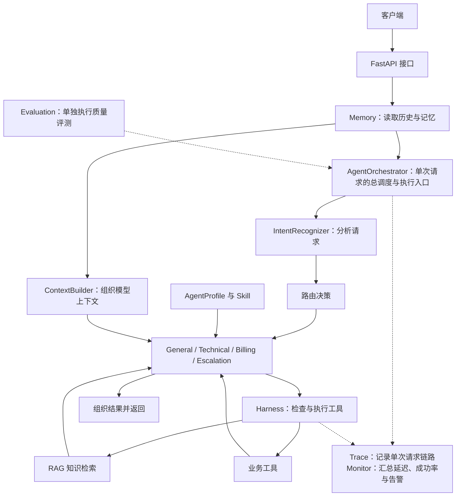

# Arclume 项目设计与全链路

## 0. 文档目录

1. **Arclume 是什么**
   - 客服场景中要解决的问题
   - 当前具备的能力和边界
   - 系统主要组件及其关系

2. **一次请求的大致流程**
   - 概览用户消息从 `/chat` 到最终回复的过程
   - 看运行时主链路，以及澄清、单 Agent、多 Agent、人工升级的分支
   - 看需要检索知识或调用工具时，请求会走向哪里
   - 认识 Memory、Trace 在整条链路中的位置

3. **沿着流程，逐层理解实现与设计**
   - 3.1 HTTP 入口与数据契约
   - 3.2 Memory 与一次请求的状态
   - 3.3 意图识别
   - 3.4 Agent 路由与协作
   - 3.5 AgentProfile、Skill 与 Context
   - 3.6 RAG：从知识准备到请求时检索
   - 3.7 工具与 Harness
   - 3.8 从模型输入到最终响应
   - 3.9 Trace、Monitor 与 Evaluation：观察运行与验证质量

4. **用具体请求观察流程如何分叉**
   - 4.1 普通聊天
   - 4.2 需要知识库的政策问题
   - 4.3 登录失败同时重复扣费的复合问题
   - 4.4 人工转接或需要审批的操作

5. **数据与状态总览：存放位置与生命周期**
   - 哪些数据能跨请求或跨重启保存
   - Redis、ChromaDB、临时 Context、Trace、Monitor 的区别

6. **如何亲自体验项目**
   - 四条核心消息路径
   - Response 与 Trace 的阅读方式
   - 出现意外结果时如何按链路查看

7. **当前实现的总结、证据与下一步**
   - 已实现且可演示的能力
   - 当前验证实际支持的结论
   - 真实边界与后续优先级

**附录**

- A. 文件与函数索引
- B. 接口、配置与运行命令速查
- C. 术语表

---

## 1. Arclume 是什么

### 1.1 项目要解决什么问题

Arclume 是一个面向客服场景的多 Agent 后端项目。

用户发来的消息可能是问候、订单查询、退款咨询、登录故障，也可能同时包含几个问题。系统需要先理解请求，再决定由谁处理、需要哪些资料、是否允许执行某个操作，最后把结果组织成用户能理解的回复。

例如：

- “你好。”通常可以直接回复。
- “退款需要多久？”需要依据知识库中的政策说明回答。
- “应用登录时报 401。”需要技术支持角色提供排查步骤。
- “登录失败，而且扣了两次钱。”可能需要技术与账单两个角色共同处理。
- “我要找人工。”需要进入人工升级路径。
- 用户要求执行某项操作时，系统还需要判断当前 Agent 是否有权限、工具是否可用、操作是否需要审批。

这些情况共同构成了 Arclume 的设计出发点：**把理解请求、分配职责、获取信息、执行工具和生成回复组织成一条可观察的处理流程。**

### 1.2 当前具备哪些能力

| 能力 | 在项目中负责什么 |
| --- | --- |
| HTTP API | 接收消息，校验请求，返回统一格式的结果 |
| 意图识别 | 判断问题类型，提取实体、紧急程度、置信度等信息 |
| Agent 路由 | 决定主 Agent、辅助 Agent，以及是否进入人工升级路径 |
| 会话记忆 | 提供历史消息、摘要、用户信息，支持连续对话 |
| RAG | 从知识库检索相关内容，为回复提供资料 |
| Skill | 为特定场景提供人工维护的处理规范 |
| 工具调用 | 查询或处理结构化信息，并把结果交回 Agent |
| Harness | 检查工具权限与风险，组织执行并记录结果 |
| Trace 与 Monitor | 记录请求过程，观察执行成功率、延迟等运行情况 |
| Evaluation | 单独运行评测，检查意图、路由、检索与回答质量 |

目前，系统有四种 Agent 角色：

| Agent | 主要职责 |
| --- | --- |
| General Agent | 普通咨询、订单、物流、信息补充，以及部分失败回退 |
| Technical Agent | 登录失败、错误码、配置问题与技术排查 |
| Billing Agent | 退款、账单、发票与支付问题 |
| Escalation Agent | 记录需要人工处理的状态，并生成交接提示 |

General、Technical 和 Billing 共享一套基础执行逻辑，通过各自的角色说明、处理规范和工具范围体现差异。它们默认可以共用同一个模型服务。

Escalation Agent 有单独的确定性处理逻辑：进入这个 Agent 后，会记录人工处理状态并生成固定结构的提示，无需调用模型生成回复。

### 1.3 当前项目的边界

Arclume 当前是一个可以运行、验证和继续扩展的工程原型。

目前项目以英文客服对话和英文知识文档为目标场景；切片与检索效果不宣称覆盖中文或多语言资料。

订单、物流等业务工具使用演示数据；人工升级会记录状态并给出提示，尚不代表请求已经发送到真实的客服坐席系统。

Harness 已能把工具请求判断为“允许、拒绝或需要审批”。但当前 `/chat` 仅向 Agent 开放知识检索和演示用的查询工具，尚未接入真实退款、修改收货地址、取消订单等会改变业务记录的操作。

因此，“需要审批”目前只是系统能够给出的一个策略判断，还不是完整的人工批准流程。未来还需要实现：保存待审批任务、让人工通过界面或接口确认、确认后恢复执行原操作，以及留下可长期保存的操作记录。

知识检索、意图识别和评测均已有实现，但现有数据的规模和来源限制了结论范围：当前结果主要用于验证工程链路可运行、发现回归和定位问题，不能直接推断真实客服场景下的效果。

### 1.4 主要组件如何分工

可以先把系统看成以下几层：

| 层 | 核心组件 | 需要回答的问题 |
| --- | --- | --- |
| 接口层 | FastAPI、请求与响应模型 | 用户发来了什么？应该返回什么结构？ |
| 理解与调度层 | IntentRecognizer、AgentOrchestrator | 用户想做什么？由谁处理？ |
| Agent 执行层 | 各角色 Agent、AgentProfile、ContextBuilder | 这次回复需要遵守什么规则、使用什么材料？ |
| 信息与能力层 | Memory、Skill、RAG、业务工具 | 从哪里获得历史、规范、知识与业务结果？ |
| 工具执行边界 | Harness | 某项工具调用能否执行？执行后得到什么？ |
| 观测与验证层 | Trace、Monitor、Evaluation | 发生了什么？运行是否正常？效果如何？ |

组件之间的关系如下：



这张图展示组件之间的关系。具体执行顺序和条件分支在下一章展开。

---

## 2. 一次请求的大致流程
本章节关注大概流程，对应的小点2.3-2.6后文会有更详细的介绍。

本章跟踪一条任意用户消息，说明它进入系统后可能经过哪些阶段。

一条请求不一定会经过全部模块。有的请求直接进入模型回复，有的调用知识检索或业务工具，有的需要多个 Agent 协作，也有的会提前返回澄清问题。


### 2.1 先看整条处理路线

`/chat` 是 Arclume 对外提供的主要 HTTP 接口。前端或其他客户端通过 `POST /chat` 发送用户消息，并携带用户与会话标识；系统处理后返回客服回复和本次请求的处理信息。

用户通过 `/chat` 发送一句话后，系统先读取这段会话已有的内容，再判断用户想解决什么问题，并选择负责处理的 Agent。

接下来，Agent 会准备本次回答需要的历史、角色要求和业务规范。如果问题需要查资料或使用工具，Agent 可以获取相应结果；如果需要多个领域协作，系统会让多个 Agent 分别处理，再组织成一条回复。最后，系统保存本轮对话和处理记录，把结果返回给用户。

不同请求会走不同分支：普通问候可能直接得到回答；知识型问题可能查询 RAG；明确要求人工的消息会进入人工升级路径。这一章大致介绍这些分支，第 3 章会解释每一步具体怎么实现。


```mermaid
flowchart TD
    A["客户端发送 POST /chat"] --> B["校验请求，确定 conversation_id"]
    B --> C["读取会话记忆"]
    C --> D["进入 Orchestrator，创建 request_id"]
    D --> E["识别意图、实体、紧急程度等信息"]
    E --> F{"当前信息是否足够继续处理？"}

    F -->|"否"| G["向用户返回补充信息请求<br/>（如订单号或具体需求）"]
    F -->|"是"| H["决定主/辅助 Agent 与所需证据"]

    H --> I{"进入哪种执行路径？"}
    I -->|"人工升级"| J["Escalation Agent：记录状态并生成提示"]
    I -->|"单个领域 Agent"| K["General / Technical / Billing"]
    I -->|"多个领域协作"| L["并行执行主 Agent 及一个或多个辅助 Agent"]

    K --> M["各 Agent 准备角色规则、Skill、可用工具与初始 Context"]
    L --> M

    M --> V{"是否需要先查询资料或业务信息？"}
    V -->|"政策、产品资料或排障知识"| W["通过 Harness 预先检索知识库"]
    V -->|"带编号的订单或物流状态"| X["通过 Harness 查询只读业务数据（当前为 Mock）"]
    V -->|"不需要"| N["调用模型，根据 Context 生成回复"]

    W --> Y["将查询结果加入 Context"]
    X --> Y
    Y --> N

    N --> O{"模型是否请求其他允许的工具？"}
    O -->|"否，返回最终文本"| P["得到 Agent 回复"]
    O -->|"是，提出 Tool Call 请求"| Q["Harness 检查工具权限、参数与风险"]
    Q --> R["执行其他允许的工具，或返回拒绝／需审批结果"]
    R --> N

    P --> T["Orchestrator 整理最终结果"]
    J --> T
    T --> S["写入用户消息与最终回复"]
    G --> S
    S --> U["API 返回 ChatResponse"]
  ```

图中展示主要处理路径。工具循环有次数限制；Agent 执行失败时还可能进入回退或错误返回，后文会单独说明。


### 2.2 运行时主链路

用户调用：POST /chat

请求的大致路线是：后文有更加详细的介绍。

```text
用户请求
→ POST /chat
→ 校验请求，确定或生成 conversation_id
→ 读取与本次会话有关的 Memory
    - Redis：近期消息、会话摘要和 AgentState
    - ChromaDB：相关历史摘要和用户画像

→ AgentOrchestrator 接管本次请求，并创建 request_id
→ IntentRecognizer 分析当前消息与近期上下文
    - 关键词证据和预设问题的 n-gram 相似度
    - 本地证据冲突或不足时，可选使用 LLM 复核
    - 产出细粒度意图、领域分数、实体、紧急程度和信息需求
    - 判断回答需要知识资料、实时业务数据、执行操作，还是不需要外部信息
    - 复合消息还会拆出不同领域的子任务

→ 判断当前信息是否足够继续处理
    - 不足：
        向用户返回补充信息请求
        （例如要求提供订单号，或说明具体想了解哪一个产品）
        → 写入本轮用户消息和系统回复
        → 返回 ChatResponse
        当前请求到此结束；用户补充后，以同一 conversation_id 发起下一轮 /chat
    - 足够：
        继续生成路由决策

→ 生成结构化路由决策
    - primary_agent
    - supporting_agents
    - routing_reason
    - routing_confidence
    - information_need、是否需要 RAG，以及可预先执行的只读查询计划

→ 选择处理路径
    - General Agent：产品介绍、一般咨询等
    - Technical Agent：登录、报错和排障问题
    - Billing Agent：退款、账单和支付问题
    - Escalation Agent：记录人工升级状态并生成提示
    - 复合问题：主 Agent 与一个或多个辅助 Agent 并行处理各自的子任务

→ 领域 Agent 准备本轮处理材料
    - AgentProfile：角色职责与可调用工具范围
    - 动态 Skills：当前领域的业务规范
    - 会话记忆、用户画像、AgentState 和结构化实体
    - 初始 Context：尚未包含本轮新查询的结果

→ 若处理计划已确定需要先查询资料或业务信息
    - 政策、产品资料或排障知识：
        通过 Harness 主动执行 knowledge_search
    - 带编号的订单或物流状态：
        通过 Harness 主动执行只读演示工具
    - Harness 返回结果后：
        将知识片段或业务结果加入本轮 Context

→ 调用 LLM，根据完整 Context 生成回复

→ 模型可能返回两种结果
    - 最终文本：
        得到该 Agent 的回复
    - Tool Call 请求：
        模型认为仍需要其他已授权工具
        → Harness 检查角色权限、参数和风险
        → 执行允许的工具，或返回拒绝／需审批结果
        → 将 ToolResult 返回模型
        → 模型继续生成回复

→ 得到一个或多个 Agent 回复
→ 多 Agent 情况下，由 ResponseComposer 合并各领域结果
→ Orchestrator 整理最终回复
→ 写回本轮用户消息与最终回复
    - Redis 更新工作记忆和会话摘要
    - 按当前策略更新长期记忆与用户画像
    - AgentState 保存本次处理状态

→ Trace 记录意图、路由、检索、工具、Agent 和记忆更新等事件
→ API 返回 ChatResponse

Monitor 不参与单条消息的生成流程。
它在后台汇总 Agent 和 Tool 的成功率、延迟、失败次数与告警信息。
```

- 当前信息不足以继续处理时，系统可能先向用户请求补充必要信息。
- Escalation Agent 使用单独的确定性处理路径，不经过普通领域 Agent 的模型回答流程。
- 只有选中了辅助 Agent 时，才会并行执行多个 Agent 并合并回复。
- “需要实时数据”不等于当前一定有真实业务工具；支付／退款状态尚不能被此原型核实。
- 请求补充信息的分支不经过普通 Agent，但这条系统回复仍由 Orchestrator 写入会话，供下一轮处理参考。

### 2.3 需要知识时，进入 RAG 链路

如果这次处理实际发起了知识检索，系统会在已经建立的知识库中寻找相关片段：

```text
提出知识检索请求
  → 查询改写
      - 推荐模式：LLM 生成多个不同角度的检索 query，
        并保留产品名、错误码、订单号和日期等关键实体
      - 无 LLM 的链路测试模式：保留原始 query，并额外生成去标点版本和
        按字母排序的关键词版本。这些变体不理解同义表达，也不会从不同角度改写问题；
        它们的作用只是让检索链路在没有额外模型调用时可运行，
        不应作为查询改写质量的依据
  → 每个 query 并行进行 Dense 检索与 BM25 检索
  → RRF 融合、跨 query 去重
  → 重排候选
      - 推荐模式可启用 LLM reranking
      - 低成本模式使用本地排序
  → 返回 Top-K 相关知识片段
  → Agent 根据检索结果继续回答
```

### 2.4 Memory 为请求提供哪些信息

请求开始时，系统可以读取此前保存的信息；处理过程中，也会更新本轮会话。

```text
Redis
  ├── 近期对话消息
  ├── 会话摘要
  └── 当前处理状态 AgentState

ChromaDB
  ├── 用户画像：可长期复用的用户信息
  ├── 情景记忆：可召回的历史对话摘要
  └── （RAG 知识库：业务文档切分后的 chunk，用于回答政策等问题）
```

这些内容帮助系统理解“刚才说的那个问题”等连续表达。知识库文档也使用 ChromaDB，但它提供的是业务资料，与用户自己的会话记忆用途不同。

### 2.5 需要调用工具时，经过 Harness

Agent 可以向系统提出工具调用请求。实际执行之前，请求会经过 Harness：

```text
Agent 提出 ToolCall
  → Harness 检查工具是否存在、是否可用、当前 Agent 是否有权限
  → 判断允许、拒绝或需要审批
  → 若允许，执行工具
  → 将结果返回给 Agent
  → Agent 继续组织回复
```

`tools/` 中是检索或业务操作的具体能力；`harness/` 管理调用这些能力时的检查、执行边界和记录。当前 `/chat` 向 Agent 开放的是限定范围内的低风险工具；已注册的高风险工单工具不在这些范围内。审批策略可单独验证，但尚未形成 `/chat` 内完整的人工批准与恢复执行流程。

### 2.6 处理过程如何留下记录

请求运行时，系统会记录意图识别、路由、Agent 执行、工具调用等事件，并给本次请求一个 `request_id`。返回结果后，可以用这个 ID 查阅对应的 Trace。

```text
意图识别与路由
  → Agent 开始处理
  → 按实际路径记录 Skill、RAG 或 Tool 事件
  → Agent 完成、结果组织
  → 请求完成
```

记录哪些事件取决于实际路径。例如，当当前信息不足时，系统会先返回一条请求用户补充必要信息的回复；人工升级路径也不会产生普通领域 Agent 的模型工具循环。

Monitor 会定期汇总运行数据。Evaluation 是单独运行的质量评测，不属于每条 `/chat` 请求的必经步骤。

## 3. 沿着流程，逐层介绍设计与实现

本章围绕这几个问题展开，帮助进一步了解重点部分的设计细节：意图和路由如何分工，知识从哪里来、为什么这样检索，工具为何需要权限边界，以及最终回答和运行记录如何产生。每一节以当前代码能支持的行为为准；尚未接通的目标设计会明确标注。

### 3.1 HTTP 入口与数据契约

Arclume 使用 FastAPI 提供 HTTP 服务，主要实现在 `api/main.py`，HTTP 请求和响应结构定义在 `schemas/api.py`。

应用启动时，`lifespan()` 会创建模型客户端、Memory、知识库、Tools、Harness、各领域 Agent、Orchestrator、Monitor 和 Evaluator，并将它们保存在 `app.state` 中供请求复用。应用关闭时，再统一释放相关资源。长期记忆或知识库不可用时，部分能力可以降级；Redis 对真实会话仍是必要依赖。具体状态可以通过 `/health` 查看。

`POST /chat` 是主要业务入口。客户端提交用户消息、用户标识和会话标识；如果没有提供会话标识，API 会自动生成一个。FastAPI 会先按照 `ChatRequest` 校验这些数据。

请求通过校验后，运行流程是：

```text
接收 ChatRequest
  → 确定 conversation_id
  → 读取会话 Memory
  → 调用 AgentOrchestrator.run()
  → 获得内部处理结果
  → 返回 ChatResponse
```

HTTP 层不负责识别意图或选择 Agent。它把用户消息和会话上下文交给 Orchestrator，再将 Orchestrator 的处理结果转换成统一响应。

`ChatResponse` 除了包含最终回答，还会返回意图、主 Agent、辅助 Agent、路由原因、人工升级状态和工具使用记录，方便客户端展示和开发者观察系统行为。

除 `/chat` 外，项目还提供知识库、Skills、Trace、Monitor 和 Evaluation 等支持接口。它们的具体参数、返回结构和使用方式见 `docs/zh/code_guide_zh.md`。

### 3.2 Memory 与一次请求的状态

Arclume 将 Memory 分成工作记忆、长期记忆和当前处理状态，避免把不同生命周期的信息混在一起。 工作记忆帮助模型理解当前对话，长期记忆用于之后按语义找回历史，而当前处理状态记录这段客服 case 正处理到哪一步。

| 类型 | 保存什么 | 主要作用 |
| --- | --- | --- |
| 工作记忆 | 近期消息、当前会话摘要 | 理解这段对话刚刚说过什么 |
| 长期记忆 | 历史对话摘要、用户画像 | 找回较早的相关经历和用户偏好 |
| 当前处理状态 | `AgentState` | 记录当前 case 的处理阶段、负责 Agent、是否需要 RAG 或人工介入 |

`AgentState` 不是某一个 Agent 自己的内部状态，而是当前客服 case 的整体处理流程状态。它记录当前意图、订单号或错误码等具体字段、主／辅 Agent、是否需要检索和是否需要人工升级等信息，使系统不必在每一轮都从自然语言聊天记录中重新猜测“这个问题目前处理到哪一步”。例如，聊天记录中虽然可能出现过“我要人工处理”，但 AgentState 会直接保存该 case 是否已经升级，供下一轮和不同模块继续使用。

当前代码主要使用 `active`、`escalated`、意图、实体和路由信息等状态。`waiting_for_input`、`waiting_for_approval`、`resolved` 等字段已经预留，但“用户补充信息后恢复处理”“人工批准后继续执行”和“case 完结”的完整流程尚未实现。

```text
Redis
  ├── 最近的对话消息
  ├── 当前会话摘要
  └── AgentState：当前客服 case 的处理状态

ChromaDB
  ├── episodic memory：可按语义召回的历史对话摘要
  └── user profile：用户偏好和关键实体
```

Redis 保存当前会话中需要快速读取、会随对话更新的信息；默认工作记忆和 `AgentState` 的 TTL 为 24 小时。ChromaDB 保存可在较久之后按语义找回的历史信息。

| 内容 | 文件 |
| --- | --- |
| 近期消息、会话摘要和压缩 | `memory/conversation_memory.py` |
| 历史摘要和用户画像 | `memory/long_term_memory.py` |
| 当前处理状态的读取与保存 | `memory/state_store.py` |
| `AgentState` 的字段定义 | `schemas/state.py` |

`/chat` 收到请求后，`ConversationMemory` 会根据 `user_id`、`conversation_id` 和当前问题准备 `memory_context`。其中包含近期对话、当前会话摘要、相关历史摘要和用户画像。具体 Agent 开始处理时，会通过 `StateStore` 读取或创建当前会话的 `AgentState`。

```text
当前问题 + user_id + conversation_id
  → 读取近期对话和会话摘要
  → 检索相关历史摘要
  → 读取用户画像
  → 读取当前 AgentState
  → 组成 memory_context 和本轮 Context
```

`ContextBuilder` 再将这些信息与当前消息中提取出的订单号、物流号、金额、错误码等具体字段，以及本轮的 Skill、知识检索结果和工具结果，组织进模型上下文。

请求结束后，Orchestrator 会统一保存用户实际收到的最终回复。因此，多 Agent 合并后的回复、失败回退后的回复和请求用户补充信息的回复，都会按最终对外文本写入 Redis，而不会只留下某一个 Agent 的草稿。与此同时，系统更新当前 case 的 `AgentState`，并在长期记忆可用时尝试更新用户画像；历史摘要只有在后续触发对话压缩时才会写入长期记忆。

#### 用户画像如何形成、写到哪里

用户画像存放在 ChromaDB 的独立 `user_profile` collection 中，与 RAG 知识库和 `episodic` 历史摘要 collection 分开。每个稳定的 `user_id` 对应一份画像文档；文档 ID 由 `user_id` 的哈希生成，避免直接把原始用户 ID 当作 ChromaDB ID 暴露。当前画像的内容是一个 JSON 对象：

```json
{
  "user_id": "user-001",
  "entities": {
    "order_id": ["ORDER-123"],
    "error_code": ["401"]
  },
  "preferences": {
    "preferred_contact": "email"
  },
  "updated_at": "..."
}
```

这不是把整段聊天原文存成“画像”。当前项目形成画像的路径如下：

```text
本轮用户消息
  → IntentRecognizer 提取结构化 entities
      - 例如订单号、物流号、金额、错误码、日期
  → Orchestrator 得到最终回复后
  → ConversationMemory.update_profile(user_id, entities=analysis.entities)
  → LongTermMemory 读取该 user_id 已有画像
  → 合并已有 entities / preferences 与本轮新增字段
  → upsert 到 ChromaDB 的 user_profile collection
```

因此，默认情况下，画像主要来自**意图识别器已经提取出的结构化字段**。如果显式开启 `ARCLUME_MEMORY_LLM_ENABLED=true` 且 Memory 使用的 LLM 已配置，`ConversationMemory` 才会额外读取当前用户原话，请模型只抽取明确表达的 `preferences` 和稳定 `entities`，并要求返回 JSON。这个 LLM 抽取默认关闭；抽取失败或 ChromaDB 不可用时，聊天主链路继续运行，只跳过本次画像更新。

下一次 `/chat` 开始时，`ConversationMemory.get_context()` 会按相同的 `user_id` 直接读取这份 JSON，并把它作为 `user_profile` 放进本轮 Context。这里不是对用户画像做语义检索：`episodic` 历史摘要才会按当前 query 在 ChromaDB 中做向量召回；用户画像是按用户 ID 精确读取的一份最新合并记录。

当前实现仍是轻量原型：自动写入的订单号、错误码等字段未区分“临时 case 信息”和“长期偏好”，也没有用户确认、删除入口、冲突解决或过期策略。因此它适合演示结构化画像如何随对话累积，不应被描述为已经成熟的用户建模或隐私治理方案。实现位于 `memory/conversation_memory.py` 的 `update_profile()` 和 `memory/long_term_memory.py` 的 `get_user_profile()`、`update_user_profile()`。

当近期消息过多时，`ConversationMemory` 会压缩较早内容：

```text
较早的对话消息
  → 生成会话摘要
  → 摘要保存在 Redis
  → 长期记忆可用时写入 ChromaDB 的 episodic memory
  → Redis 仅保留最近几条原始消息
```

这样既能控制模型上下文长度，也能在之后通过语义检索找回相关历史。

RAG 知识库同样使用 ChromaDB，但它保存的是业务知识文档，与用户的历史摘要和用户画像属于不同的数据集合。RAG 的存储与检索将在 3.6 节介绍。

### 3.3 意图识别

意图识别不仅要回答“属于哪个 Agent”，还要判断“回答前需要哪类证据”。主要实现位于 `core/intent_recognizer.py`，由 Orchestrator 传入当前英文消息和近期对话。

```text
当前消息
+ 最近最多三轮对话
  （当前消息是本地识别的主要对象；近期对话主要供可选 LLM 复核参考）
  → 清理文本，统一大小写与基础格式
  → 关键词／短语匹配
      - 在预设业务词中查找命中项
      - 保留命中的原文证据
        例如 refund、charged twice、cannot log in、tracking
      - 同一意图命中的词越多，本地证据分数越高
  → 模板相似度匹配
      - 将当前消息与各 intent 的预设典型问题切成字符级 1/2/3-gram
      - 映射为本地向量，计算余弦相似度
      - 每个 intent 取其所有模板中的最高分，并比较第一名与第二名的差距
  → 优先判断明确业务主题
      - refund、登录失败、重复扣费等明确主题
        优先于 how、what、please 等通用 query／request 词
      - 因此 “What is your refund policy?” 会识别为 refund，
        而不是普通 query
  → 判断本地证据是否足够
      - 明确单一主题：直接采用本地结果
      - 多个独立领域：保留多个领域，不因“有多个问题”而调用 LLM
      - 主题重叠、仅有弱关键词、无可靠业务主题或模板结果接近：
        记为不确定情况
  → 仅当 ARCLUME_INTENT_LLM_ENABLED=true 且存在不确定情况时
      - 将当前消息、近期对话和允许的 intent 列表交给 LLM
      - LLM 返回候选 intent、置信度与理由
      - 与本地关键词、模板结果融合；LLM 不可用时保留本地结果
  → 提取具体字段
      - order_id、tracking_id、amount、error_code、date
  → 判断紧急程度
      - low / medium / high / critical
      - 用于人工升级和更谨慎的处理路径判断
  → 计算领域与协作信息
      - general / technical / billing 的领域分数
      - 判断是否存在多个独立领域
      - 若存在，生成分别交给各领域 Agent 的子任务
  → 另行判断信息需求
      - none：不需要外部信息
      - knowledge：需要政策、产品资料或排障知识
      - live_data：需要订单、物流或支付等当前业务数据
      - mixed：同时需要知识与实时数据
      - action：用户希望系统执行退款、取消、修改等操作
  → 返回 IntentResult
      - 主意图、置信度、领域分数、协作领域
      - 实体、紧急程度、信息需求
      - should_use_rag、可预先执行的只读查询计划、子任务
```

#### 关键词与模板分别提供什么

`Pattern` 可以理解成一张人工维护的“业务词对照表”。系统先在用户当前消息中寻找明确的英文关键词或短语：例如，`refund`、`money back` 指向退款；`charged twice`、`payment failed` 指向支付问题；`cannot log in`、`401` 指向登录问题；`my order`、`tracking`、`delivery` 指向订单或物流问题。单独出现的 `return` 虽然可能与退款有关，但也可能表示别的含义，因此只作为较弱的本地证据。

`policy`、`how long`、`how to`、`introduce` 等表达不属于这张 Pattern 表。它们由后面的信息需求判断使用，帮助系统区分用户是在询问政策、流程、产品资料还是排障方法，从而决定回答前是否需要查询知识库。

关键词匹配的优点是直接、快速且容易解释。系统不仅知道“退款类有证据”，还会保留到底命中了哪个词，例如 `refund` 或 `charged twice`，这些内容会写入 `topic_evidence`，方便之后查看 Trace 或排查误判。每个 intent 的本地分数由命中词数量简单累积：命中一个关键词时有基础分，同一类再命中更多词时分数提高，最高不超过 1。这个分数只是用于比较本地证据强弱，不表示“系统有 80% 概率一定正确”。

英文关键词匹配会考虑单词边界，避免短词误命中其他单词。例如，`hi` 不应因为出现在 `shipping` 中就被当成问候语。关键词规则更适合识别业务主题明确的情况，但它要求写法接近预设词。例如用户把 `cannot sign in` 写成 `cannot signin`，少了一个空格，严格的关键词规则可能无法命中。

模板匹配用于补充这一点。每个细粒度意图下都维护若干典型问题，例如退款类包含 `refund request`、`I want to request a refund`；登录类包含 `cannot log in`、`I cannot sign in`。系统不会要求用户原句和模板逐字完全一致，而是把两句话都切成连续的字符片段：1 个字符、2 个字符和 3 个字符为一组，再比较两边共享了多少片段。

例如，`I cannot sign in` 和 `I cannot signin` 在空格附近不同，但 `cannot`、`sign` 等部分仍会产生大量相同的小片段，因此相似度可能较高。`refund`、`refunding`、`refunded` 也会共享一部分字符片段。实现上，这些片段会被映射为固定维度的本地向量，再通过余弦相似度计算当前消息和每条模板有多接近；每个 intent 取自己所有模板中的最高分。

这不是 ChromaDB 使用的语义 Embedding，也不代表系统真正理解同义表达。它本质上仍然是更宽松的字面相似度：速度快、不需要 API 成本，但对 `I need my money back` 和 `I want a refund` 这种“意思接近、字面不同”的表达未必可靠。若未来收集到足够误判样例，可以将真正的语义 Embedding 作为候选方案进行对照评测；在没有评测前，不能假设它一定优于当前规则和模板组合。

通用的 `what`、`how`、`?`、`please` 等词只说明用户正在提问或请求帮助，不应覆盖明确业务主题。例如，`What is your refund policy?` 同时命中通用问句和 `refund`，但 `refund` 提供的是更具体的业务证据，因此最终主意图应是退款，而不是普通 `query`。模板相似度主要在没有可靠业务关键词时作为补充候选；当前“模板分数至少 0.75，且领先第二名至少 0.15”是经验性工程阈值，仍需要通过更多英文样例评测。

#### 什么时候算判断不清

系统并不会因为一句话中出现多个关键词，就自动认为需要 LLM。它先区分“多个独立问题”和“多个词碰巧同时出现”。

例如：I cannot log in and I was charged twice.

其中 `cannot log in` 属于技术领域，`charged twice` 属于账单领域，并且它们由 `and` 连接成两个独立片段。系统可以直接把它识别为两个问题，分别交给 Technical 和 Billing 处理，不需要额外调用 LLM。

真正不确定的情况主要包括：只命中 `return`、`account`、`payment`、`401`、`500` 这类可能属于多个场景的弱证据；没有可靠业务主题，但用户仍在提问、请求帮助，或只说了 `it`、`that`、`this` 等依赖上下文的代词；或者技术和账单领域都被命中，但它们没有出现在明显独立的分句中，系统无法判断这究竟是两个问题还是一次误命中。

开启 `ARCLUME_INTENT_LLM_ENABLED=true` 后，只有出现这些不确定原因时，系统才会请求 Chat LLM。LLM 会看到当前消息、最近几轮对话和允许选择的 intent 列表，然后返回候选意图、置信度和理由。模型结果会和本地关键词、模板结果一起参与最终判断；如果模型调用失败、返回内容格式不正确，或开关没有打开，系统仍使用本地结果继续运行。

LLM 复核的作用只是帮助判断用户问题属于什么类别，不负责决定工具是否可以执行，也不负责批准高风险操作。当前本地分数与 LLM 分数的融合权重只是工程初值，并未经过统计校准；即使没有触发 LLM，也不表示系统能够保证识别所有自然语言表达。

#### 识别结果如何决定后续路径

`IntentRecognizer` 完成分析后，会返回一份 `IntentResult`。它不只是回答“用户在问什么”，还会把当前消息拆成后续路由需要的结构化信息：具体问题类型、所属业务分组、哪些领域可能需要协作、消息中是否有订单号或错误码、问题是否紧急，以及回答前需要查知识库还是查询当前业务数据。

这里首先要区分三个层次：

```text
细粒度意图（intent）
→ 用户当前最具体在问什么

意图分组（intent_group）
→ 这个具体问题属于哪一大类业务问题

负责 Agent
→ 当前系统最终由哪个 Agent 处理这类问题
```

细粒度意图让系统不只知道“这是账单问题”，还知道它是退款、发票还是重复扣费。这样后续才能决定：是先查退款政策、查询当前支付状态，还是只是向用户说明下一步。

当前项目的 19 个细粒度意图、对应的意图分组和主要负责 Agent 如下：

| 主要负责 Agent | `intent_group` | 细粒度 `intent` | 说明 |
| --- | --- | --- | --- |
| General | `greeting` | `greeting` | 问候或确认客服是否在线 |
| General | `feedback` | `feedback` | 正向反馈、评价 |
| General | `complaint` | `complaint` | 一般投诉或不满表达 |
| General | `query` | `query`、`order_status`、`logistics` | 普通咨询、订单状态、物流问题 |
| General | `request` | `request` | 未明确业务主题的一般请求 |
| General | `other` | `other` | 当前无法可靠归类的问题 |
| Technical | `technical` | `technical`、`technical_login`、`technical_crash` | 一般技术问题、登录失败、应用或页面崩溃 |
| Billing | `billing` | `billing`、`refund`、`invoice`、`payment_issue` | 一般账单问题、退款、发票、支付或重复扣费 |
| Billing | `account` | `account`、`account_security` | 账户资料和账户安全；当前项目没有独立 Account Agent，因此由 Billing Agent 负责 |
| Escalation | `escalation` | `escalation`、`human_handoff` | 用户明确要求人工，或需要升级处理 |

`intent_group` 用于把多个细粒度问题归入较大的业务类别；它不完全等同于 Agent 名称。例如 `account_security` 的分组是 `account`，但当前项目中仍由 Billing Agent 处理，因为尚未单独实现 Account Agent。


除了 `intent` 和 `intent_group`，`IntentResult` 还会保存判断依据、候选领域、具体字段以及回答前所需的信息。这些字段共同决定后续如何路由和处理请求。

| 字段 | 含义与后续用途 |
| --- | --- |
| `confidence` | 当前主意图的最终可信程度。它用于衡量这次分类是否足够可靠；当结果为 `other`、消息具有实际内容且置信度低于门槛时，Orchestrator 会向用户请求更具体的信息。它是工程计算出的启发式分数，不是经过校准的正确率。 |
| `matched_intents` | 本地规则识别出的其他候选意图。例如一句话同时出现登录失败和重复扣费时，可能同时保留 `technical_login` 与 `payment_issue`，帮助系统发现复合问题或关键词误命中。 |
| `topic_evidence` | 本次判断实际命中的关键词或短语，例如 `cannot log in`、`charged twice`。它会用于 Trace 和调试，说明系统为什么做出当前判断。 |
| `domain_scores` | General、Technical、Billing 三个业务领域各自积累的证据强度。Orchestrator 会参考这些分数选择主 Agent，并判断是否存在值得交给辅助 Agent 的独立问题。 |
| `entities` | 从消息中提取出的具体字段，例如订单号、物流号、金额、错误码和日期。后续查询订单或物流信息时，可以直接把这些字段作为只读工具的参数。 |
| `urgency` | 请求的紧急程度，包括 `low`、`medium`、`high` 和 `critical`。`critical` 可以直接进入人工升级路径；`high` 会在正常处理后标记为需要进一步介入。 |
| `ambiguity_reasons` | 记录本地判断不够可靠的具体原因，例如只命中歧义词、缺少明确业务主题，或者多个领域同时出现但不能确定是不是两个独立问题。只有存在这些疑点时，系统才会考虑使用可选的 LLM 复核。 |
| `supporting_domains` | 已确认存在独立子问题的辅助业务领域。它不是简单记录所有得分较高的领域，而是用于判断是否确实需要辅助 Agent 参与。 |
| `subtasks` | 按业务领域组织的执行任务。单领域请求保留完整消息；复合请求会把不同问题拆开，分别交给对应 Agent，避免多个 Agent 重复回答整条消息。 |
| `information_need` | 表示回答前需要哪类信息，包括 `none`、`knowledge`、`live_data`、`mixed` 和 `action`。它决定系统应该查询知识库、读取当前业务数据、识别操作请求，还是直接回答。 |
| `should_use_rag` | 是否计划使用知识库。当 `information_need` 为 `knowledge` 或 `mixed` 时为 `true`，而不是简单根据某个意图固定开启 RAG。 |
| `planned_tool_name` | 根据问题类型和已提取字段预先安排的只读工具。例如消息中包含订单号时，可以计划调用 `order_query`；缺少必要参数时则不会直接查询。当前这类预取计划主要由 General Agent 使用。 |

#### `subtasks` 如何拆分复合请求

每个 `IntentSubtask` 表示某个领域在本轮实际需要处理的任务，其中会保存：

- 分配到的业务领域；
- 该领域需要处理的英文子问题；
- 对应的细粒度意图；
- 订单号、错误码等已提取字段；
- 所需的信息类型；
- 是否使用 RAG；
- 可以预先执行的只读工具。

例如： I cannot log in and I was charged twice.
系统可以生成两个任务：
```text
Technical 子任务
  → query: I cannot log in
  → intent: technical_login
  → information_need: knowledge
  → should_use_rag: true

Billing 子任务
  → query: I was charged twice
  → intent: payment_issue
  → information_need: live_data
  → should_use_rag: false
```

Technical Agent 只处理登录失败，Billing Agent 只处理重复扣费。这样后续即使并行执行多个 Agent，也不会让每个 Agent 都回答一遍完整问题。

普通单领域请求同样会产生一个 `subtask`，但不会强行切分消息，而是保留用户的完整原文。

#### `information_need` 如何决定信息来源

`information_need` 回答的是“生成回复前还需要什么信息”，而不是“应该由哪个 Agent 处理”。两者是独立判断：

```text
退款政策、处理规则、技术排障
  → knowledge
  → 尝试通过 knowledge_search 查询知识库

当前订单或物流状态
  → live_data
  → 已有订单号或物流号时，调用对应的只读工具

既需要技术知识，又需要当前业务数据
  → mixed
  → 同时准备知识检索和业务查询

问候、纯反馈、人工转接
  → none
  → 不需要查询外部信息

退款、改地址、取消订单等操作请求
  → action
  → 识别用户的操作意图，但不自动执行高风险操作
```

例如，“What is your refund policy?” 和 “Has my refund arrived?” 都可能交给 Billing Agent，但前者需要查询政策知识，后者需要查询当前业务状态。因此，选对 Agent 并不代表一定要使用 RAG。

`should_use_rag` 正是从这个信息需求中产生：只有 `knowledge` 或 `mixed` 才计划检索知识库。

目前，订单和物流查询工具使用的是 Mock 数据，支付和退款状态尚未连接真实业务后台。因此，即使系统正确识别出 `live_data`，也不能把演示结果描述成用户的真实业务状态。


之后，3.4 节的 Orchestrator 会根据 `domain_scores`、`supporting_domains` 和 `subtasks`，从 Technical 与 Billing 中选择主 Agent 和辅助 Agent，并让它们分别处理自己的子问题。这里的关键不是“检测到两个 Agent 名称”，而是系统已经明确每个 Agent 应处理哪一部分消息、回答前分别需要什么信息。


### 3.4 Agent 路由与协作

意图识别完成后，`AgentOrchestrator` 负责决定由谁处理请求、是否需要其他 Agent 协助，以及发生异常时如何降级。

主要实现位于 `agents/agent_orchestrator.py`。各领域 Agent 位于 `agents/general_agent.py`、`agents/technical_agent.py`、`agents/billing_agent.py` 和 `agents/escalation_agent.py`。

整体流程是：

```text
IntentResult
  → Orchestrator 先记录“意图识别完成”的 Trace
  → 判断当前结果是否不足以继续处理
      - 条件：
          intent = other（系统没有把这条消息识别为退款、登录、物流、人工升级等任何已定义业务类型）
          且消息长度大于 2 （过滤只有一个符号或极短输入的情况；例如单独的 “?” 不进入这条处理）
          且本地 confidence < 0.5（关键词、模板相似度和可选 LLM 复核都没有提供足够强的判断依据）
      - 满足时：
          不再选择普通领域 Agent
          → 返回“请用户补充必要信息”的回复
          → primary_agent 记为 general
          → 写入本轮用户消息和这条系统回复
          → 请求结束
        用户补充信息后，需要以同一 conversation_id 发起下一轮 /chat

  → 若信息足够，调用 _make_decision() 形成 RoutingDecision

      1. 优先判断是否直接进入人工升级路径
          - 用户明确要求人工：
              intent = human_handoff / escalation
          - 或紧急程度为 critical
          → primary_agent = Escalation
          → 不进入 General / Technical / Billing 的普通模型回答路径
          → Escalation Agent 记录升级状态并返回确定性的提示文本

      2. 若不属于直接升级，选择主 Agent
          - technical、technical_login、technical_crash
              → Technical Agent
          - refund、invoice、payment_issue、billing、account、account_security
              → Billing Agent
          - 其他情况
              → 比较 general / technical / billing 的 domain_scores
              → 分数最高的领域成为 primary_agent

      3. 选择辅助 Agent
          对每一个非主领域，只有同时满足以下条件才成为 supporting_agent：
          - 领域分数 ≥ 0.45
          - 领域分数 ≥ 主领域分数的 55%
          - IntentRecognizer 已确认它属于独立领域
            （例如消息被识别为两个独立问题，而非关键词误命中）

          因此：
          - 单一退款问题
              → Billing Agent
          - 登录失败 + 重复扣费
              → Technical Agent + Billing Agent
          - 产品咨询 + 登录失败 + 重复扣费
              → 当前稳定识别为 Technical + Billing。产品介绍会形成 General 子任务，
                但 General 尚不会自动成为辅助 Agent，因此这部分目前可能没有被执行；
                这是当前路由需要改进的边界
          - 领域证据不足或没有独立问题片段
              → 不增加辅助 Agent

      4. 形成 RoutingDecision
          - primary_agent：主处理 Agent
          - supporting_agents：一个或多个辅助 Agent
          - reason：选择这些 Agent 的本地证据和领域分数说明
          - confidence：当前路由可信度
          - use_rag：是否存在 knowledge / mixed 信息需求

          订单号、物流号等可预先执行的只读查询计划，
          保留在 IntentResult 的 planned_tool_name 中；
          当前由后续 General Agent 使用，不是 RoutingDecision 自己重新生成。

  → 根据 RoutingDecision 选择执行方式

      A. Escalation 路径
          → Escalation Agent
          → 保存 status = escalated、needs_human = true
          → 返回“已标记为需要人工支持”的提示
          → 当前不会真的创建客服工单或接通真人

      B. 单 Agent 路径
          → 执行 primary_agent
          → Agent 处理本领域问题、准备 Context、按需检索或调用工具
          → 获得一个 AgentResponse

      C. 多 Agent 路径
          → 同时执行 primary_agent 与所有 supporting_agents
          → 每个 Agent 只接收分配给自己的 IntentSubtask
          → 每个 Agent 独立准备自己的 Skill、Context 和 RAG 结果；
            订单／物流的预取只读查询计划当前主要由 General Agent 使用
          → 等待各 Agent 返回 AgentResponse
          → 不在各 Agent 内部重复写入整段会话
          → 由 Orchestrator 统一处理最终对外回复

  → 处理结果与失败回退

      单 Agent：
      - 主 Agent 成功
          → 使用该 Agent 的回复
      - 主 Agent 失败，且主 Agent 不是 General
          → 回退执行 General Agent
      - General 也失败
          → 返回统一的处理失败提示
      - 模型配置或模型请求异常
          → 仍先尝试 General Agent 回退；若最终失败原因仍是模型异常，
            才向上抛给 API，返回对应 HTTP 错误

      多 Agent：
      - 至少一个 Agent 成功
          → ResponseComposer 合并成功 Agent 的结果
          → 主 Agent 的结果作为主要部分
          → 将文本不完全相同的辅助回复追加到主结果之后
      - 所有 Agent 都失败
          → 返回统一的处理失败提示

  → 处理完成后，再判断是否需要标记人工升级
      - 直接人工升级、critical urgency
          → 标记 escalated = true
      - high urgency
          → 当前实现会在普通处理完成后标记 escalated = true
      - 某个 Agent 在执行中明确发出升级信号
          → 标记 escalated = true，并记录原因

  → Orchestrator 生成 OrchestratorResult
      - 最终回复
      - primary_agent / supporting_agents
      - routing_reason / routing_confidence
      - escalated、升级原因和来源
      - tools_used / tool_traces
      - request_id 和本轮耗时

  → 统一写回用户实际看到的结果
      - 写入本轮用户消息
      - 写入最终 Assistant 回复
      - 更新用户画像和长期记忆（可用时）
      - Agent 保存当前 case 的 AgentState
      - 记录 ResponseComposed、MemoryUpdated、RequestCompleted 等 Trace
```

#### 3.4.1 路由使用哪些信息

Orchestrator 接收 IntentRecognizer 生成的 `IntentResult`，主要使用：

| 信息 | 在路由中的作用 |
| --- | --- |
| `intent` | 将明确意图映射到对应 Agent |
| `confidence` | 判断识别结果是否可靠 |
| `urgency` | 判断是否需要人工介入 |
| `domain_scores` | 判断请求涉及哪些业务领域 |
| `matched_intents` | 保留一条消息中的多个意图 |
| `supporting_domains` | 限定有独立证据的辅助领域 |
| `subtasks` | 将复合消息中的子问题、领域和各自的证据需求绑定起来 |
| `information_need` | 区分知识、实时数据、操作与无需外部证据 |
| `should_use_rag`、`planned_tool_name` | 安排知识检索；订单／物流编号齐全时，供后续 General Agent 预取只读查询 |

这样，路由层使用结构化分析结果，不在路由函数里重新运行一套关键词分类。但领域分数本身仍包含前一步的 Pattern 证据，因此不能把辅助 Agent 的选择描述成完全摆脱关键词的语义判断。

#### 3.4.2 信息不足与直接升级

Orchestrator 首先处理两种特殊情况。

如果意图是低置信度的 `other`，系统不会立即选择领域 Agent，而是直接向用户询问这是订单、退款、账户还是技术问题。

```text
意图不明确
  → 请求用户补充必要信息
  → 暂不执行领域 Agent
```

如果用户明确要求人工客服，或者请求具有关键紧急程度，系统会直接选择 Escalation Agent。

```text
人工转接意图或关键紧急请求
  → Escalation Agent
  → 记录人工升级状态
  → 返回交接提示
```

Escalation Agent 使用确定性逻辑，不进入普通领域 Agent 的模型与工具循环。

#### 3.4.3 主 Agent 与辅助 Agent

普通请求进入 `_make_decision()`，生成结构化的 `RoutingDecision`：

| 字段 | 作用 |
| --- | --- |
| `primary_agent` | 对本次请求主要负责的 Agent |
| `supporting_agents` | 提供跨领域补充的 Agent |
| `reason` | 意图、领域分数和选择结果 |
| `confidence` | 本次路由的置信度 |
| `use_rag` | 是否要求 Agent 在回答前尝试知识检索 |

对于明确意图，系统优先使用预设映射：

```text
登录失败、错误码、程序崩溃
  → Technical Agent

退款、发票、支付问题
  → Billing Agent

普通咨询、订单、物流
  → General Agent
```

如果没有明确映射，系统会比较 General、Technical 和 Billing 的领域分数，选择得分最高的角色作为主 Agent。

选择主 Agent 后，系统还会检查其他领域的得分。识别器会保留命中的关键词证据，并要求两个领域出现在独立的问题片段中；满足这一条件且辅助领域分数达到最低、相对主领域分数的门槛，才会加入 `supporting_agents`。只因 `return` 这类模糊词命中账单领域，不会自动拉入 Billing Agent。

例如：

```text
“我无法登录，而且被重复扣款”
  → Technical 处理登录问题
  → Billing 处理重复扣款问题
```

识别器确认存在独立领域后，会按英文逗号、分号以及 `and`、`also`、`plus`、`but` 等连接词得到候选片段，再根据每个片段的主题证据生成领域任务。没有命中特定领域、但属于产品介绍或常规信息的问题由 General Agent 负责。每个任务会重新计算自己的证据需求，因此某个 Agent 需要知识库，并不意味着所有辅助 Agent 都必须使用 RAG。

这仍然是本地启发式切分，不是通用语义解析器。连接词出现在产品名称或普通短语中、省略连接词、反问、否定，以及同一个不可拆分片段同时包含两个领域时仍可能误判；模糊词会标记为疑点，开启配置后可交给 LLM 复核，后续还需用复合请求标注集验证任务覆盖率和错分率。

#### 3.4.4 单 Agent 与多 Agent 执行

只有一个领域时，Orchestrator 执行主 Agent：

```text
RoutingDecision
  → Primary Agent
  → AgentResponse
```

存在辅助 Agent 时，系统会并行执行主 Agent 和辅助 Agent：

```text
用户请求
  → IntentSubtask 列表
       ├── 领域 A 子问题 → Primary Agent
       └── 领域 B 子问题 → Supporting Agent
  → 并行执行
```

各 Agent 共享同一份历史 Memory 和请求级路由背景，但只接收分配给自己领域的当前子问题。Skill 选择、知识检索查询和信息需求都以该子任务为准；订单／物流的预取只读工具计划当前主要由 General Agent 使用。Agent 不再拿着完整复合消息重复回答其他领域。系统提示还会明确：历史中可能有其他主题或旧的完整回答，只能作为必要背景，不能再次扩写。普通单 Agent 请求仍使用原始消息。

例如：

```text
how long does it take for the shipping?
and can u introduce the mini desk lamp?
and how can i get the refund?

  → General 子任务
      how long does it take for the shipping?
      can u introduce the mini desk lamp?

  → Billing 子任务
      how can i get the refund?
```

General 和 Billing 分别用自己的子问题检索和生成回答，再把互不重叠的结果合并。这样处理的是重复回答的根因；仅在最终文本上做字符串去重，无法识别两段措辞不同但含义重复的模型回复。

主 Agent 负责保存本轮 AgentState；辅助 Agent 可以读取相同上下文，但不重复保存状态。会话消息由 Orchestrator 在最终回复确定后统一写入一次。

每个 Agent 最后返回统一的 `AgentResponse`，其中包含回复内容、是否成功、执行耗时、工具使用记录和人工升级信号。

#### 3.4.5 多 Agent 结果合并

多个 Agent 完成后，`agents/response_composer.py` 中的 `ResponseComposer` 会组织结果：

```text
主 Agent 回复
  → 放在最终结果前面

辅助 Agent 回复
  → 作为补充信息追加
```

合并使用确定性代码，不会再次调用模型。这样可以减少额外的模型延迟和成本，并确保主 Agent 的回复保持主要位置。合并器仍只负责组织成功结果；避免整段重复主要依靠执行前的子任务隔离，而不是依赖合并器理解两段文本的语义。

当前合并方式主要进行顺序组织，不会主动解决不同 Agent 回答之间的语义冲突。更复杂的冲突消解可以作为后续改进。

#### 3.4.6 失败回退与执行后升级

如果单个 Technical 或 Billing Agent 执行失败，Orchestrator 会尝试使用 General Agent 回退处理。

并行执行时，如果只有部分 Agent 失败，系统仍会使用成功结果；如果全部失败，则返回统一的失败信息。

人工升级也可能在 Agent 执行过程中产生，例如：

```text
业务 Tool 执行失败
Agent 发现需要后台权限
Agent 判断问题需要人工决策
```

Orchestrator 会统一整理升级状态、原因和来源。Tool Policy 也能返回“需要人工审批”，但目前高风险写工具不在 `/chat` 的 Agent 工具范围内，尚不能把它描述为现有聊天请求会触发的完整审批分支。

因此，路由结果最终完成了三件事：

```text
决定由谁主要负责
决定是否需要跨领域协作
决定是否需要请求用户补充信息、回退或人工介入
```

---

### 3.5 AgentProfile、Skill 与 Context

Agent 被选中后，系统还需要确定：

```text
这个 Agent 负责什么
本轮需要遵守哪些业务规范
模型需要看到哪些信息
模型可以使用哪些工具
```

Arclume 使用 AgentProfile、Skill 和 Context 分别管理这些内容：

```text
AgentProfile
  → 定义稳定的角色职责和能力边界

Skill
  → 根据当前业务场景补充处理规范

Context
  → 汇总本轮请求需要的信息
```

#### 3.5.1 AgentProfile：定义角色契约
`AgentProfile`  同时约束：Agent 应该怎样回答，以及Agent 可以执行哪些动作。
`AgentProfile` 是每个 Agent 的一份结构化角色说明。`agents/agent_profile.py` 只定义“这份说明可以有哪些字段”；真正的字段值写在各领域 Agent 文件的 `profile = AgentProfile(...)` 中：`agents/general_agent.py`、`agents/technical_agent.py`、`agents/billing_agent.py` 和 `agents/escalation_agent.py`。

例如，`TechnicalAgent` 在自己的文件中填写“我是技术支持”“处理登录和报错”“可以使用哪些工具”等内容；创建 Agent 对象时，`CustomerServiceAgent` 会把这份 Profile 保存为 `self.profile`，并在本轮调用模型时使用它。

| Profile 字段 | 在代码中表示什么 | 当前怎样使用 |
| --- | --- | --- |
| `role` | Agent 的人类可读角色名 | 写入模型上下文，例如 `Technical support and troubleshooting`；也会显示在监控信息中。 |
| `mission` | 这个角色的核心任务 | 写入模型上下文，说明它主要应解决什么问题。 |
| `workflow` | 推荐的处理步骤列表 | 写入模型上下文，例如“确认症状 → 判断原因 → 给出检查步骤”；它是模型应遵守的工作提示，不是 Python 自动执行的流程图。 |
| `input_contract` | 回答前通常需要的信息 | 写入模型上下文，提示模型缺少订单号、错误码或发生时间时应主动询问；当前不会由代码强制校验这些字段必须齐全。 |
| `output_contract` | 回复应包含的内容 | 写入模型上下文，例如技术 Agent 应说明可能原因、排查步骤和缺失信息；当前不是自动格式校验器。 |
| `handoff_conditions` | 应交给人工处理的情况 | 写入模型上下文，提示模型何时不应自行承诺处理；直接人工升级仍主要由 Orchestrator 的意图与紧急程度规则决定。 |
| `tool_scope` | 该 Agent 被允许使用的工具名列表 | 这是实际执行的权限边界：系统只向模型提供该范围内的 Tool Schema，Harness 也会以此检查工具调用。 |
| `model` | 可选的、该 Agent 专用的模型名 | 当前各领域 Profile 都未单独填写它，因此使用全局配置的 Chat 模型。 |
| `temperature` | 模型输出的随机性 | 实际传给 LLM 调用；例如 Billing 为 `0.0`，Technical 为 `0.1`，General 为 `0.3`。 |
| `max_tokens` | 单次回复最多生成多少 Token | 实际传给 LLM 调用，限制回答的最大长度。 |

Agent 执行时，会把 Profile 的角色、任务、工作步骤、输入／输出要求和转人工条件转换成模型可读的角色说明。同时，`tool_scope` 会限制本轮向模型暴露的工具，并作为 Harness 的权限检查依据；`temperature` 与 `max_tokens` 会直接传入模型调用。


#### 3.5.2 Skill：补充当前场景的业务规范

当前项目中的 Skill 是人工编写的 Markdown 业务 SOP(标准操作流程)：它告诉模型在某个具体场景下应关注什么、先问什么、不能承诺什么、下一步如何说明。

例如，退款 Skill 会告诉模型先区分用户是在问退款资格、处理时间还是已提交退款的状态；需要订单级核实时应索取订单号；没有已验证的业务结果时不能承诺退款已经完成。它本身不会查询订单，也没有权限改变退款状态。

同一个 Agent 可能处理多个具体场景。General Agent 既可以处理普通咨询，也可以处理物流问题；Billing Agent 既可以处理退款，也可以处理发票。因此，项目不把所有场景规则永久写进每个 Agent 的基础 Prompt，而是将它们拆成可按需加载的 Skill，保存在：

```text
skills/refund/SKILL.md
skills/logistics/SKILL.md
skills/technical/SKILL.md
skills/escalation/SKILL.md
```

每个 Skill 文件包含两部分：前面的元数据决定“它可不可以在这一轮出现”，后面的正文才是注入模型的业务规范。

```text
元数据
  - name：Skill 名称
  - agents：允许使用它的 Agent
  - keywords：用于直接调用时的关键词发现，也为未来的语义匹配保留提示
  - enabled：是否临时禁用

正文
  - Purpose：适用的业务场景
  - Workflow / Procedure：建议处理步骤
  - Safety rules：不能越过的业务边界
  - Response style：回复应怎样表达
```

#### 动态注入是什么意思

“动态”指的是：Skill 不会在服务启动时永久附着到某个 Agent；每一轮请求都会根据**本轮被选中的 Agent 和该 Agent 实际负责的细粒度意图**重新决定是否加载。没有对应场景时，模型只获得 AgentProfile 和其他 Context，不会收到不相关的 SOP。

完整路径如下：

```text
IntentRecognizer
  → 得到 intent 和 IntentSubtask

Orchestrator
  → 根据 Agent + intent 给出本轮候选 Skill 名称
     例如 refund / payment_issue → refund Skill

CustomerServiceAgent
  → SkillLoader 再检查：
     - Skill 是否 enabled
     - 当前 Agent 是否在 Skill 的 agents 范围内
  → 两项都通过，才加载对应 SKILL.md
  → 将正文截断到长度限制内，加入本轮 Context 的 skill_instructions
  → 模型生成回答时参考这些规则
  → 模型可能直接回答、请求用户补充信息，或提出 Tool Call
    → 若提出 Tool Call，仍要经过 Harness 检查后才能执行
```

例如，用户说： I was charged twice. How do I request a refund?

意图识别先把它路由到 Billing Agent，并将 `refund` 作为候选 Skill。随后 `SkillLoader` 检查：退款 Skill 已启用，并且允许 Billing Agent 使用；因此它被加入这一轮模型上下文。即使用户使用的是 `I need my money back` 这类未列在 Skill 关键词表中的表达，只要前面的意图识别已经确定为退款，也不会再次漏掉退款 标准操作流程。下一条普通问候消息没有对应的细粒度场景，因此不会加载退款 Skill。

当前 Orchestrator 给出的候选规则是：

| 当前被选中的 Agent 与细粒度意图 | 候选 Skill | 最终是否注入 |
| --- | --- | --- |
| Technical Agent + `technical`、`technical_login` 或 `technical_crash` | `technical` | Skill 已启用且允许 Technical Agent 使用时注入；不再要求用户再次命中特定关键词。 |
| Billing Agent + `refund` 或 `payment_issue` | `refund` | Skill 已启用且允许 Billing Agent 使用时注入。 |
| General Agent + `order_status` 或 `logistics` | `logistics` | Skill 已启用且允许 General Agent 使用时注入。 |
| Billing Agent + `invoice` 或宽泛 `billing` | 暂无对应 Skill | 不错误注入退款 SOP，仅使用 Billing AgentProfile；未来可增加 `invoice` 或通用 `billing` Skill。 |
| Escalation 意图 | `escalation` 会被列为候选 | 当前 Escalation Agent 使用确定性回复路径，不走通用的 Skill 注入与模型生成流程；这个 Skill 文件主要是为未来可扩展的人工交接流程预留。 |

所以，“Technical Agent → technical Skill”更准确的意思是：当本轮细粒度意图已经属于技术支持时，系统把 `technical` 选为这一轮的场景规范；只要它已启用且属于 Technical Agent 的权限范围，就进入模型 Context。它不表示 Technical Agent 每次都执行某个固定操作。

Skill 文件中的 `keywords` 目前不再推翻 `/chat` 已经做出的意图判断。它们仍保留在元数据中，供 Agent 被单独调用、没有来自 Orchestrator 的明确候选时进行关键词发现；未来也可以替换或补充为 Embedding 相似度匹配，以适应更多表达方式。

#### Skill 和 Tool 的边界

Skill 规定“模型应该怎样处理和说明”；Tool 才是“系统实际查询或执行什么”的能力。两者的关系是：

```text
Skill
  → 例如：先索取订单号；未验证时不能承诺退款完成
  → 只是模型指令，不产生外部操作

Tool / Harness
  → 例如：在已有订单号时查询订单，或检索退款政策
  → 需要经过权限、参数和风险检查，才可能真的执行
```

因此，是否调用知识库或业务工具主要由 `information_need`、已提取的实体和模型的 Tool Call 决定，而不是由 Skill 单独决定。Skill 可以要求“需要订单号时先询问”，但不能绕过 Harness 自己调用 `order_query`，更不能执行退款、改地址等写操作。

被选中的 Skill 会转换成业务指令，加入本轮模型上下文。单个 Skill 默认最多 3200 个字符，全部 Skill 默认最多 5000 个字符，避免注入过多规则，占用大量模型上下文。

Skill 加载失败时，Agent 会记录警告并继续使用基础 AgentProfile，不会因为一个可选 Skill 使整次请求失败。

#### 3.5.3 Context：汇总本轮请求信息

Context 表示一次模型调用需要的临时信息。它随每次请求重新构建，不作为一份独立的长期数据保存。

Context 的结构定义在 `schemas/context.py`，构建逻辑位于 `core/context_builder.py`，调用位置在 `agents/customer_service_agent.py`。

ContextBuilder 会接收其他模块已经准备好的内容，并写入 `Context` 的对应字段：

| 进入模型前的信息 | `Context` 字段 | 来源与实际内容 |
| --- | --- | --- |
| 当前用户消息 | `user_message` | 当前 Agent 实际处理的消息；单 Agent 时通常是原消息，多 Agent 时是分配给该 Agent 的 `IntentSubtask.query`。 |
| 近期对话 | `conversation_history` | Redis 工作记忆中的 `recent_messages`，元素类型为 `ContextMessage`，含 `role` 和 `content`。 |
| 当前会话摘要 | `memory_summary` | Redis 中较早消息压缩得到的摘要。 |
| 相关历史摘要 | `episodic_memories` | ChromaDB 长期记忆召回的历史会话摘要记录。 |
| 用户画像 | `user_profile` | ChromaDB 长期记忆中的用户偏好、关键实体等结构化信息。 |
| 当前 case 的处理状态 | `state` | StateStore 从 Redis 读取的 `AgentState`。 |
| Agent 的基础系统说明 | `system_instructions` | 创建 `ContextBuilder` 时传入的该 Agent 基础 `system_prompt`。`AgentProfile` 会在之后另外渲染并追加到模型的 system prompt，不是这个字段本身。 |
| 当前场景的 SOP | `skill_instructions` | SkillLoader 渲染的已选中 `SKILL.md` 正文；没有适用 Skill 时为空列表。 |
| 已验证的知识片段 | `knowledge_results` | Agent 经 Harness 预取 `knowledge_search` 后得到的 RAG 结果。 |
| 结构化请求信息 | `metadata` | `intent`、`intent_group`、`intent_confidence`、`urgency`、`entities`、`active_agent`、`supporting_agents`、`routing_reason`、`rag_enabled`、`information_need`、`prefetch_status`、`request_id`、`task_scoped`。 |
| 工具结果 | `tool_results` | `Context` 预留的 `ToolResult` 列表。当前初始 Context 通常为空；模型 Tool Call Loop 产生的结果会作为后续模型消息单独追加。 |

ContextBuilder 只负责整理信息，不负责访问 Redis、查询 ChromaDB、执行 RAG 或调用模型。

这样可以把数据获取和上下文组织分开：
```text
Memory、Skill、RAG、Harness → 准备数据
ContextBuilder → 组织本轮数据
```

#### 3.5.4 Context 如何变成模型输入

`Context` 不是原样序列化后整体交给模型。你可以先把它理解为“系统为模型准备的一组材料”：角色规则、当前 case 状态、业务规范、记忆、知识和当前问题。`CustomerServiceAgent` 再把这些材料按不同消息角色发给 LLM；第一遍阅读时，先理解下表中“模型会看到什么”即可，不必先记住 `system`、`tool` 等技术角色名。

| 输入材料或字段 | 模型会看到什么 | 格式与示例 |
| --- | --- | --- |
| `system_instructions` | 一直有效的基础回答规则 | 普通文本，类似：`Respond clearly and politely. Do not invent policies or facts.` 每一轮都会有。 |
| `AgentProfile` | 当前客服角色的职责说明 | 也是普通文本，格式类似：`[Agent profile]`<br>`Role: Billing verification and after-sales support`<br>`Mission: Clarify billing cases...`<br>`Allowed Tools: knowledge_search, check_billing_fields...`。 |
| `state` | 当前客服 case 的处理状态 | 一条 system 消息，格式类似：`[Current case state]`<br>`{"status":"active","active_agent":"billing","intent":"refund","needs_rag":true}`。它是结构化状态，不是聊天原文。 |
| `metadata` | 系统刚刚对这条消息作出的判断 | 一条 system 消息，格式类似：`[Request analysis]`<br>`{"intent":"refund","entities":{"order_id":["AB1234"]},"information_need":"knowledge"}`。模型不必再从原句猜这些信息。 |
| `skill_instructions` | 当前场景下额外需要遵守的业务 SOP | 一条 system 消息，只有选中 Skill 才出现，例如：`[Active instructions]`<br>`### refund`<br>`Do not claim that a refund has been approved without a business-system result.` |
| `memory_summary` | 较早对话的压缩摘要 | 一条 system 消息，例如：`[Conversation summary]`<br>`The user previously asked about a delayed order and was asked for an order ID.` |
| `episodic_memories` | 从较久历史中找回的相关事件 | 一条 system 消息，例如：`[Relevant past conversations]`<br>`[{"summary":"User previously reported a login error 401."}]`。只放语义相关的少量历史。 |
| `user_profile` | 已保存的用户偏好和已确认信息 | 一条 system 消息，例如：`[User profile]`<br>`{"preferred_language":"en","known_product":"AL-M100"}`。它不是实时订单或支付事实。 |
| `knowledge_results` | 从知识库找到的相关资料片段 | 一条 system 消息，例如：`[Relevant knowledge]`<br>`[{"content":"Refund requests are accepted within seven days...","source":"refund_policy.md"}]`。 |
| `conversation_history` | 最近几轮原始对话 | 保持原来的聊天消息格式，例如：`{"role":"user","content":"My order has not arrived."}`<br>`{"role":"assistant","content":"Please share your order ID."}`。 |
| `tool_results` | 工具实际返回的查询结果 | 初始时通常没有。模型调用工具后，会收到类似：`{"role":"tool","content":"{\"order_id\":\"AB1234\",\"status\":\"shipped\"}"}`，再依据结果继续回答。 |
| `user_message` | 本轮需要回答的用户问题 | 最后一条 user 消息，例如：`{"role":"user","content":"What is your refund policy?"}`。它最后加入，让模型先读完前面的材料。 |

可以把一次普通模型调用简化为：

```text
system_prompt
  = 基础 system_instructions + AgentProfile

history
  = AgentState
  → 请求分析 metadata
  → 已选 Skill
  → 摘要／历史记忆／用户画像
  → RAG 知识片段
  → 近期对话

最后一条消息
  = 当前 Agent 实际处理的 user_message
```

工具定义不属于上述文本消息，而是作为独立的 `tool schemas` 参数提供给支持 Tool Calling 的模型。模型若返回 Tool Call，Harness 执行或拒绝后，再把 `ToolResult` 作为 `tool` 消息加入下一轮调用。

如果识别器判断需要知识，Agent 会先经 Harness 尝试 `knowledge_search`，然后把成功检索到的片段放进初始 Context。默认 Tool Call Loop 仍可让模型调用**其他**获准工具，但本次已预取的知识工具不会再重复开放。

```text
识别出知识需求
  → Harness 尝试 RAG
  → 把有来源的片段或检索失败状态放进 Context
  → 调用模型
  → 模型可继续请求其他有权限的工具
  → 生成最终回答
```

AgentProfile、Skill 和 Context 分别对应稳定角色、动态业务规范和单次请求信息，使三类内容可以独立维护。下一节将继续展开 RAG 的知识准备与请求时检索流程。

### 3.6 RAG：从知识准备到请求时检索

Arclume 当前的 RAG 以英文客服知识问答为目标，重点是让知识检索能够稳定进入多 Agent 客服链路：文档切片、Dense 与 BM25 混合召回、RRF 融合、跨 query 去重，以及可选的 LLM 查询改写和重排均已具备。

当前知识库规模、评测集和业务文档类型仍以演示场景为主，因此项目不把现有结果描述为生产级检索效果。随着真实业务资料、用户权限和工具能力增加，后续可继续完善领域元数据、文档版本管理、权限过滤、更细的召回／重排策略，以及基于标注集和 Checker 的分层评测。

目前，客服回答中的政策、排障步骤和产品规则应来自可维护的知识资料。RAG 先找相关资料，再让 Agent 利用资料回答。意图识别负责判断“这类问题是否可能需要知识”；知识库负责回答“有哪些相关资料”。知识库检索结果不会反过来决定用户意图。

当前知识库使用同一个 ChromaDB `knowledge_base` collection 保存不同领域的文档，没有按 Technical、Billing 分成独立知识库。检索结果因此需要经过排序和筛选，不能因为某个文档被召回，就把请求路由给该文档所属领域的 Agent。当前也没有为每个 chunk 强制标注业务类别；标题、来源和片段位置用于展示与追溯。


```text
提出知识检索请求
  → 查询改写
      - 推荐模式：LLM 生成多个不同角度的检索 query，
        并保留产品名、错误码、订单号和日期等关键实体
      - 无 LLM 的链路测试模式：保留原始 query，并额外生成去标点版本和
        按字母排序的关键词版本。这些变体不理解同义表达，也不会从不同角度改写问题；
        它们的作用只是让检索链路在没有额外模型调用时可运行，
        不应作为查询改写质量的依据
  → 每个 query 并行进行 Dense 检索与 BM25 检索
  → RRF 融合、跨 query 去重
  → 重排候选
      - 推荐模式可启用 LLM reranking
      - 低成本模式使用本地排序
  → 返回 Top-K 相关知识片段
  → Agent 根据检索结果继续回答
```

#### 3.6.1 文档如何入库和切片

系统首次连接到空知识库时会导入 `data/demo_docs` 中的演示资料；之后也可以通过知识库接口添加文档或上传 `.md`、`.txt`、`.json` 文件。入库前会读取文本、清理多余空白，并将 JSON 转成可检索的文本。图片、视频、OCR、文档版本管理和面向不同客户的权限过滤尚未进入这条链路。

一整篇文档通常包含多个主题，直接作为一个检索单元会把无关内容一起带给模型。当前只针对英文客服资料设计切片：先识别 Markdown 标题层级和空行分隔的段落，在同一小节内尽量完整保留段落并合并短段；只有段落过长时，才优先在英文句末、其次在单词边界切开。单个 chunk 默认最多 500 个字符，用 `CHROMA_CHUNK_SIZE` 调整。每块尽量保留所在标题路径；标题过长时会截短，以守住 chunk 长度上限。

同一小节的相邻 chunk 会携带一小段、尽量按词边界截取的前块末尾内容，默认上限 50 个字符，可用 `CHROMA_CHUNK_OVERLAP` 调整；不同小节之间不重叠，避免混入另一个政策主题。入库与切片位于 `knowledge/knowledge_base.py`。每个 chunk 保存标题、来源、片段序号和总片段数，并生成稳定 ID。重复导入完全相同的 chunk 会更新同一 ID；修改原文后的旧 chunk 尚无自动按来源清理机制。已经入库的旧 chunk 不会因切片代码改变而自动重建，正式比较效果前需先制定清理旧索引和重新入库的步骤。标题、段落、长度和 overlap 的实际效果仍需用英文客服文档评测，而不是仅凭切片规则判断优劣。

#### 3.6.2 Embedding、Dense 与 BM25 各做什么

同一批 chunk 支撑两种召回：

```text
知识文档 chunk
  ├── ChromaDB：保存文档并提供 Dense 向量检索
  └── 进程内 BM25：从同一批 chunk 建立关键词索引
```

Arclume 没有单独维护 Embedding 服务，也没有显式指定自定义 `embedding_function`。当前固定依赖 `chromadb==0.5.23`，其默认 Embedding Function 使用 `all-MiniLM-L6-v2`；文档写入和 `query_texts` 查询由 ChromaDB 负责向量化。这个模型由所用 ChromaDB 版本的默认行为决定，不是我们经过模型对比后选定的领域模型。以后如显式更换模型，应固定模型版本，并重新为已有文档生成向量。意图识别的 `_template_match()` 只是本地字符 n-gram 相似度，两者不是同一套向量。

Dense 召回适合处理“用户说法与文档原话不同”的问题；BM25 适合错误码、订单号、产品名等精确词。BM25 从 ChromaDB 中已有的 chunk 重建，放在当前服务进程内；重启后需要重新加载，导入新文档后需要刷新。当前目标语料是英文，BM25 按英文词项工作；即便代码包含其他字符的兜底分词，也不代表已经验证了多语言检索质量。相关实现分别位于 `knowledge/knowledge_base.py`、`knowledge/bm25_index.py`。

#### 3.6.3 何时检索，以及谁决定调用

`IntentRecognizer` 先识别业务主题，再根据用户所需的信息判断 `information_need`。政策、流程和排障问题标记为 `knowledge`；订单或物流的当前状态标记为 `live_data`；复合请求可能为 `mixed`。`should_use_rag` 由知识需求产生，不再仅根据最后一个意图标签查固定列表。有关代码在 `core/intent_recognizer.py`、`agents/agent_orchestrator.py` 和 `agents/customer_service_agent.py`。

当本轮 `use_rag=true`，领域 Agent 会在模型生成前主动尝试调用 `knowledge_search`，即使模型支持 Tool Call Loop 也是如此。调用经过 Harness，结果进入初始 Context；本次已预取的工具不会再作为同一轮的模型可选工具重复开放。模型仍可请求其他有权限的工具。若知识库不可用或没有结果，模型会收到“没有已核实知识”的提示，不能把猜测当成政策事实。

```text
识别到知识需求
  → Agent 经 Harness 主动尝试 knowledge_search
  → 有结果：放入 Context，再调用模型
  → 无结果或故障：明确缺少核实证据，再调用模型
```

因此，“计划需要 RAG”“工具实际执行”“检索到可用片段”仍是三个不同的观察点；最后一步无法由意图规则保证。`tools_used`、Tool Trace 和检索结果需要分别检查。

#### 3.6.4 查询改写、混合召回与融合

实际调用 `knowledge_search` 时，`ToolManager` 会始终保留原始问题，并生成少量查询变体。面向检索质量的模式应开启 `ARCLUME_RAG_LLM_ENABLED=true`：当前 Chat LLM 通过 API 生成最多三个不同角度的 query，同时要求保留产品名、错误码、日期和标识符等关键实体。例如，用户问“how long does a refund take”，模型可以生成围绕退款资格、审核周期和到账周期的不同检索问法。

关闭该开关后，代码不会进行真正的语义改写，而只返回原始 query、去标点版本，以及按字母排序的词项版本。后两者只是确定性的本地变体，不能理解同义表达，也不能主动补出“审核”“到账”等用户原句没有出现的检索角度。这条无 LLM 路径保留的目的是：控制额外 Token 成本、在没有模型 Key 时让检索链路可运行、以及单独测试 Dense/BM25/RRF 等下游步骤；它不应被描述为有质量保证的查询改写方案。

若已开启 LLM 改写但模型调用失败、返回的 JSON 无法解析或没有有效变体，系统才退回本地变体或原始问题，避免“改写失败”使整次知识检索中断。

每个查询变体并行进入混合检索；在变体内部，Dense 和 BM25 也并行召回候选：

```text
原始问题 + 查询变体
  → 每个变体并行检索
      ├── ChromaDB Dense：语义相近
      └── BM25：关键词精确匹配
  → 每个变体内部使用 RRF 融合
  → 合并各变体候选并按 chunk ID 去重
```

Dense 距离和 BM25 分数含义不同，直接相加会使某一分支因分数尺度占优。RRF 只使用各分支的排名：同一 chunk 在多个分支中排得越靠前，融合分数越高。其基本形式是 `1 / (k + 排名)`，当前 `k` 默认为 60。若其中一个检索分支失败，系统尽量使用另一分支，并标记本次结果已降级。混合召回与 RRF 位于 `knowledge/hybrid_retriever.py`；查询改写与跨查询去重位于 `tools/tool_manager.py`。

#### 3.6.5 为什么还要重排，以及用什么模型

召回的任务是尽量找全候选；最终回答需要的是少量真正能回答当前问题的片段。所以系统在融合和去重后还要排序，只把前 Top-K 交给 Agent，控制上下文长度与噪声。

当前默认重排是**本地轻量排序**：结合 RRF 融合分数与原始问题、chunk 的词汇重合度，不额外消耗模型 Token。项目也已实现**可选的 LLM 重排**：打开 `ARCLUME_RAG_LLM_ENABLED=true` 后，把原始问题与编号的候选 chunk 发给 `LLM_MODEL` 配置的 Chat 模型 API，让它返回相关性分数，再按分数排序；失败时回退本地排序。当前本地配置的模型是 `gemini-3.5-flash-lite`，更换配置后重排会随之使用新模型；它不是专门的 Reranker。查询改写和 LLM 重排共用这一开关，默认关闭。

这里没有部署独立的 Cross-Encoder 或 BGE Reranker。RRF 是两路召回结果的融合方法；本地排序和可选 Chat LLM 评分是融合后的重排方法。若未来评测显示“正确 chunk 已召回，却经常排不到 Top-K”，再考虑引入适合英文资料的 Cross-Encoder，并同时比较检索指标、回答质量、延迟和资源成本。重排代码位于 `tools/tool_manager.py`。

Top-K 也不是一个已经由实验确定的最优数字：当前 `/chat` 的 Agent 预取默认请求 3 条，独立知识检索工具则可接收 `top_k` 参数。检索阶段会先多取候选再截断。后续应固定同一批英文客服标注问题，对 Top-1、Top-3、Top-5 以及是否使用 LLM 重排做对照，并按“召回是否命中、排序是否进 Top-K、引用是否支持回答”逐层检查；可再加入人工标注或独立 Checker 检查回答与证据的一致性。当前小型评测不能证明 LLM 重排一定优于本地排序。

#### 3.6.6 结果、证据边界与失败处理

检索结果会包含 chunk 内容、来源及排序信息。当前 `/chat` 的知识需求路径在生成回答前预取检索结果，由 ContextBuilder 放入上下文；模型后续发起的其他 Tool Call 仍作为 Tool 消息处理。最终由 Agent 生成用户可读的回答，知识库本身不生成答案。

客服政策应以检索到的有效业务资料为依据。当前 Agent Prompt 要求利用提供的证据，并禁止在缺少工具结果时声称订单、退款或后台操作已经完成；但系统还没有强制引用来源、验证回答逐句忠实于证据的机制。若知识为空、过期或与常识冲突，仍需要人工审查资料及回答，而不能把模型的常识当作已核实的政策。

单个查询变体或单路召回失败时，系统尽量保留其他结果；LLM 改写或重排失败时退回本地方法；检索整体失败时，工具返回明确的空结果和降级标记，Agent 不应据此编造业务事实。当前 RAG 检索评测集只有演示知识上的少量标注用例，能检验链路和定位错误，尚不足以证明大规模知识库或真实用户流量下的效果。

### 3.7 工具与 Harness：能力与执行边界

**Tool 是实际能力，Harness 是所有 Tool 调用都必须经过的统一控制层。** Agent 或模型可以提出“想用哪个 Tool”，但不能直接执行任意 Python 函数。下面先说明当前有哪些能力和控制规则，再说明一次调用怎样实际运行。

#### 3.7.1 当前有哪些 Tool，Harness 怎样管理它们

当前注册的内部 Tool 可以按用途理解：

| 用途 | 当前 Tool | 当前边界 |
| --- | --- | --- |
| 业务知识 | `knowledge_search` | 从本地知识库检索政策、产品资料和排障资料；不直接生成最终回答 |
| 通用支持 | `suggest_required_fields`、`inspect_request_context` | 帮助判断还缺什么信息或查看本轮已提供的非敏感结构化信息 |
| 技术支持 | `lookup_error_code`、`build_diagnostic_plan` | 解释常见错误码、组织低风险排查步骤 |
| 账单支持 | `check_billing_fields`、`compare_amounts` | 检查核验字段、比较用户明确提供的金额；不查询真实支付系统 |
| 订单与物流 | `order_query`、`logistics_query` | 仅返回 Mock 演示数据，不能当作真实业务记录 |
| 人工升级准备 | `create_handoff_summary` | 生成交接摘要，不创建真实工单 |
| 高风险操作演示 | `ticket_create` | 需要审批；未连接真实工单系统，且当前不在 Agent 可见工具范围内 |

Harness 不负责这些业务能力本身，而是统一管理一次 Tool 调用是否允许、安全怎样执行、过程如何留下记录。它的内部设计如下。

Harness 接收的不是一段自然语言，而是一份结构化的 `ToolCall`。它至少包含本次调用的唯一 `call_id`、想调用的 `tool_name`、模型或 Agent 给出的 `arguments`，以及提出调用的 `requested_by`。运行时还会收到当前 case 的 `AgentState`、本轮 Context 和当前 Agent 被允许使用的 `allowed_tools`。

与之对应，注册每个 Tool 时也会保存一份 `ToolDefinition`：它的名称、参数 Schema、实际 Python 函数、风险等级、超时、重试次数、可使用它的 Agent、是否启用，以及可选的缓存、Fallback 和重排能力。Harness 就是把“这次请求给出的字段”与“该 Tool 的注册规则”逐项对照，而不是让模型自行决定能否执行。

| Harness 部分 | 接收或查看什么 | 做出什么事 | 主要文件 |
| --- | --- | --- | --- |
| `ToolPolicy` | `tool_name`、Tool 是否注册/启用、`allowed_tools`、Tool 的 `allowed_agents`、当前 `active_agent`、风险等级 | 返回 `allow`、`deny` 或 `require_approval`；它不执行 Tool，也不调用 LLM | `harness/policy.py` |
| `ToolExecutor` | 已获允许的 `ToolCall`、Tool 的 `input_schema`、`timeout_seconds`、`max_retries` | 校验参数是否齐全且类型正确，调用对应 Python 函数，处理超时和重试，并规范化为 `ToolResult` | `harness/executor.py` |
| `HarnessRuntime` | `ToolCall`、当前状态、Context、当前可用 Tool 范围 | 将 Policy、Executor 和 Trace 串成一次调用的统一入口；拒绝或需审批时停止，不把请求交给函数执行 | `harness/runtime.py` |
| `TraceRecorder` | request ID、conversation ID、Agent 名称、Tool 名、调用结果、耗时和失败原因 | 保存结构化事件，供 `/traces/{request_id}`、Monitor 和排查使用 | `harness/trace.py` |

当前的 Policy 判断顺序是固定且可预测的：Tool 不存在则拒绝；已禁用则拒绝；不在当前 Agent 的 `tool_scope`／`allowed_tools` 内则拒绝；不在该 Tool 的 Agent 白名单内也拒绝；通过这些检查后，高风险 Tool 返回“需要人工审批”；其余低风险 Tool 才允许执行。`AgentState` 中的 `active_agent` 用来确认当前实际由谁处理；没有状态时才使用 `requested_by` 作为来源。

Tool 的请求有两种来源，但边界相同。意图识别已经判断“回答前必须先取资料”时，Agent 会主动经 Harness 预取，例如对政策或排障问题先执行 `knowledge_search`，对已给出编号的订单或物流问题先执行只读查询；结果加入 Context 后再调用模型。另一种是模型在回答过程中返回 `ToolCall`，请求某项仍在其范围内的 Tool。预取 Tool 会从该轮发给模型的 Tool Schema 中移除，避免重复调用；`use_rag=false` 时也不向模型提供 `knowledge_search`。无论来源是什么，模型拿到的 Tool Schema 都只是“可提出请求的说明”，不能越过 Harness 直接执行。

#### 3.7.2 一次 Tool Call 如何执行

```text
Agent 按计划预取，或模型提出 ToolCall：工具名 + 参数
  → Harness 记录请求
  → ToolPolicy 对照三类输入，判断允许、拒绝或需要审批
      - ToolCall：tool_name、arguments、requested_by、call_id
      - 当前请求：AgentState、allowed_tools
      - ToolDefinition：input_schema、allowed_agents、risk_level、enabled、timeout 等配置
  → deny：直接返回拒绝原因
  → require_approval：返回待审批结果，不执行函数
  → allow：ToolExecutor 校验参数并执行
      - 按工具配置处理超时、重试、缓存、熔断和 fallback
  → 返回统一 ToolResult，并记录 Trace
  → Agent 将结果交回模型继续回答
```

Agent 自己负责模型 Tool Call Loop。当前每个 Agent 的循环有次数上限，避免模型连续请求工具而无法结束；达到上限后，Agent 不会继续发起新的 Tool Call。

每次把 `ToolResult` 交回模型时，系统会保留该模型原始 Tool Call 的必要扩展字段。这个细节对跨供应商兼容性很重要：Gemini 3 的 OpenAI 兼容接口会在 `extra_content.google.thought_signature` 中附带签名，并要求下一次工具循环原样带回；项目由 `core/llm_utils.py` 解析保留、`agents/customer_service_agent.py` 回传。没有这类字段的 OpenAI 兼容模型不受影响。签名用于模型协议校验，不是业务工具参数，也不作为业务事实写入 Memory。

例如 `knowledge_search` 是低风险工具，可被允许的角色调用；若知识库故障，返回带降级信息的空检索结果。`order_query` 和 `logistics_query` 返回演示数据，不能据此声称连接了真实订单或物流系统。

#### 3.7.3 高风险操作当前走到哪里

高风险工具在 Policy 中会得到“需要人工审批”，本次调用不会执行。项目中注册了演示用的 `ticket_create`，但它既没有连接真实工单系统，也没有进入任何 Agent 当前的 `tool_scope`。因此，正常 `/chat` 请求不会由模型执行或申请该写操作；审批判断可以通过 Harness 的独立调用与测试验证。项目目前没有批准后恢复调用、人工坐席接单或真实工单创建的完整闭环。

这一区分很重要：Agent 可以根据问题给出人工升级提示，Tool Policy 可以阻止高风险操作，但两者都不等于“工单已创建”或“退款已执行”。

如果未来要形成真实审批闭环，还需要把待执行操作及参数保存为可恢复的审批记录、向有权限的人展示并验证批准结果，再由系统以同一操作 ID 恢复执行；同时要处理过期、重复批准和审计记录。这是后续设计方向，不是当前 `/chat` 已实现的能力。

当前项目没有将这些 Tool 暴露为 MCP（Model Context Protocol）Server，也没有接入外部 MCP 工具。现有能力都在 Arclume 进程内注册并由 Harness 调用；对于当前规模较小的客服原型，这样能直接控制工具定义、权限、Trace 和测试边界。

未来若需要接入独立部署的业务系统、复用第三方 Tool，或让其他 Agent／客户端以统一协议发现 Arclume 的能力，可以再评估 MCP。即使采用 MCP，调用仍应经过 Harness 的权限、风险、超时、审计和审批边界：MCP 解决的是接入协议，不替代工具治理。

### 3.8 从模型输入到最终响应

这一节只回答一件事：已经完成路由、Skill 选择、记忆读取和证据准备后，**模型看到了什么、各 Agent 产生什么、最终怎样合并并返回给客户端。** Context 中每个字段怎样构建见 3.5，本节不重复展开。

#### 3.8.1 一个 Agent 最终会收到什么并产生什么

普通领域 Agent 的执行入口是 `agents/customer_service_agent.py` 中的 `respond()`。它先调用 `core/context_builder.py` 将本轮材料转换成模型消息，再通过统一的 `LLMClient` 调用配置的 OpenAI 兼容 Chat 模型。当前用户消息始终放在最后；前面的材料用于约束和补充回答。

```text
System prompt
  → 通用系统规则
  → 当前 AgentProfile：角色、职责、允许的 Tool
  → 本轮若选中的 Skill：业务处理规范
  → 若为复合问题：只处理当前分配子问题的限制
  → 资料不足、Mock 数据或不允许执行操作时的边界提示

History / system / tool messages
  → AgentState、意图、实体、紧急程度、路由信息
  → 会话摘要、相关历史摘要、用户画像
  → 已检索的知识片段
  → 本轮已经执行的 ToolResult
  → 近期对话

最后一条 user message
  → 单 Agent：原始用户消息
  → 多 Agent：只属于当前 Agent 的英文子问题
```

例如用户说 `I cannot log in and I was charged twice.` 时，Technical Agent 的最后一条用户消息是登录失败子问题，Billing Agent 的最后一条用户消息是重复扣费子问题。两者各自拥有对应的角色规则、Skill、知识和可调用 Tool，不是让两个模型都对整条原始消息重复作答。

模型可以直接返回文本，也可以在 Tool Call Loop 中请求仍被允许的 Tool；工具结果会作为后续 `tool` 消息交回模型。循环结束后，一个领域 Agent 产生内部 `AgentResponse`，包含以下信息：

| 字段 | 含义 |
| --- | --- |
| `agent_type` | 产生结果的领域 Agent，例如 `technical` 或 `billing` |
| `content` | 该 Agent 最终生成的文本 |
| `success`、`error`、`latency_ms` | 此次 Agent 调用是否成功、失败原因和耗时 |
| `escalated`、`escalation_reason`、`escalation_source` | 是否在处理过程中标记需要人工介入，以及原因和来源 |
| `tools_used`、`tool_traces` | 此 Agent 实际使用过的 Tool 及其调用记录 |

Escalation Agent 是例外：它生成确定性的人工升级提示，不进入普通领域 Agent 的模型 Tool Call Loop，也不创建真实工单。

#### 3.8.2 一个或多个 Agent 的结果怎样合并

单 Agent 请求不需要合并：`AgentResponse.content` 就是最终回复。复合请求中，`AgentOrchestrator` 并行等待主 Agent 和一个或多个辅助 Agent；每个 Agent 已经只处理自己的 `IntentSubtask`。随后 `agents/response_composer.py` 的 `ResponseComposer.compose()` 进行**不调用模型的确定性文本拼接**。

```text
Technical Agent
  → “For the login problem, please reset your password ...”

Billing Agent
  → “For the duplicate charge, check whether one payment is pending ...”

ResponseComposer
  → 按 primary_agent 排序，将主 Agent 文本放在最前面
  → 依次检查成功且非空的辅助 Agent 文本
  → 若辅助文本与主文本完全相同，跳过
  → 否则追加固定分隔：Additional information:
  → 得到一条最终字符串
```

最终结果的形状是：

```text
[主 Agent 的完整回答]

Additional information:

[第一个辅助 Agent 的完整回答]

[后续辅助 Agent 的完整回答]
```

因此，当前的“合并”不是一个新的 LLM 总结步骤。它不会重写语气、统一格式、发现事实冲突或做语义级去重；它只跳过与主回复**完全相同**的字符串。这种实现没有额外模型成本且行为可预测，但当辅助 Agent 与主 Agent 有内容重叠或风格不一致时，用户仍可能看到重复或生硬的连接。未来可在充分评测后增加一个受控 Answer Composer，让模型基于多个结构化 `AgentResponse` 生成统一回复。

如果专属 Agent 失败，Orchestrator 会尝试由 General Agent 回退；多 Agent 路径中只要至少一个 Agent 成功，就合并成功结果。若所有 Agent 都失败，则返回统一失败提示。模型配置或模型请求错误在最终无法回退时仍可能由 API 返回对应错误，不能把所有失败描述为“已自动回复”。相关位置为 `agents/agent_orchestrator.py`、`agents/response_composer.py`。

#### 3.8.3 最终文本怎样写回并返回

Orchestrator 在完成单 Agent 回复、多 Agent 拼接、回退或“请求用户补充必要信息”后，才取得唯一的最终对外文本。它统一将本轮用户消息和这条最终 Assistant 回复各写入 Redis 一次，并更新本 case 的 `AgentState`；长期记忆可用时，再尝试更新用户画像。这样下一轮使用相同 `conversation_id` 时，读到的是用户实际收到的合并结果，而不是某个主 Agent 的草稿。Redis 的两次消息写入不是跨消息事务，若中途失败，部分写入仍是当前需要进一步处理的工程边界。

```text
一个或多个 AgentResponse
  → Orchestrator 得到最终 response 文本
  → 写入本轮 user message + 最终 assistant message
  → 汇总路由、升级和 Tool 信息为 OrchestratorResult
  → api/main.py 转换为 ChatResponse
```

`ChatResponse` 中的字段可按用途理解：

| 用途 | 主要字段 |
| --- | --- |
| 客户端继续对话 | `message`、`conversation_id`、`model` |
| 查看系统决策 | `intent`、`intent_group`、`primary_agent`、`supporting_agents`、`routing_reason`、`routing_confidence`、`escalated` |
| 排查本次运行 | `request_id`、`tools_used`、`tool_traces` |

`tools_used` 或 `tool_traces` 中没有 `knowledge_search` 时，不能只因路由结果标记了 `use_rag` 就断言知识库已经参与回答；“计划检索”“实际调用”“取得有效证据”是三件不同的事。主要实现位于 `agents/agent_orchestrator.py` 的 `run()` 和 `_persist_final_turn()`，以及 `api/main.py` 的 `chat()`。

### 3.9 Trace、Monitor 与 Evaluation：观察运行与验证质量

Trace、Monitor 和 Evaluation 都会产生“数据”，但它们回答的问题完全不同：

| 名称 | 观察对象 | 什么时候发生 | 要回答的问题 |
| --- | --- | --- | --- |
| Trace | 一次具体 `/chat` 请求 | 请求运行时 | 这次请求实际经过了哪些步骤、在哪一步失败？ |
| Monitor | 多次请求累积的 Agent 与 Tool 统计 | 后台周期性采集 | 最近哪个 Agent 或 Tool 变慢、失败变多？ |
| Evaluation | 带预期结果的测试样例 | 手动命令或 API 单独触发 | 当前版本在固定样例上的意图、检索或回答质量如何？ |

#### 3.9.1 Trace：还原一次请求走过的路径

Trace 的实现位于 `harness/trace.py`。每发生一个关键步骤，Orchestrator、Agent 或 Harness 都可以向 `TraceRecorder` 写入一条 `TraceEvent`；同一请求的事件通过 `request_id` 关联，而不是通过自然语言日志猜测它们是否属于同一次处理。

| `TraceEvent` 字段 | 含义 |
| --- | --- |
| `event_id`、`event_type`、`timestamp` | 事件唯一标识、事件类别和记录时间 |
| `request_id`、`conversation_id` | 将事件关联到一次请求及其会话 |
| `agent_name` | 相关 Agent；无关时为空 |
| `call_id`、`tool_name` | 相关 Tool 调用；非 Tool 事件时为空 |
| `data` | 与事件类型对应的补充字段，例如意图、路由原因、耗时、结果数量或失败原因 |

当前事件类型覆盖请求开始/结束/失败、意图识别、路由选择、Skill 选择、RAG 完成、Agent 开始/完成、回复合并、Memory 更新，以及 Tool Call 的接收、Policy 判断、执行结束和 Runtime 结束等。它可以帮助区分“没有选中 Billing Agent”“选中了但没有实际检索”“检索执行失败”“模型在已有证据下仍答错”这些不同问题。

`TraceRecorder` 目前只是进程内列表，默认最多保存 10,000 条事件；超过上限时删除最早事件，服务重启后也会丢失。因此它是调试和演示用的运行记录，不是可长期保存的审计日志。使用 `/chat` 响应中的 `request_id` 请求 `GET /traces/{request_id}` 可查看完整路径；`GET /trace/tool/{request_id}` 只聚焦 Tool 相关事件。相关串联逻辑在 `harness/runtime.py`。

#### 3.9.2 Monitor 与 Prometheus：观察近期运行状态

Monitor 的实现位于 `monitor/performance_monitor.py`。FastAPI 启动后，`PerformanceMonitor` 默认每 10 秒从 `AgentOrchestrator.get_stats()` 和 `ToolManager.get_stats()` 读取已经累计的内存统计；它不会在每条 `/chat` 请求中额外调用模型。

```text
AgentOrchestrator
  → 每个 Agent：total、success、success_rate、average_ms、monitor_penalty

ToolManager
  → 每个 Tool：total、success、failed、success_rate、avg_latency_ms、
    consecutive_failures、cache_hits、fallback_count、circuit 状态

PerformanceMonitor（默认每 10 秒）
  → 检查阈值和异常波动
  → 在内存中保存 alerts 与 suggestions
  → 为同类 Agent 计算有限的 routing penalty
  → 输出 /monitor 汇总和 /metrics 指标
```

当前默认阈值是：Agent 成功率低于 90%、Tool 成功率低于 95%、Agent 平均耗时超过 3,000 ms、Tool 平均耗时超过 5,000 ms。连续失败三次的 Tool 也会产生检查依赖、Trace、超时或 Fallback 的建议。告警和建议目前只保存在进程内；路由降权只是对后续 Agent 选择的有限反馈，不是自动修复。

`GET /monitor` 返回给人或前端使用的 JSON：Monitor 是否运行、最近采集时间、各 Agent/Tool 统计、未解决告警和建议。`GET /metrics` 返回同一类数据的 Prometheus 格式文本。

Prometheus 不是项目中“负责监控判断”的部分，而是一套专门保存**随时间变化的数值指标**并提供查询页面的监控系统。它与项目内 Monitor 的关系是：

```text
AgentOrchestrator / ToolManager
  → PerformanceMonitor 读取并整理当前统计
  → Python prometheus-client 将统计暴露为 /metrics
  → Prometheus Server 每隔一段时间主动抓取 /metrics
  → 保存时间序列，可查询“过去一小时成功率或延迟怎样变化”
  → 可选再由 Grafana 等工具绘制 Dashboard
```

项目代码已经提供前三步；仓库的 Docker Compose 还准备了 Prometheus Server 服务，启动该服务后才会发生第四步。当前不包含 Grafana Dashboard。`prometheus-client` 是 Python 依赖，负责把内部数据转换成 Prometheus 能读的格式；Prometheus Server 则是另一个进程或容器，负责周期抓取、保存历史和提供网页查询。项目暴露的指标例如：

```text
arclume_agent_success_rate{agent="billing"}
arclume_agent_latency_ms{agent="billing"}
arclume_tool_success_rate{tool="knowledge_search"}
arclume_requests_total
```

**不启动 Prometheus Server 也可以查看指标。** 本地启动 FastAPI 后，直接访问 `GET /monitor` 可查看方便人阅读的当前 JSON 汇总，访问 `GET /metrics` 可查看 Prometheus 格式的原始指标文本；也可以在 `http://127.0.0.1:8000/docs` 中执行这两个接口。这适合确认“Monitor 是否在运行、当前统计是什么”，但不会提供历史曲线或 PromQL 查询。

如果希望使用 Prometheus 自己的网页查询和历史曲线，需要再启动 Prometheus Server；Docker 不是唯一方式，但本项目提供了最方便的 Compose 服务：

```bash
docker compose up -d api redis chromadb prometheus
```

随后打开 `http://127.0.0.1:9090/targets`，确认 `arclume-api` 是 `UP`；在 Prometheus 的查询页输入 `arclume_agent_success_rate`、`arclume_agent_latency_ms` 或 `arclume_tool_success_rate`，即可查看按时间采集的值。仓库中的 `config/prometheus.yml` 会每 10 秒抓取 Compose 网络里的 `api:8000/metrics`。

也可以不使用 Docker，而是在本机安装并启动 Prometheus Server；这时配置文件的抓取目标应改为本机 API，例如 `127.0.0.1:8000`，而不是 Compose 中专用的 `api:8000`。`PROMETHEUS_PORT` 是另一项可选配置，用于由 Python 进程额外开启一个指标抓取端口；它只暴露指标，不等于启动了 Prometheus 的历史存储和网页查询服务。

即使未安装 `prometheus-client`，项目仍能返回基础文本指标，但 `prometheus_available` 会显示为 `false`。当前没有 Grafana Dashboard、完整持久化运维方案或生产级告警通知闭环。

#### 3.9.3 Evaluation：用标注样例单独验证质量

Evaluation 是单独运行的“用固定题目检查版本变化”的机制，不是每次 `/chat` 都自动给系统打分。它用于分别检查意图识别、路由、检索和最终回答，而不是只看模型回复是否通顺。

当前项目已经准备了三类评测代码，但验证程度不同：

| 层次 | 当前状态 |
| --- | --- |
| 意图识别与简化主路由 | 已实际运行。`evaluation/data/intent_cases_500.json` 保存 500 条由 LLM 生成的英文合成样例及预期标签；`python -m evaluation` 使用本地规则、关键词和 n-gram 模板进行检查，不调用真实 Chat LLM。 |
| RAG 检索 | 已有 18 条演示查询、相关 chunk 标注和 Recall@K、Precision@K、MRR、nDCG 等计算代码；尚未记录可信的当前检索分数。 |
| 端到端回答 | 已实现 `/eval/run` 和可选 LLM-as-a-Judge 接口；尚无人工确认的英文真实模型回答基线。 |

截至 2026-10-04，本地意图识别器在这 500 条 LLM 生成样例上的结果为：意图 Accuracy 92.2%（461/500），简化确定性主路由 Accuracy 96.6%（483/500）。这只能说明当前本地规则在该合成数据上的回归表现，不能代表真实用户准确率，更不能代表整个 Agent 系统、RAG 或最终回答质量。

可选的 LLM-as-a-Judge 会从四个角度评价回答：**relevance**（是否回答问题）、**accuracy**（事实是否正确）、**completeness**（是否遗漏关键信息）和 **helpfulness**（用户能否据此继续行动）。当前这项能力尚未形成可信结果；Judge 未配置或调用失败时的占位分数不能作为质量结论。

`baseline` 不是权威标准答案集，而是一次较早、使用相同数据和配置运行后保存的 JSON 报告。只有显式传入 `--baseline` 时，系统才将当前结果与该旧报告比较是否回归。目前没有人工确认的正式质量门槛。

后续应先建立人工审核的英文客服测试集，再考虑接入 Ragas、TruLens 等更成熟的评测工具，分别检查检索相关性、回答是否忠于证据、工具调用是否正确等问题。

更具体的数据来源、指标含义、运行命令、现有结果边界和后续评测计划见：[评测体系与运行方法](evaluation_protocol_zh.md)。

## 4. 用具体请求观察流程如何分叉

以下示例只标出相对第 2 章主链路的分叉点；最终回答措辞取决于模型及实际取得的证据。

### 4.1 普通聊天：`Hello!`

识别为问候后，路由到 General Agent。不需要业务知识或实时数据，跳过 RAG 和业务工具，直接组织上下文并生成回答；最终对外回复写入会话记忆。这里的关键分叉是“没有证据需求”，不是“每条消息都先检索一次”。

### 4.2 政策问题：`What is your refund policy?`

虽然它是一个问句，`refund` 仍提供明确的账单领域证据。系统选择 Billing Agent，并将信息需求标记为知识库：Agent 在生成前经 Harness 主动尝试 `knowledge_search`，将找到的政策片段放进 Context。若检索为空或失败，不能把模型常识说成已核实的退款政策。这里要观察的不是只有 `use_rag=true`，还包括工具 Trace 中是否真正执行检索、返回了什么。

### 4.3 复合问题：物流、产品介绍和退款同时出现

例如：`How long does shipping take, can you introduce the Mini Desk Lamp, and how can I get a refund?`

`shipping` 与 `refund` 提供 General、Billing 的独立领域证据，产品介绍片段归入 General。系统生成两个任务：General 只处理“物流时效 + 产品介绍”，Billing 只处理“退款流程”；两者分别按自己的子问题判断是否检索并并行生成回答。`ResponseComposer` 再将两份不重叠的结果合并，**合并后的最终文本**写入会话记忆。

`I cannot log in and I was charged twice.` 的处理方式相同，只是任务变成 Technical 的登录故障和 Billing 的重复扣费。当前并非只因两个分数接近就启动多 Agent，也没有再次用模型检查合并结果是否事实冲突。若本地规则不能确认存在独立片段，就不会贸然把整句话交给多个 Agent。

### 4.4 人工转接与高风险操作

`Please connect me to a human agent.` 会走 Escalation Agent 的确定性升级提示，不进入普通 Agent 的模型回答循环。它表示“需要人工处理”，不表示已经创建真实工单。另一种情况是工具被判为高风险：Harness 可以返回“需要审批”并阻止执行，但当前 `/chat` 没有人工批准后恢复操作的完整流程；不要把这两条路径混同。

## 5. 数据与状态总览：存放位置与生命周期

前面章节分别解释了 Memory、RAG、Context 和 Trace 怎样工作；这一章不重复流程，只回答两个实际问题：**这些数据物理上放在哪里？一次请求结束或服务重启后还在不在？**

| 数据 | 实际存放位置 | 何时读写 | 生命周期与边界 |
| --- | --- | --- | --- |
| 近期对话、会话摘要、`AgentState` | Redis | `/chat` 开始时读取；最终回复和状态确定后写入 | 默认 TTL 为 24 小时；Redis 数据仍在时可跨 API 重启读取 |
| 历史摘要 | ChromaDB 的 `episodic` collection | 当前 query 到来时做语义召回；对话压缩时写入 | 不随单次请求结束而消失；依赖 ChromaDB 持久卷与数据维护 |
| 用户画像 | ChromaDB 的 `user_profile` collection | 请求开始时按 `user_id` 精确读取；本轮收尾时合并更新 | 每个用户一份最新 JSON；当前没有过期、删除或用户确认流程 |
| RAG 知识 chunk | ChromaDB 的知识库 collection，另有进程内 BM25 索引 | 需要知识证据时检索；导入文档时写入并刷新 BM25 | ChromaDB 中的知识可持久化；BM25 索引仅在当前 API 进程中，重启后重新建立 |
| 本轮 `Context` | 当前 FastAPI 请求的 Python 局部内存 | Agent 调用模型前临时组装 | 不写入 Redis、ChromaDB 或文件；请求结束后不再保留。它是给模型的“材料包”，不是数据库。 |
| Trace | 当前 FastAPI 进程中 `TraceRecorder._events` 列表 | 请求运行时追加；按 `request_id` 查询 | 默认最多 10,000 条；服务重启、切换 worker 或超过容量后丢失，不是持久审计日志 |
| Monitor 统计、告警与建议 | 当前 FastAPI 进程中 `PerformanceMonitor` 的内存 | 后台定期采集 Agent 与 Tool 的累计统计 | 服务重启后丢失；只有启动 Prometheus Server 抓取 `/metrics` 后，才会形成独立的历史时间序列 |

可以把一次请求理解为：从 Redis 和 ChromaDB **读取已保存材料**，在内存中临时拼出 Context，执行 Agent 后把最终对话与状态写回 Redis、把画像按需写回 ChromaDB；Trace 与 Monitor 则平行记录当前运行情况。这里最容易混淆的是：**Context 和 Trace 都在内存中，但 Context 只属于当前请求，Trace 属于整个 API 进程的有限事件缓冲。**

## 6. 如何亲自体验项目

这一章不是完整启动手册：环境变量、Docker 与前端启动方式见 [README_zh.md](README_zh.md)，代码级测试和评测命令见 [评测体系与运行方法](evaluation_protocol_zh.md)。这里的目标是启动项目后，用少量英文消息亲自观察它会走哪条路径。

启动 API 后，可以在前端网页聊天，也可以打开 `http://127.0.0.1:8000/docs`，使用 `POST /chat` 发送消息。每次响应都应保存 `conversation_id`（继续同一段对话）和 `request_id`（查看本次执行过程）。

| 想体验的能力 | 可以发送的英文消息 | 你应该观察什么 |
| --- | --- | --- |
| 普通对话 | `Hello, I need help.` | `primary_agent` 通常为 `general`；不应无故调用知识检索。 |
| 知识库回答 | `What is your refund policy?` | Billing 路径；查看 `tools_used` 与 `tool_traces` 是否出现 `knowledge_search`。这需要本地已导入演示知识文档。 |
| 多 Agent 协作 | `I cannot log in and I was charged twice.` | `primary_agent` 和 `supporting_agents` 是否覆盖 Technical、Billing；最终回答是否包含两部分信息。 |
| 人工升级 | `Please connect me to a human agent.` | `escalated=true` 与升级原因；它只表示系统标记需要人工，不表示真的创建工单。 |

收到 `/chat` 响应后，可以打开 `GET /traces/{request_id}` 查看意图、路由、Skill、Agent 和工具事件；只想看工具时使用 `GET /trace/tool/{request_id}`。阅读时要分开判断：系统是否计划使用 RAG、是否真的执行 `knowledge_search`、是否得到知识片段、模型是否正确利用证据，是四件不同的事。

如果结果不符合预期，可以按链路回看：Agent 选错先查意图与路由 Trace；选对但没有检索，查 `information_need` 和 Tool Policy；检索为空，查知识库和 BM25；有证据但回答仍错，再看 Context 与模型输出。更具体的文件定位和故障排查见 [代码结构与实现指南](code_guide_zh.md)。

## 7. 当前实现的总结、证据与下一步

Arclume 当前是一个面向英文客服场景的可运行后端原型。它的重点不是“让一个模型自由聊天”，而是把一次客服请求拆成可观察的工程步骤：理解问题、决定由谁处理、按需取得知识或业务证据、限制工具调用、组织一个或多个 Agent 的回答，并保存对话与运行记录。

### 已实现且可以演示的能力

- FastAPI 的 `/chat` 入口、Redis 工作记忆、ChromaDB 长期记忆与英文知识库；
- 本地关键词与 n-gram 模板意图识别，可选 LLM 复核；
- General、Technical、Billing、Escalation 四条处理路径，以及条件式主／辅助 Agent 协作；
- 英文文档的切片、Dense + BM25 混合检索、RRF、去重和本地排序；可配置 LLM 查询改写与重排；
- Tool 注册、Agent 权限范围、参数校验、超时、重试、缓存、Fallback、熔断和高风险审批判断；
- 最终回复统一写回、多 Agent Trace、基础 Monitor 与 Prometheus 指标暴露。

### 当前验证能支持什么结论

项目已通过 69 个单元测试和 9 条本地冒烟样例。500 条 LLM 生成英文合成样例上的本地意图识别 Accuracy 为 92.2%，简化确定性主路由 Accuracy 为 96.6%。这些结果说明当前规则与路由映射在**同一批合成回归样例**上可以稳定运行；它们不包含真实 Chat LLM、完整 Orchestrator、多 Agent 协作、RAG 检索或最终回答质量，不能外推为真实客服或整个 Agent 系统的准确率。

RAG 的 18 条演示检索题、端到端 `/eval/run` 和可选 LLM Judge 都已准备好，但尚未形成可信的当前检索分数或人工确认的真实模型回答基线。相关结论必须保守表述为“链路已实现、评测接口已准备”，而不能表述为“效果已验证”。

### 当前不能当作真实业务能力的部分

| 能力 | 当前真实边界 |
| --- | --- |
| 订单、物流、账单状态 | 订单和物流是 Mock 演示数据；支付和退款没有真实业务后台查询。 |
| 写操作与人工审批 | Harness 能阻止或标记高风险 Tool，但没有真实退款、改地址、取消订单、人工确认后恢复执行的闭环。 |
| 人工转接 | 只保存升级状态并返回提示，不创建真实工单或接通真人。 |
| 用户画像与长期记忆 | 已有结构化存储，但没有用户确认、删除、过期、冲突处理或成熟隐私治理。 |
| 回答可信度 | Prompt 要求依赖证据，但尚无强制引用、主张级事实核验或独立输出 Guardrail。 |
| 运行观测 | Trace、Monitor 和告警主要在进程内；没有持久审计日志、Grafana Dashboard 或生产告警闭环。 |

### 下一步优先级

1. 先建立人工审核的英文客服测试集，分别验证意图、路由、检索 Top-K、证据一致性和最终回答；再决定是否接入 Ragas、TruLens、专用 Reranker 或 Answer Checker。
2. 接入真实且受认证保护的订单、物流、支付或工单服务，并明确哪些操作必须审批；补齐待审批记录、人工确认和可恢复执行。
3. 改进多 Agent 的最终 Answer Composer，减少重复、统一格式，并在有足够样例后评测其是否比当前确定性拼接更好。
4. 为真实使用补齐身份认证、权限隔离、数据保留与删除策略、隐私保护、持久 Trace/审计和部署监控。

## 附录 A. 文件与函数索引

| 想追踪的问题 | 主要入口 |
|---|---|
| HTTP 请求如何进入系统 | `api/main.py`：`lifespan()`、`chat()`；`schemas/api.py`：`ChatRequest`、`ChatResponse` |
| 意图与信息需求如何产生 | `core/intent_recognizer.py`：`IntentRecognizer.recognize()` |
| 谁处理、是否并行、如何收尾 | `agents/agent_orchestrator.py`：`run()`、`_make_decision()`、`_run_parallel()`；`agents/response_composer.py` |
| Agent 如何组织上下文和调用模型 | `agents/customer_service_agent.py`：`respond()`；`core/context_builder.py`；`core/skill_loader.py` |
| 知识如何入库与检索 | `knowledge/knowledge_base.py`；`tools/tool_manager.py`；`tools/tool_functions.py` |
| 工具权限与执行如何治理 | `harness/policy.py`、`harness/runtime.py`、`harness/executor.py`、`harness/trace.py` |
| 记忆和状态存放在哪里 | `memory/conversation_memory.py`、`memory/long_term_memory.py`、`memory/state_store.py` |
| 怎样查看质量与运行状态 | `evaluation/`、`monitor/performance_monitor.py` |

这是阅读索引，不是逐函数说明；需要修改代码时再查 `docs/code_guide_zh.md` 和相应测试。

## 附录 B. 接口、配置与运行命令速查

主要业务接口是 `POST /chat`；`GET /health` 查看组件状态，`GET /traces/{request_id}` 与 `GET /trace/tool/{request_id}` 查看执行记录，`GET /knowledge/search` 或 `POST /search` 单独检查检索，`POST /knowledge/add` 和 `POST /knowledge/upload` 导入知识，`GET /monitor` 查看运行汇总，`POST /eval/run` 运行 API 评测。接口字段以 `schemas/api.py` 和 `/docs` 为准。

本地开发常用命令：

```bash
docker compose up -d redis chromadb
python -m uvicorn api.main:app --reload --host 127.0.0.1 --port 8000
python -m unittest discover -s tests -q
python -m evaluation
```

核心配置包括 `LLM_API_KEY`、`LLM_BASE_URL`、`LLM_MODEL`、`REDIS_URL`、`CHROMA_HOST`、`CHROMA_PORT`；可选实验开关有 `ARCLUME_INTENT_LLM_ENABLED`、`ARCLUME_RAG_LLM_ENABLED`、`ARCLUME_RAG_BM25_ENABLED`、`ARCLUME_MEMORY_LLM_ENABLED`。不要把真实 Key 写进文档或提交到仓库。更完整的启动与配置说明见 `docs/code_guide_zh.md`。

## 附录 C. 术语表

| 术语 | 在本项目中的意思 |
|---|---|
| Intent | 用户本轮要处理的客服主题或动作类别 |
| 信息需求 | 回答前是否需要知识库、实时业务数据或执行操作；与“谁来处理”分开判断 |
| AgentProfile / Skill | 前者定义 Agent 长期角色与工具范围；后者补充当前场景的业务规范 |
| Context | 本轮提供给模型的临时材料，不等于数据库中的完整历史 |
| RAG | 从业务知识库找证据，再让 Agent 依据证据回答 |
| Dense / BM25 / RRF | 分别是语义召回、关键词召回、两路结果的排名融合 |
| Rerank | 对已召回的候选重新排序；不负责创建新知识 |
| Harness | 工具调用的权限、审批判断、执行与记录边界 |
| Trace / Monitor / Evaluation | 分别看单次请求经过什么、运行期整体表现如何、标注用例上的质量如何 |
